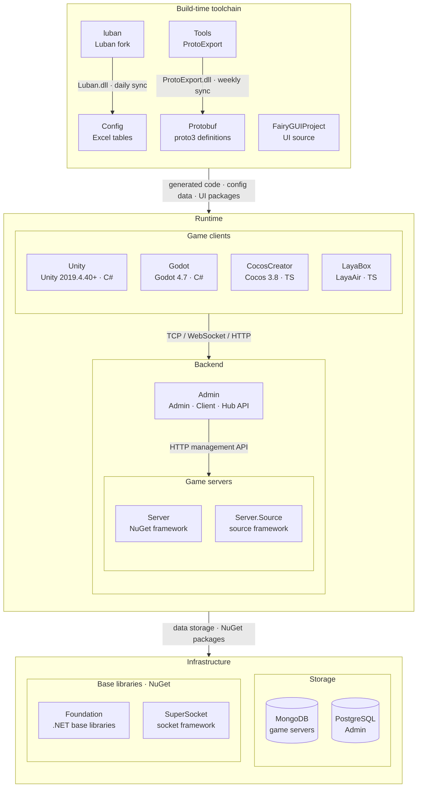

<div align="center">


# GameFrameX.Config

[](https://github.com/GameFrameX/GameFrameX.Config/releases)
[](LICENSE.md)
[](https://gameframex.doc.alianblank.com)

**인디 게임 개발자를 위한 올인원 솔루션 · 인디 개발자의 꿈을 실현**

[📖 문서](https://gameframex.doc.alianblank.com/ko) • [🚀 빠른 시작](#초보자-실전) • [💬 QQ 그룹: 870596322](https://qm.qq.com/q/IrE4RSmqgY)

---

🌐 **언어**: [English](README.md) | [简体中文](README.zh-CN.md) | [繁體中文](README.zh-TW.md) | [日本語](README.ja.md) | **한국어**

---

</div>

## 이건 뭔가요?

**GameFrameX.Config는 '설정 표 도구'예요.**

쉽게 말해: **기획자가 Excel에 게임 데이터를 채우면, 이 도구가 알아서 그걸 코드와 데이터 파일로 바꿔줘요. 게임 프로그램(클라이언트와 서버) 어디서든 바로 쓸 수 있어요.**

비유하자면 — Excel 표는 여러분의 '게임 데이터 사전'이고, Config가 그 사전을 프로그램이 바로 읽을 수 있는 형태로 통역해 주는 거예요. 기획자는 표만 채우고, 프로그래머는 데이터만 읽으면 돼요. 그 중간 단계는 Config가 자동으로 처리해 줍니다.

이 도구는 오픈소스 도구인 [Luban](https://github.com/GameFrameX/luban)을 기반으로 만들어졌어요(GameFrameX가 맞춤형으로 기능을 더했어요).

## 무엇을 할 수 있나요?

**기획자라면:**

- 익숙한 Excel에서 데이터를 채우기만 하면 돼요(아이템, 업적, 사운드, 다국어 텍스트…)
- 표를 고치고 나서 개발자에게 "생성해 줘"라고 넘기면, 데이터가 게임에 반영돼요
- 코드는 만질 필요가 없어요

**개발자라면:**

- 스크립트 하나를 실행하면, C# 설정 클래스와 데이터 파일이 자동으로 만들어져요
- 코드에서 바로 `tables.TbXxx.Get(id)`로 읽으면 돼요, 파싱 코드를 손으로 쓸 필요 없어요
- 클라이언트(Unity)와 서버(.NET) 각각 한 벌씩 만들어지고, 타입도 서로 맞아요

## 먼저 알아둘 용어

| 단어 | 쉬운 설명 |
|----|-----------|
| **설정 표** | 게임의 데이터 표, Excel에 저장돼요. 예를 들어 아이템 표, 업적 표, 레벨 표. |
| **클라이언트** | 플레이어 쪽에서 돌아가는 게임 프로그램, 여기서는 Unity로 만들었어요. |
| **서버** | 서버에서 돌아가는 프로그램, 여기서는 .NET으로 만들었어요. |
| **생성** | Excel을 프로그램이 바로 쓸 수 있는 코드와 데이터로 바꾸는 작업, 이 단계는 자동으로 진행돼요. |
| **다국어(현지화)** | 같은 글자가 여러 언어 버전으로 있어요(중국어/영어/일본어/한국어…). 플레이어가 어떤 걸 보게 될지는 설정에 따라 달라요. |

## 폴더 안에는 뭐가 있나요

```
Config/
├── Defines/        ← 자체 데이터 타입(좌표 등)
├── Excels/         ← 여러분이 채울 Excel 파일이 모두 여기에(가장 중요)
│   ├── Tables/     ← 게임 데이터 표(아이템, 업적 등)
│   └── Local/      ← 다국어 텍스트
├── Tools/          ← 도구 본체(건드릴 필요 없음)
├── luban.conf      ← 도구 설정(보통 건드릴 필요 없음)
└── gen-*.bat/.sh   ← 생성 스크립트(더블클릭 또는 실행하면 됨)
```

**이런 것들을 주목하세요:**

- **`Excels/Tables/`** — 게임 데이터 표는 여기에 둬요. 예를 들어 아이템 표, 업적 표.
- **`Excels/Local/`** — 다국어 텍스트는 여기에요. 같은 글자의 나라별 번역이에요.
- **`Excels/__tables__.xlsx`、`__beans__.xlsx`、`__enums__.xlsx`** — 이 세 개는 '고급 정의 표'예요. 복잡한 필드 타입(예: 열거형, 구조체)을 정의할 때 써요. 초보자는 일단 신경 쓰지 않아도 돼요. 가장 단순한 `int`、`string`만으로도 표를 채울 수 있어요.
- **`Defines/`** — 도구 자체의 타입 정의예요(예: 좌표 `vec2/vec3/vec4`). 클라이언트와 서버가 각자의 좌표 타입에 맞게 자동으로 적응해요.
- **`Tools/`** — 도구 본체예요, 건드릴 필요 없어요.
- **`gen-client-json.bat`、`gen-server-bin.bat`** — 생성 스크립트예요. **이게 여러분이 가장 자주 누르게 될 거예요.**

## 초보자 실전

이제부터 처음부터 '아이템 표'를 하나 만들어 보면서, 전체 흐름을 한 번 돌려볼게요. 한 번 따라 해 보면 전부 이해하게 될 거예요.

### 1단계: Excel 파일 만들기

`Excels/Tables/` 폴더 안에 새 Excel 파일을 하나 만들고, 이름은 이렇게 지어요:

```
D-MyItem-我的道具表.xlsx
```

**이름은 어떻게 정해졌을까요? 공식 하나만 기억하면 돼요: `글자 - 영어 이름 - 중국어 이름`**

- `D` — 글자 한 글자예요. 폴더 안에서 정렬해서 찾기 편하려고 넣는 거예요. 아무 글자나 써도 돼요(A/B/C/D 아무거나 괜찮아요)
- `MyItem` — 영어 이름이에요. **코드 안의 클래스명이 돼요**(자동으로 `Tb` 접두사가 붙어요 → `TbMyItem`)
- `我的道具表` — 중국어 이름이에요. 사람이 보라고 넣는 거라 뭐라고 써도 괜찮아요

### 2단계: 헤더 채우기(앞 4줄이 '설명서'예요)

파일을 열면, 앞 4줄은 정해진 '헤더'예요. 이 표에 어떤 필드가 있는지 도구에게 알려주는 역할이에요:

| 줄 | 뭘 채우나요 | 이 예시에서는 |
|----|--------|------|
| 1줄 `##var` | 필드명(영어) | `id`、`name`、`price` |
| 2줄 `##type` | 필드 타입 | `int`、`text`、`int` |
| 3줄 `##group` | 필드 그룹(보통 비워둠) | 빈칸、빈칸、빈칸 |
| 4줄 `##` | 설명(사람이 보는 용도) | 道具ID、道具名、价格 |

채우고 나면 이렇게 돼요:

| ##var | id | name | price |
|-------|----|------|-------|
| ##type | int | text | int |
| ##group | | | |
| ## | 道具ID | 道具名 | 价格 |

> 이 네 줄의 첫 칸(`##var`、`##type`、`##group`、`##`)은 정해진 표식이라 그대로 적어야 해요.

### 3단계: 데이터 채우기(5번째 줄부터)

헤더 아래부터가 진짜 데이터예요, 한 줄에 하나씩 채워요:

| ##var | id | name | price |
|-------|----|------|-------|
| ##type | int | text | int |
| ##group | | | |
| ## | 道具ID | 道具名 | 价格 |
| | 10001 | diamond | 10 |
| | 10002 | coin | 1 |

- `id`는 숫자(`int`)를 써요
- `name`은 **다국어 key**(`text` 타입)를 적어요. 실제로 표시되는 글자는 `Excels/Local/`에서 번역해요. 여기에 `diamond`라고 적고, 다국어 표에서 `diamond` = 다이아/钻石/ダイヤ… 식으로 쓰는 거예요.
- `price`는 숫자예요

### 4단계: 코드 생성하기

`Config` 폴더로 돌아와서:

- **Windows**: `gen-client-json.bat`을 더블클릭해요
- **Mac / Linux**: 터미널에서 `sh gen-client-json.sh`을 실행해요

다 끝날 때까지 기다려요(`pause`가 보이거나 에러가 없으면 성공이에요).

### 5단계: 결과 확인하기

도구가 옆의 `Unity` 폴더에 두 가지를 자동으로 만들어줘요:

- **데이터 파일**(JSON): 안에 여러분의 아이템 데이터가 들어 있어요
- **코드 파일**(C#): `TbMyItem` 클래스가 들어 있고, 그게 여러분의 아이템 표예요

### 6단계: 코드에서 사용하기

```csharp
// id가 10001인 아이템 가져오기
var item = tables.TbMyItem.Get(10001);

// 아이템 이름은 자동으로 현재 언어로 바뀌어요(예: 한국어면 '다이아'로 표시)
Debug.Log(item.Name);
Debug.Log(item.Price); // 10
```

**끝!** Excel에 채운 데이터가 이렇게 게임에서 바로 쓸 수 있는 코드가 됐어요 ✅

## 표 이름은 어떻게 짓나요

위에서 쓴 그 공식을 여기서 전부 설명할게요:

```
글자 - 영어 이름 - 중국어 이름.xlsx
글자 - 영어 이름 - 그룹 - 중국어 이름.xlsx      ← 한쪽 끝에서만 쓰게 제한하고 싶을 때
```

**세 부분의 의미:**

| 부분 | 뭔가요 | 규칙 | 예시 |
|----|--------|------|------|
| **글자** | 정렬용 글자 한 글자, 파일을 찾기 편하게 | 아무 글자나 숫자나 다 돼요 | `C`、`D`、`S`、`L` |
| **영어 이름** | 코드 클래스명 `Tb영어이름`이 돼요 | 영어만 쓸 수 있어요, **중국어는 안 돼요** | `ItemConfig` → `TbItemConfig` |
| **중국어 이름** | 사람이 보라고 넣는 이름 | 마음대로 써도 돼요, `-`를 여러 개 넣어도 돼요 | `道具表`、`道具表-1001` |

**⚠️ 주의: 영어 이름에는 절대로 중국어를 쓰면 안 돼요.** 안 그러면 도구가 에러를 내요: *"중국어 표 이름은 지원하지 않아요"*.

**클라이언트나 서버 한 쪽에서만 쓰고 싶다면?** 영어 이름과 중국어 이름 사이에 그룹 표식을 끼워 넣어요:

| 파일명 | 효과 |
|--------|------|
| `D-ItemConfig-道具表.xlsx` | 클라이언트와 서버 **모두 써요**(기본) |
| `D-ItemConfig-c-道具表.xlsx` | **클라이언트만** 써요 |
| `D-ItemConfig-s-道具表.xlsx` | **서버만** 써요 |

> `c` = 클라이언트, `s` = 서버. 그룹을 안 넣으면 양쪽 다 만들어져요.

**기존 표의 이름 대조:**

| 파일명 | 만들어지는 클래스명 |
|--------|-----------|
| `C-AchievementConfig-成就表.xlsx` | `TbAchievementConfig` |
| `D-ItemConfig-道具表-道具-1001.xlsx` | `TbItemConfig` |
| `S-SoundsConfig-声音表.xlsx` | `TbSoundsConfig` |
| `L-Localization-成就.xlsx` | `TbLocalization` |

## 표는 어떻게 채우나요

모든 데이터 표의 앞 4줄은 정해진 '헤더'예요:

| 줄 | 표식 | 뭘 채우나요 |
|----|------|--------|
| 1 | `##var` | 필드명(영어, 예: `id`、`name`) |
| 2 | `##type` | 필드 타입(아래 표 참고) |
| 3 | `##group` | 필드 그룹, 보통 비워둬요 |
| 4 | `##` | 설명, 자신이나 동료가 보는 용도 |

**자주 쓰는 필드 타입:**

| 타입 | 의미 | 예시 |
|------|------|------|
| `int` | 정수 | `10001` |
| `string` | 보통 글자(번역 안 함) | `icon_diamond` |
| `text` | 다국어 글자(key를 적어요, 실제 글자는 `Local/`에 있어요) | `diamond` |
| `bool` | 예/아니오 | `true` / `false` |
| `float` | 소수 | `1.5` |
| 열거형 이름 | `__enums__.xlsx`에서 정의한 타입 | `ItemType` |

> `text`와 `string`의 차이: `text`는 번역하는 다국어 글자(key 하나를 적어요)고, `string`은 번역하지 않는 보통 글자(내용을 바로 적어요)예요.

**채워넣은 예시(업적 표 일부):**

| ##var | id | image | name | achievement_content |
|-------|----|-------|------|---------------------|
| ##type | int | int | text | text |
| ##group | | | | |
| ## | ID | 아이콘 id | 업적 Key | 업적 내용 Key |
| | 900001 | 101 | achievement_001 | achievement_001_desc |

## 표가 너무 크면 어떡하죠

표 하나에 데이터가 너무 많으면(예: 아이템이 수천 개), **여러 파일로 쪼개도 돼요**. 도구가 알아서 한 표로 합쳐줘요.

**어떻게 쪼개요?** **영어 이름만 같으면** 돼요. 중국어 이름은 구분하려고 마음대로 적어요:

```
D-ItemConfig-道具表-1-1000.xlsx      ← 1~1000번 아이템
D-ItemConfig-道具表-1001-2000.xlsx   ← 1001~2000번 아이템
D-ItemConfig-道具表-2001-3000.xlsx   ← 2001~3000번 아이템
```

이 세 파일의 영어 이름은 모두 `ItemConfig`라서, 도구가 알아서 하나의 `TbItemConfig`로 합쳐줘요.

**다국어 표도 같은 방식으로 쪼개요**(모듈별로):

```
L-Localization-成就.xlsx    ┐
L-Localization-文本.xlsx    ├→ 하나의 TbLocalization로 합쳐져요
L-Localization-UI.xlsx      ┘
```

> 중국어 이름 안의 번호나 분류(예: `1-1000`、`成就`)는 사람이 보라고 넣는 거예요. 도구가 해석하지 않아요. 편한 대로 적으면 돼요.

## 코드는 어떻게 만들어내나요

### 먼저 준비하기

1. **.NET SDK**를 설치해요(도구가 이걸로 돌아가요)
2. `Config` 폴더 옆에 `Unity`와 `Server` 폴더가 있어야 해요(생성된 코드가 그 안에 들어가요)

### 클라이언트(Unity) 데이터 생성

- **Windows**: `gen-client-json.bat`을 더블클릭해요
- **Mac / Linux**: `sh gen-client-json.sh`을 실행해요

생성된 건 어디로 갈까요:

- 데이터 → `../Unity/Assets/Bundles/Config`
- 코드 → `../Unity/Assets/Hotfix/Config/Generate`

### 서버(.NET) 데이터 생성

- **Windows**: `gen-server-bin.bat`을 더블클릭해요
- **Mac / Linux**: `sh gen-server-bin.sh`을 실행해요

생성된 건 어디로 갈까요:

- 데이터 → `../Server/GameFrameX.Config/Json`
- 코드 → `../Server/GameFrameX.Config/Config`

> 네 개의 스크립트 조합: `gen-{끝단}-{형식}.{sh/bat}`. 끝단 = `client`/`server`, 형식 = `json`(사람이 읽을 수 있음) / `bin`(더 작고 빠름).

## 생성된 코드는 어떻게 쓰나요

**클라이언트(Unity)에서:**

```csharp
// tables는 설정 관리자예요, 도구가 자동으로 만들어줘요
// TbItemConfig가 여러분이 채운 '아이템 표'예요. Get(id)로 id로 찾아요
var item = tables.TbItemConfig.Get(10001);
Debug.Log($"이름:{item.Name}, 가격:{item.Price}");

// 모든 아이템을 두루 보기
foreach (var it in tables.TbItemConfig.DataList)
{
    Debug.Log(it.Name);
}
```

**서버(.NET)에서:**

```csharp
var item = tables.TbItemConfig.Get(10001);
Console.WriteLine($"{item.Name}: {item.Price}");
```

> `text` 타입 필드(예: `Name`)는 자동으로 플레이어의 현재 언어로 표시돼요. 언어를 직접 판단할 필요 없어요.

## 생성된 코드는 어디로 가나요

도구는 '끝단'별로 따로 만들어요. 서로 섞이지 않아요:

| 누구용인가요 | 어떤 스크립트를 쓰나요 | 코드 네임스페이스 |
|----------|-----------|-------------|
| **클라이언트**(Unity) | `gen-client-*` | `Hotfix.Config` |
| **서버**(.NET) | `gen-server-*` | `GameFrameX.Config` |
| **양쪽 다 필요할 때** | 각 스크립트를 한 번씩 실행 | 각자의 것 |

> 쉽게 외우자면: 클라이언트는 `client` 스크립트, 서버는 `server` 스크립트. 어느 쪽이 필요하면 그걸 실행하면 돼요.

## 저장소에는 어떤 표가 있나요

지금은 이런 데모 표들이 들어 있어요:

| 표 | 파일 | 내용 |
|----|------|------|
| 업적 | `Excels/Tables/C-AchievementConfig-成就表.xlsx` | 업적 정의 |
| 아이템 | `Excels/Tables/D-ItemConfig-道具表-道具-1001.xlsx` | 아이템 정의 |
| 사운드 | `Excels/Tables/S-SoundsConfig-声音表.xlsx` | 사운드 정의 |
| 다국어-업적 | `Excels/Local/L-Localization-成就.xlsx` | 업적의 다국어 텍스트 |
| 다국어-텍스트 | `Excels/Local/L-Localization-文本.xlsx` | 공통 다국어 텍스트 |
| 다국어-UI | `Excels/Local/L-Localization-UI.xlsx` | UI의 다국어 텍스트 |

새 표를 추가하고 싶다면? '초보자 실전'의 단계를 따라 하면 돼요.

## 생태계 아키텍처

GameFrameX는 아래 저장소로 구성됩니다. 빌드 시 도구 체인이 프로토콜과 설정 코드를 생성하고, 런타임에는 게임 클라이언트·게임 서버·운영 백오피스가 협력합니다.



### 핵심 프로젝트

| 프로젝트 | 역할 | 기술 스택 | 산출물 및 연동 |
|------|------|------|------|
| [Unity](https://github.com/GameFrameX/GameFrameX.Unity) | Unity 클라이언트 프로젝트: GameFrameX UPM 레지스트리에서 90개 이상의 프레임워크 패키지를 필요에 따라 조합, HybridCLR 핫 업데이트, 로그인·가방·룸 예제 포함 | Unity 2019.4.40+, HybridCLR, YooAsset, FairyGUI, UniTask | Protobuf / Config / FairyGUIProject 산출물 사용; TCP 29100 + HTTP 28080으로 Server, HTTP 20808로 Admin Client API에 연결 |
| [Server](https://github.com/GameFrameX/GameFrameX.Server) | Actor 모델 게임 서버: 영속 상태 Apps 계층과 핫 업데이트 가능한 Hotfix 로직 계층을 엄격히 분리, 단일/다중 프로세스 배포 지원 | .NET 10, MongoDB, Docker | TCP 29100 / WebSocket 29110 / HTTP 28080 수신; Admin용 메일·아이템 지급·플레이어 관리 등 HTTP 관리 API 제공 |
| [Admin](https://github.com/GameFrameX/GameFrameX.Admin) | 멀티 테넌트 운영 백오피스: Admin(20802) / Client(20808) / Hub(20806) 3개 호스트 + Vue 관리 화면, 서버 구역·공지·메일·주문 결제·원격 설정·라이브 운영 지원 | .NET 10, SqlSugar, PostgreSQL, Vue 3.5, PrimeVue | 서버 구역별 `HttpManageUrl`로 Server 호출; Client API가 게임 클라이언트에 전역 정보·로그인·결제 콜백 제공 |
| [luban](https://github.com/GameFrameX/luban) | Luban 설정 도구의 GameFrameX 포크: 공식 v5.1.0 병합, `gameframex` 테이블 임포터와 `cs-dotnet-json` / `cs-dotnet-bin` 등 생성 타깃 추가 | .NET 10, Scriban | Luban tar.gz와 Docker 이미지 배포; 매일 Config의 `Tools/`로 동기화 |
| [Config](https://github.com/GameFrameX/GameFrameX.Config) | 설정 테이블 저장소: Excel 데이터 표 + 스키마 + 현지화 표, 스크립트 한 번으로 클라이언트·서버 코드와 데이터 생성 | Excel, Luban | `gen-client-*` → Unity; `gen-server-json` → Server; `gen-server-bin` → Server.Source; `gen-godot-json` / `gen-cocos-json` / `gen-laya-json` → Godot / CocosCreator / LayaBox |
| [Protobuf](https://github.com/GameFrameX/GameFrameX.Protobuf) | 통합 네트워크 프로토콜 정의: proto3, 파일 이름의 숫자 모듈 ID별로 메시지와 오류 코드 구성(양수=클라이언트↔서버, 음수=서버 내부) | proto3 | `Proto2CsExport_Server` → Server; `Proto2CsExport_Client` → Unity; `Proto2CsExport_Godot` / `Proto2TsExport_CocosCreator` / `Proto2TsExport_LayaBox` → 기타 클라이언트; push마다 CI가 6개 언어 Release 배포 |
| [Tools](https://github.com/GameFrameX/GameFrameX.Tools) | ProtoExport 프로토콜 코드 생성기: C# / TypeScript / C++ / Lua / Go 5개 언어, CLI·Avalonia GUI·Docker 3가지 형태 제공 | .NET 10, Avalonia 12 | `ProtoExport.dll`을 매주 Protobuf의 `Tools/`로 동기화; Docker 이미지 `gameframex/gameframex-tools` |

### 주변 시스템

| 프로젝트 | 역할 | 기술 스택 | 산출물 및 연동 |
|------|------|------|------|
| [Foundation](https://github.com/GameFrameX/GameFrameX.Foundation) | 모듈형 .NET 라이브러리 모음: 현지화, JSON, 명령줄 인수, 로그, HTTP, 암호화, 해시, ORM 기본 엔티티, 멱등성 | .NET | NuGet 패키지로 Server·Server.Source·Admin·Tools에서 참조 |
| [SuperSocket](https://github.com/GameFrameX/GameFrameX.SuperSocket) | SuperSocket의 GameFrameX 포크: .NET 10 타깃, 의존성 주입, 약한 네트워크 게임 트래픽용 KCP / ReliableSession | .NET 10 | NuGet: Server(ClientEngine), Server.Source(Server / Kcp / Udp / WebSocket) |
| [Server.Source](https://github.com/GameFrameX/GameFrameX.Server.Source) | 프레임워크 계층을 저장소 내 소스로 포함한 서버 버전: 서비스 디스커버리, 프로세스 간 RemoteMessaging(TCP / KCP), 다중 프로세스 배포 | .NET 10, MongoDB, Docker | Config `gen-server-bin` 출력 대상; `docker-compose.multi.yml`로 다중 프로세스 실행 |
| [Godot](https://github.com/GameFrameX/GameFrameX.Godot) | Godot .NET 클라이언트: 재사용 가능한 런타임 모듈, 에디터 플러그인, 핫 업데이트 어셈블리 | Godot 4.7, C# | Config `gen-godot-json`, Protobuf `Proto2CsExport_Godot`; TCP 29100 / WebSocket 29110으로 Server에 연결 |
| [CocosCreator](https://github.com/GameFrameX/GameFrameX.CocosCreator) | Unity 버전을 기준으로 이식한 Cocos Creator 클라이언트 | Cocos Creator 3.8, TypeScript | `npm run gen:proto` / `gen:config`가 Protobuf / Config 스크립트 호출; WebSocket으로 Server에 연결 |
| [LayaBox](https://github.com/GameFrameX/GameFrameX.LayaBox) | LayaBox 클라이언트 | LayaAir, TypeScript | Config `gen-laya-json`, Protobuf `Proto2TsExport_LayaBox`; WebSocket으로 Server에 연결 |
| [FairyGUIProject](https://github.com/GameFrameX/GameFrameX.FairyGUIProject) | FairyGUI 에디터 프로젝트: 모든 게임 UI의 디자인 원본 | FairyGUI Editor | UI 패키지를 Unity `Assets/Bundles/UI`, 코드를 `Assets/Hotfix/UI/FairyGUI/`로 게시 |

## 무엇이 필요한가요

- **.NET SDK** — 도구를 돌리는 데 필요해요([dot.net](https://dotnet.microsoft.com/)에서 내려받아요)
- **Excel**(또는 WPS, Numbers 등 `.xlsx`를 편집할 수 있는 소프트웨어) — 표를 채우는 데 써요
- **운영체제** — Windows, Mac, Linux 어느 것이든 괜찮아요

## 라이선스

이 프로젝트는 [Apache License 2.0](LICENSE.md) 라이선스로 공개돼 있어요. 무료로 쓸 수 있고, 상업적으로도 쓸 수 있어요.

## 관련 링크

- [문서](https://gameframex.doc.alianblank.com)
- [GitHub 저장소](https://github.com/GameFrameX/GameFrameX.Config)
- [문제 신고](https://github.com/GameFrameX/GameFrameX.Config/issues)
- [Luban(GameFrameX 맞춤 버전)](https://github.com/GameFrameX/luban)
- [Luban(원래 상위 저장소)](https://github.com/focus-creative-games/luban)
