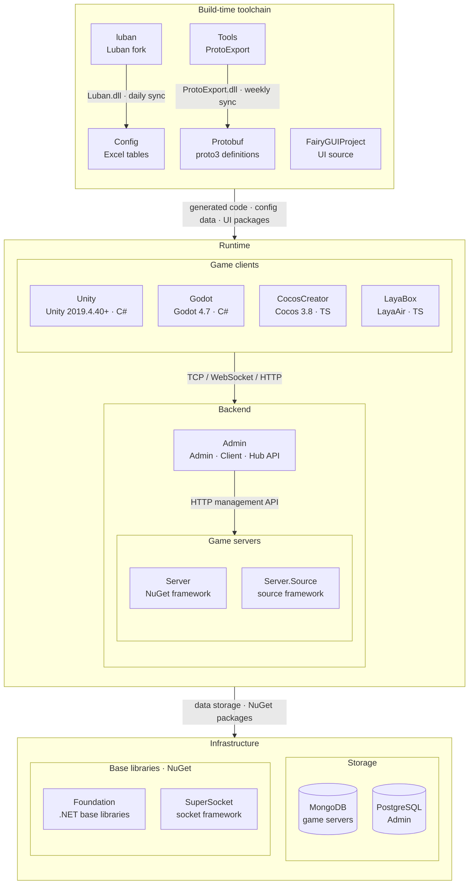

<div align="center">


# GameFrameX.Config

[](https://github.com/GameFrameX/GameFrameX.Config/releases)
[](LICENSE.md)
[](https://gameframex.doc.alianblank.com)

**獨立遊戲前後端一體化解決方案 · 獨立遊戲開發者的圓夢大使**

[📖 文檔](https://gameframex.doc.alianblank.com/zh-TW) • [🚀 快速開始](#新手實戰) • [💬 QQ群: 870596322](https://qm.qq.com/q/IrE4RSmqgY)

---

🌐 **語言**: [English](README.md) | [简体中文](README.zh-CN.md) | **繁體中文** | [日本語](README.ja.md) | [한국어](README.ko.md)

---

</div>

## 這是什麼？

**GameFrameX.Config 是一個「設定表工具」**。

簡單說：**策劃在 Excel 裡填遊戲資料，本工具會自動把它們變成程式碼和資料檔案，遊戲程式（客戶端和伺服器）都能直接用。**

打個比方——Excel 表就是你的「遊戲資料字典」，Config 負責把這本字典翻譯成程式能直接讀懂的格式。策劃只管填表，程式只管讀資料，中間這一步 Config 幫你自動完成。

它基於開源工具 [Luban](https://github.com/GameFrameX/luban) 構建（GameFrameX 做了客製化增強）。

## 能幫你做什麼？

**如果你是策劃：**

- 在熟悉的 Excel 裡填資料就行（道具、成就、聲音、多語言文字……）
- 改完表交給程式「生成一下」，資料就同步到遊戲裡了
- 不用碰程式碼

**如果你是開發者：**

- 跑一個腳本，自動得到 C# 的設定類別 + 資料檔案
- 直接在程式碼裡 `tables.TbXxx.Get(id)` 讀取，不用手寫解析
- 客戶端（Unity）和伺服器（.NET）各生成一份，類型還對得上

## 先搞懂幾個詞

| 詞 | 大白話解釋 |
|----|-----------|
| **設定表** | 遊戲的資料表，存在 Excel 裡。比如道具表、成就表、等級表。 |
| **客戶端** | 玩家那邊的遊戲程式，這裡是 Unity 做的。 |
| **伺服器** | 伺服器上跑的程式，這裡是 .NET 做的。 |
| **生成** | 把 Excel 轉成程式能直接用的程式碼和資料，這一步自動完成。 |
| **多語言（在地化）** | 同一條文字有多個語言版本（中文/英文/日文/韓文……），玩家看到哪種取決於設定。 |

## 資料夾裡都有什麼

```
Config/
├── Defines/        ← 自帶的資料類型（座標等）
├── Excels/         ← 你填的 Excel 都放這裡（最重要）
│   ├── Tables/     ← 遊戲資料表（道具、成就等）
│   └── Local/      ← 多語言文字
├── Tools/          ← 工具本體（不用動）
├── luban.conf      ← 工具設定（一般不用動）
└── gen-*.bat/.sh   ← 生成腳本（雙擊或執行就用）
```

**重點看這幾個：**

- **`Excels/Tables/`** —— 遊戲資料表放這裡。比如道具表、成就表。
- **`Excels/Local/`** —— 多語言文字放這裡。同一條文字的各國翻譯。
- **`Excels/__tables__.xlsx`、`__beans__.xlsx`、`__enums__.xlsx`** —— 這三個是「進階定義表」，用來定義複雜的欄位類型（比如列舉、結構體）。新手可以先不管，用最簡單的 `int`、`string` 就能填表。
- **`Defines/`** —— 工具自帶的類型定義（比如座標 `vec2/vec3/vec4`），客戶端和伺服器會自動適配各自的座標類型。
- **`Tools/`** —— 工具本體，不用動。
- **`gen-client-json.bat`、`gen-server-bin.bat`** —— 生成腳本，**這是你最常點的東西**。

## 新手實戰

下面帶你從零做一張「道具表」，走完一遍完整流程。跟著做一遍，你就全懂了。

### 第 1 步：新建 Excel 檔案

在 `Excels/Tables/` 資料夾裡，新建一個 Excel 檔案，名字叫：

```
D-MyItem-我的道具表.xlsx
```

**名字怎麼來的？記住一個公式：`字母 - 英文名 - 中文名`**

- `D` —— 一個字母，方便在資料夾裡排序找檔案，隨便取（用 A/B/C/D 都行）
- `MyItem` —— 英文名，**會變成程式碼裡的類別名**（自動加 `Tb` 前綴 → `TbMyItem`）
- `我的道具表` —— 中文名，給人看的，寫啥都行

### 第 2 步：填表頭

打開檔案，前 4 行是固定的「表頭」，告訴工具這張表有哪些欄位：

| 行 | 填什麼 | 本例 |
|----|--------|------|
| 第 1 行 `##var` | 欄位名（英文） | `id`、`name`、`price` |
| 第 2 行 `##type` | 欄位類型 | `int`、`text`、`int` |
| 第 3 行 `##group` | 欄位分組（一般留空） | 空、空、空 |
| 第 4 行 `##` | 中文說明（給人看） | 道具ID、道具名、價格 |

填出來長這樣：

| ##var | id | name | price |
|-------|----|------|-------|
| ##type | int | text | int |
| ##group | | | |
| ## | 道具ID | 道具名 | 價格 |

> 這四行的第一格（`##var`、`##type`、`##group`、`##`）是固定標記，必須照寫。

### 第 3 步：填資料

表頭下面就是真正的資料，一行一條：

| ##var | id | name | price |
|-------|----|------|-------|
| ##type | int | text | int |
| ##group | | | |
| ## | 道具ID | 道具名 | 價格 |
| | 10001 | diamond | 10 |
| | 10002 | coin | 1 |

- `id` 用數字（`int`）
- `name` 填的是一個**多語言 key**（`text` 類型），實際顯示的文字在 `Excels/Local/` 裡翻譯。這裡填 `diamond`，再到在地化表裡寫 `diamond` = 鑽石/鑽石/ダイヤ…。
- `price` 用數字

### 第 4 步：生成程式碼

回到 `Config` 資料夾：

- **Windows**：雙擊 `gen-client-json.bat`
- **Mac / Linux**：終端機裡執行 `sh gen-client-json.sh`

等它跑完（看到 `pause` 或沒報錯就行）。

### 第 5 步：拿到結果

工具會自動在旁邊的 `Unity` 資料夾裡生成兩個東西：

- **資料檔案**（JSON）：裡面是你的道具資料
- **程式碼檔案**（C#）：裡面有個 `TbMyItem` 類別，就是你的道具表

### 第 6 步：在程式碼裡用

```csharp
// 拿到 id 為 10001 的道具
var item = tables.TbMyItem.Get(10001);

// 道具名會自動變成當前語言（比如中文顯示「鑽石」）
Debug.Log(item.Name);
Debug.Log(item.Price); // 10
```

**完事！** 你在 Excel 裡填的資料，就這樣變成遊戲裡能直接用的程式碼了 ✅

## 怎麼給表取名字

上面用過那個公式，這裡講全：

```
字母 - 英文名 - 中文名.xlsx
字母 - 英文名 - 分組 - 中文名.xlsx      ← 想限制只給某一端用時
```

**三段含義：**

| 段 | 是什麼 | 規則 | 例子 |
|----|--------|------|------|
| **字母** | 排序用的單字母，方便找檔案 | 隨便一個字母或數字 | `C`、`D`、`S`、`L` |
| **英文名** | 會變成程式碼類別名 `Tb英文名` | 只能用英文，**不能寫中文** | `ItemConfig` → `TbItemConfig` |
| **中文名** | 給人看的名字 | 隨便寫，可加多個 `-` | `道具表`、`道具表-1001` |

**⚠️ 注意：英文名絕對不能寫中文**，否則工具會報錯：*"不支援中文表名"*。

**想只給客戶端或伺服器用？** 在英文名和中文名中間加個分組標記：

| 檔名 | 效果 |
|--------|------|
| `D-ItemConfig-道具表.xlsx` | 客戶端、伺服器**都用**（預設） |
| `D-ItemConfig-c-道具表.xlsx` | **只有客戶端**用 |
| `D-ItemConfig-s-道具表.xlsx` | **只有伺服器**用 |

> `c` = 客戶端，`s` = 伺服器。不加分組就兩邊都生成。

**現有表的名字對照：**

| 檔名 | 生成的類別名 |
|--------|-----------|
| `C-AchievementConfig-成就表.xlsx` | `TbAchievementConfig` |
| `D-ItemConfig-道具表-道具-1001.xlsx` | `TbItemConfig` |
| `S-SoundsConfig-聲音表.xlsx` | `TbSoundsConfig` |
| `L-Localization-成就.xlsx` | `TbLocalization` |

## 表裡該怎麼填

每張資料表的前 4 行是固定「表頭」：

| 行 | 標記 | 填什麼 |
|----|------|--------|
| 1 | `##var` | 欄位名（英文，如 `id`、`name`） |
| 2 | `##type` | 欄位類型（見下表） |
| 3 | `##group` | 欄位分組，一般留空 |
| 4 | `##` | 中文說明，給自己和同事看 |

**常用欄位類型：**

| 類型 | 意思 | 例子 |
|------|------|------|
| `int` | 整數 | `10001` |
| `string` | 普通文字（不翻譯） | `icon_diamond` |
| `text` | 多語言文字（填 key，實際文字在 `Local/` 裡） | `diamond` |
| `bool` | 是/否 | `true` / `false` |
| `float` | 小數 | `1.5` |
| 列舉名 | 在 `__enums__.xlsx` 裡定義過的類型 | `ItemType` |

> `text` 和 `string` 的區別：`text` 是要翻譯的多語言文字（填一個 key），`string` 是不翻譯的普通文字（直接填內容）。

**一個填好的例子（成就表片段）：**

| ##var | id | image | name | achievement_content |
|-------|----|-------|------|---------------------|
| ##type | int | int | text | text |
| ##group | | | | |
| ## | ID | 圖示id | 成就Key | 成就內容Key |
| | 900001 | 101 | achievement_001 | achievement_001_desc |

## 一張表太大怎麼辦

當一張表資料特別多（比如道具上千條），可以**拆成幾個檔案**，工具會自動把它們合併成一張表。

**怎麼拆？** 只要**英文名一樣**就行，中文名隨便寫來區分：

```
D-ItemConfig-道具表-1-1000.xlsx      ← 第 1~1000 個道具
D-ItemConfig-道具表-1001-2000.xlsx   ← 第 1001~2000 個道具
D-ItemConfig-道具表-2001-3000.xlsx   ← 第 2001~3000 個道具
```

這三個檔案的英文名都是 `ItemConfig`，工具會自動合併成一個 `TbItemConfig`。

**多語言表也是這麼分的**（按模組拆）：

```
L-Localization-成就.xlsx    ┐
L-Localization-文本.xlsx    ├→ 合併成一個 TbLocalization
L-Localization-UI.xlsx      ┘
```

> 中文名裡的編號、分類（比如 `1-1000`、`成就`）只是給人看的，工具不解析，你怎麼方便怎麼寫。

## 怎麼生成程式碼

### 先準備好

1. 裝好 **.NET SDK**（工具靠它執行）
2. 在 `Config` 資料夾旁邊，要有 `Unity` 和 `Server` 兩個資料夾（生成的程式碼會放進去）

### 生成客戶端（Unity）資料

- **Windows**：雙擊 `gen-client-json.bat`
- **Mac / Linux**：`sh gen-client-json.sh`

生成的東西去哪了：

- 資料 → `../Unity/Assets/Bundles/Config`
- 程式碼 → `../Unity/Assets/Hotfix/Config/Generate`

### 生成伺服器（.NET）資料

- **Windows**：雙擊 `gen-server-bin.bat`
- **Mac / Linux**：`sh gen-server-bin.sh`

生成的東西去哪了：

- 資料 → `../Server/GameFrameX.Config/Json`
- 程式碼 → `../Server/GameFrameX.Config/Config`

> 四個腳本的組合：`gen-{端}-{格式}.{sh/bat}`，端 = `client`/`server`，格式 = `json`（人能讀）/ `bin`（更小更快）。

## 生成的程式碼怎麼用

**客戶端（Unity）裡：**

```csharp
// tables 是設定管理器，工具會自動生成
// TbItemConfig 就是你填的「道具表」，Get(id) 按id查
var item = tables.TbItemConfig.Get(10001);
Debug.Log($"名字:{item.Name}, 價格:{item.Price}");

// 遍歷所有道具
foreach (var it in tables.TbItemConfig.DataList)
{
    Debug.Log(it.Name);
}
```

**伺服器（.NET）裡：**

```csharp
var item = tables.TbItemConfig.Get(10001);
Console.WriteLine($"{item.Name}: {item.Price}");
```

> `text` 類型的欄位（如 `Name`）會自動顯示成玩家當前語言，不用你手動判斷語言。

## 生成的程式碼去了哪裡

工具按「端」分別生成，互不干擾：

| 生成給誰 | 用哪個腳本 | 程式碼命名空間 |
|----------|-----------|-------------|
| **客戶端**（Unity） | `gen-client-*` | `Hotfix.Config` |
| **伺服器**（.NET） | `gen-server-*` | `GameFrameX.Config` |
| **兩邊都要** | 各跑一次對應腳本 | 各自的 |

> 簡單記：客戶端用 `client` 腳本，伺服器用 `server` 腳本，需要哪端就跑哪個。

## 現在倉庫裡有哪些表

目前自帶這些演示表：

| 表 | 檔案 | 內容 |
|----|------|------|
| 成就 | `Excels/Tables/C-AchievementConfig-成就表.xlsx` | 成就定義 |
| 道具 | `Excels/Tables/D-ItemConfig-道具表-道具-1001.xlsx` | 道具定義 |
| 聲音 | `Excels/Tables/S-SoundsConfig-聲音表.xlsx` | 聲音定義 |
| 多語言-成就 | `Excels/Local/L-Localization-成就.xlsx` | 成就的多語言文字 |
| 多語言-文本 | `Excels/Local/L-Localization-文本.xlsx` | 通用多語言文字 |
| 多語言-UI | `Excels/Local/L-Localization-UI.xlsx` | UI 的多語言文字 |

想加新表？照著「新手實戰」的步驟來就行。

## 生態架構

GameFrameX 由以下倉庫組成：建置期工具鏈產生協議與配置程式碼，執行時由遊戲用戶端、遊戲伺服器與營運後台協作。



### 核心專案

| 專案 | 作用 | 技術棧 | 產物與對接 |
|------|------|------|------|
| [Unity](https://github.com/GameFrameX/GameFrameX.Unity) | Unity 用戶端工程：從 GameFrameX UPM 源按需組裝 90+ 框架元件，HybridCLR 熱更新，內建登入、背包、房間等範例 | Unity 2019.4.40+, HybridCLR, YooAsset, FairyGUI, UniTask | 使用 Protobuf / Config / FairyGUIProject 產物；TCP 29100 + HTTP 28080 連線 Server，HTTP 20808 連線 Admin Client API |
| [Server](https://github.com/GameFrameX/GameFrameX.Server) | Actor 模型遊戲伺服器：Apps 持久化狀態層與 Hotfix 可熱更邏輯層嚴格分離，支援單程序與多程序部署 | .NET 10, MongoDB, Docker | 監聽 TCP 29100 / WebSocket 29110 / HTTP 28080；為 Admin 提供郵件、發道具、玩家管理等 HTTP 管理介面 |
| [Admin](https://github.com/GameFrameX/GameFrameX.Admin) | 多租戶營運後台：Admin（20802）/ Client（20808）/ Hub（20806）三個 host + Vue 管理端，涵蓋區服、公告、郵件、訂單支付、遠端配置、線上營運 | .NET 10, SqlSugar, PostgreSQL, Vue 3.5, PrimeVue | 依區服 `HttpManageUrl` 呼叫 Server；Client API 為遊戲用戶端提供全域資訊、登入與支付回呼 |
| [luban](https://github.com/GameFrameX/luban) | Luban 配置工具的 GameFrameX 分支：合入官方 v5.1.0，新增 `gameframex` 表匯入器與 `cs-dotnet-json` / `cs-dotnet-bin` 等產生目標 | .NET 10, Scriban | 發佈 Luban tar.gz 與 Docker 映像；每日同步至 Config 的 `Tools/` |
| [Config](https://github.com/GameFrameX/GameFrameX.Config) | 配置表倉庫：Excel 資料表 + schema + 在地化表，一鍵腳本產生前後端程式碼與資料 | Excel, Luban | `gen-client-*` → Unity; `gen-server-json` → Server; `gen-server-bin` → Server.Source; `gen-godot-json` / `gen-cocos-json` / `gen-laya-json` → Godot / CocosCreator / LayaBox |
| [Protobuf](https://github.com/GameFrameX/GameFrameX.Protobuf) | 統一網路協議定義：proto3，依檔名中的數字模組 ID 組織訊息與錯誤碼（正數為用戶端↔伺服器，負數為伺服器內部） | proto3 | `Proto2CsExport_Server` → Server; `Proto2CsExport_Client` → Unity; `Proto2CsExport_Godot` / `Proto2TsExport_CocosCreator` / `Proto2TsExport_LayaBox` → 其他用戶端；每次 push 由 CI 發佈六種語言的 Release |
| [Tools](https://github.com/GameFrameX/GameFrameX.Tools) | ProtoExport 協議程式碼產生器：C# / TypeScript / C++ / Lua / Go 五種語言，提供 CLI、Avalonia GUI 與 Docker 三種形態 | .NET 10, Avalonia 12 | `ProtoExport.dll` 每週同步至 Protobuf 的 `Tools/`；Docker 映像 `gameframex/gameframex-tools` |

### 周邊系統

| 專案 | 作用 | 技術棧 | 產物與對接 |
|------|------|------|------|
| [Foundation](https://github.com/GameFrameX/GameFrameX.Foundation) | 模組化 .NET 類別庫合集：在地化、JSON、命令列參數、日誌、HTTP、加密、雜湊、ORM 基底實體、冪等性 | .NET | 以 NuGet 套件被 Server、Server.Source、Admin、Tools 引用 |
| [SuperSocket](https://github.com/GameFrameX/GameFrameX.SuperSocket) | SuperSocket 的 GameFrameX 分支：.NET 10 建置目標、相依性注入支援、面向弱網遊戲流量的 KCP / ReliableSession | .NET 10 | NuGet：Server（ClientEngine）、Server.Source（Server / Kcp / Udp / WebSocket） |
| [Server.Source](https://github.com/GameFrameX/GameFrameX.Server.Source) | 框架層以原始碼形式放在倉庫內的伺服器版本：服務發現、跨程序 RemoteMessaging（TCP / KCP）、多程序部署 | .NET 10, MongoDB, Docker | 接收 Config `gen-server-bin` 產物；`docker-compose.multi.yml` 多程序部署 |
| [Godot](https://github.com/GameFrameX/GameFrameX.Godot) | Godot .NET 用戶端：可重用執行時模組、編輯器外掛、熱更新組件 | Godot 4.7, C# | Config `gen-godot-json`, Protobuf `Proto2CsExport_Godot`；TCP 29100 / WebSocket 29110 連線 Server |
| [CocosCreator](https://github.com/GameFrameX/GameFrameX.CocosCreator) | Cocos Creator 用戶端，以 Unity 版為基準遷移 | Cocos Creator 3.8, TypeScript | `npm run gen:proto` / `gen:config` 呼叫 Protobuf / Config 腳本；WebSocket 連線 Server |
| [LayaBox](https://github.com/GameFrameX/GameFrameX.LayaBox) | LayaBox 用戶端 | LayaAir, TypeScript | Config `gen-laya-json`, Protobuf `Proto2TsExport_LayaBox`；WebSocket 連線 Server |
| [FairyGUIProject](https://github.com/GameFrameX/GameFrameX.FairyGUIProject) | FairyGUI 編輯器工程：所有遊戲介面的設計原始檔 | FairyGUI Editor | 發佈 UI 包至 Unity `Assets/Bundles/UI`，程式碼至 `Assets/Hotfix/UI/FairyGUI/` |

## 需要什麼環境

- **.NET SDK** —— 執行工具用（去 [dot.net](https://dotnet.microsoft.com/) 下）
- **Excel**（或 WPS、Numbers 等能編輯 `.xlsx` 的軟體）—— 填表用
- **系統** —— Windows、Mac、Linux 都行

## 開源協議

本項目基於 [Apache License 2.0](LICENSE.md) 協議開源，免費用、可商用。

## 相關連結

- [文檔](https://gameframex.doc.alianblank.com)
- [GitHub 倉庫](https://github.com/GameFrameX/GameFrameX.Config)
- [問題反饋](https://github.com/GameFrameX/GameFrameX.Config/issues)
- [Luban（GameFrameX 客製版）](https://github.com/GameFrameX/luban)
- [Luban（原版上游）](https://github.com/focus-creative-games/luban)
