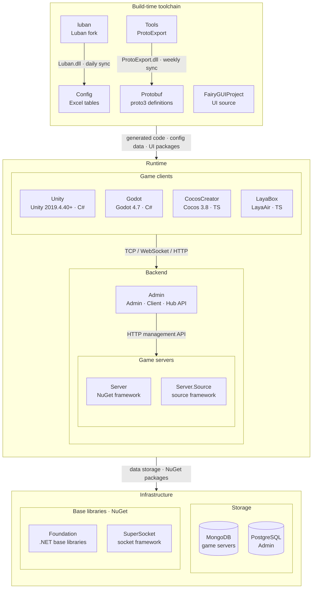

<div align="center">


# GameFrameX.Protobuf

[](https://github.com/GameFrameX/GameFrameX.Protobuf/releases)
[](LICENSE.md)
[](https://gameframex.doc.alianblank.com)
[](https://github.com/GameFrameX/GameFrameX.Protobuf/actions/workflows/proto-export.yml)

[](https://discord.gg/VDWUjWMDw9)
[](https://github.com/GameFrameX/gameframex)
[](https://www.bilibili.com/video/BV1yrpeepEn7)
[](https://gitee.com/GameFrameX/gameframex)

**インディゲーム開発者向けオールインワンソリューション · インディ開発者の夢を支援**

<br />

[ドキュメント](https://gameframex.doc.alianblank.com) · [クイックスタート](#クイックスタート) · [多言語リリース](https://github.com/GameFrameX/GameFrameX.Protobuf/releases/latest) · QQグループ: 467608841 / 233840761

<br />

[English](README.md) | [简体中文](README.zh-CN.md) | [繁體中文](README.zh-TW.md) | **日本語** | [한국어](README.ko.md)

</div>

## プロジェクト概要

GameFrameX.Protobuf は、GameFrameX フレームワークの統一ネットワークプロトコル定義リポジトリです。Protocol Buffers 3（`proto3`）を採用し、メッセージとエラーコードの定義をビジネスモジュールごとに整理します。各 `.proto` ファイルは数値のモジュール ID（ファイル名の接尾辞）で識別され、クライアントとサーバー間のメッセージルーティングおよびエラーコード生成に使用されます。

コード生成は [GameFrameX.Tools `ProtoExport`](https://github.com/GameFrameX/GameFrameX.Tools) ツールが駆動します。自分に合ったワークフローを選んでください:

- **CI（セットアップ不要）** —— 各 `push` で全言語を自動エクスポートし、ローリングの [`latest` Release](https://github.com/GameFrameX/GameFrameX.Protobuf/releases/latest) に公開します。ダウンロードするだけ。
- **Docker** —— `docker run gameframex/gameframex-tools:latest ...`、ツールチェーンのインストール不要。
- **ローカルスクリプト** —— `Tools/` ディレクトリの `ProtoExport` 成果物はワークフローにより毎週自動同期されます。クローン後すぐ `Proto2*Export.sh/.bat` を実行できます。詳しくは[エクスポートツール](#エクスポートツール)を参照。

完全なドキュメントは [GameFrameX ドキュメントサイト](https://gameframex.doc.alianblank.com/protobuf/require) で公開されています。

### 機能概要

- 数値モジュール ID で整理された統一の `proto3` プロトコル定義
- 同梱スクリプトで C#、C++、Go、Lua、TypeScript をワンコマンド生成
- 各 `push` で CI が全言語の成果物をローリング `latest` Release に自動公開
- Docker イメージと毎週自動同期される `Tools/` 成果物により、ツールチェーン設定不要

## クイックスタート

### インストール

**オプション A —— CI からダウンロード（セットアップ不要）:** 必要な言語のバンドルを[最新の Release](https://github.com/GameFrameX/GameFrameX.Protobuf/releases/latest)から取得。

**オプション B —— Docker:**

```bash
docker run --rm \
  -v "$PWD":/protos \
  -v "$PWD/output":/output \
  gameframex/gameframex-tools:latest \
  --mode csharp --isServer true \
  --inputPath /protos --outputPath /output --namespaceName GameFrameX.Proto.Proto
```

**オプション C —— ローカルスクリプト:** `Tools/` の成果物は自動同期済みです（ローカルの .NET 10 SDK が必要）。リポジトリルートでそのまま実行します:

```bash
./Proto2CsExport_Server.sh   # C#（サーバー）
./Proto2GoExport.sh          # Go
```

## 使用例

リポジトリルートで同梱スクリプトをそのまま実行してローカル生成します:

```bash
./Proto2CsExport_Server.sh   # C#（サーバー）
./Proto2GoExport.sh          # Go
```

各スクリプトは `dotnet ./Tools/ProtoExport.dll` で `Tools/` の自動同期された生成器を起動します。パラメータ一覧は[エクスポートパラメータ](#エクスポートパラメータ)、詳細は[エクスポートドキュメント](https://gameframex.doc.alianblank.com/protobuf/require)を参照してください。

## プロトコルモジュール

| Proto ファイル | モジュール | 説明 |
|----------------|------------|------|
| `_-0002_Inner_Basic.proto` | -2 | 内部基礎プロトコル（サーバー専用） |
| `_0010_Basic.proto` | 10 | 基礎プロトコル |
| `_0020_Common.proto` | 20 | 共通プロトコル（エラーコード、共有型） |
| `_0100_Bag.proto` | 100 | バッグ（インベントリ）プロトコル |
| `_0120_Social.proto` | 120 | ソーシャルプロトコル |
| `_-0120_Inner_Social.proto` | -120 | 内部ソーシャルプロトコル（サーバー側） |
| `_0300_User.proto` | 300 | ユーザー / アカウントプロトコル |
| `_0310_Attribute.proto` | 310 | プレイヤー属性同期プロトコル |
| `_0400_Room.proto` | 400 | ルームプロトコル |
| `_0410_RockPaperScissors.proto` | 410 | じゃんけんミニゲームプロトコル |
| `_0500_Mail.proto` | 500 | メールシステムプロトコル |

## プロトコル規約

protobuf 初心者ですか？この節はステップ・バイ・ステップのチュートリアルです。上から順に読めば、`.proto` ファイルを書いたことがなくても、新しいプロトコルモジュールを追加できるようになります。各ステップには平易な説明、最小のサンプル、そしてその背後にあるルールが揃っています。厳格なツール強制ルールの一覧は、下記の[プロトコル要件](#プロトコル要件)を参照してください。

### はじめる前に —— 3 つの平易な概念

- **Protobuf（`.proto`）** は、双方が合意した「申込書のテンプレート」です——印刷された注文書のように、各欄の名前と位置が決まっており、クライアントとサーバーがその枠に沿って記入するため、誤解が起きません。
- **モジュール ID** は「仕分け番号」です。宅配業者のエリア番号を想像してください：バッグ、メール、ルーム……といった各業務に番号が割り当てられ、メッセージはその番号で正しい担当に振り分けられます。
- **外部プロトコル vs 内部プロトコル** —— 外部プロトコルはクライアントが見て呼べる「メニュー」、内部プロトコルはサーバー間だけでやり取りされる「厨房の合図」です。この 2 つは絶対に混ざってはいけません。混ざると、クライアントが呼んではいけないものを呼べてしまいます。

### ステップ 1 —— ファイルを作る

各業務ドメインは独自のファイルに置かれ、ファイル名は `_<ModuleID:0000>_<Domain>.proto` です —— **すべてのファイル名は `_` で始まり、続いて 4 桁のゼロ埋めモジュール ID** が来るため、どのファイルブラウザでも同じくモジュール番号順に並びます。ファイル名だけでルーティング番号とドメインが一目で分かります。

```protobuf
// ファイル：_0100_Bag.proto
syntax = "proto3";      // 常に proto3 —— 現行の protobuf 構文
package Bag;            // ドメイン名（PascalCase）
```

行ごとの解説:

- `syntax = "proto3";` —— 現行の protobuf 構文を宣言します。すべてのファイルはこの行で始まります。
- `package Bag;` —— このファイルのドメインは「Bag」。PascalCase は先頭が大文字であることを意味します。
- モジュール ID —— **ファイル名のプレフィックスのみ**で決まる（`_0100_` → 100）。`option module` は**書かない**：2026-09-28 に全 proto ファイルから削除済み。ファイル名と option の二重定義は齟齬と module mismatch 例外を招く。

ルール:

- ファイル名：外部は `_<ModuleID:0000>_<Domain>.proto`（例: `_0500_Mail.proto`）、内部は `_-<ModuleID:0000>_Inner_<Domain>.proto`（例: `_-0120_Inner_Social.proto`）。モジュール ID は**外部は正**（クライアント ↔ サーバー）、**内部は負**（サーバー ↔ サーバー）。負の ID はファイル名に符号をそのまま残し、すべてのファイル名が `_` で始まるため、合法（`-` で始まらない）かつ統一された並び順になります。
- 内部モジュール番号は外部モジュールと**ミラー採番**します：外部の対応モジュールがあればその負値（`_0120_Social` 120 ↔ `_-0120_Inner_Social` -120）、なければ内部予約帯から採番（例: `_-0002_Inner_Basic` -2）。
- `-s`/`_s` ファイル名接尾辞メカニズムは**本リポジトリでは無効**（エクスポートツールは引き続きサポートしますが、本リポジトリのファイルでは使用禁止）。

**なぜ** —— モジュール ID をファイル名に書き込むと、ファイル名自体がルーティングキーになります：ドメインが一目で分かり、2 つのファイルが同じ番号を黙って共有することもありません。負のモジュール番号により、内部プロトコルはエクスポート時に自動的に除外され、クライアントに漏れません。

### ステップ 2 —— データを定義する：メッセージとフィールド

**メッセージ（message）** は「フォーム」です——関連するフィールドの集まり。**フィールド（field）** はフォーム上の 1 つの枠で、名前・型・番号を持ちます。

```protobuf
message BagItem {
  int32 ItemId = 1; // アイテム ID
  int64 Count = 2;  // アイテム数量
}
```

行ごとの解説:

- `message BagItem { ... }` —— `BagItem` というフォームを定義します。
- `int32 ItemId = 1;` —— `ItemId` という枠、型 `int32`（小さい整数）、番号 `1`。
- `int64 Count = 2;` —— `Count` という枠、型 `int64`（大きい整数）、番号 `2`。
- 行末の `// ...` はコメントで、このフィールドの意味を説明します。

ルール:

- フィールド名は PascalCase。番号は 1 から連続して増やし、飛ばさない。
- フィールドを削除したら、`reserved` でその番号を抑える——番号を再利用してはいけない。
- すべてのフィールドに行末コメントを書く。

型の選び方（平易版）:

| この値は…… | 使う型 | 例 |
|------------|--------|----|
| プレイヤー / インスタンス ID（大きくなりうる） | `int64` | `PlayerId` |
| 設定 / アイテム ID（範囲が小さい） | `int32` | `ItemId` |
| 数量（積み上がりうる） | `int64` | `Count` |
| タイムスタンプ | `int64` | `CreateTime` |
| レベル / アバター（小さい、負にならない） | `uint32` | `Level` |
| 選択肢が決まっているステータス | 列挙型（ステップ 4） | `RoomStatus` |
| リスト / 辞書 | `repeated` / `map` | `repeated RoomPlayerInfo` |

**なぜ** —— 番号を連続させるのは、フィールド番号が通信時の識別子だからです：飛び番はスペースを無駄にし、リリース済みの番号を再利用すると旧クライアントのデータが新フィールドに入り込み、黙ってデータ破損を引き起こします。型は「十分な範囲、オーバーフローなし」に従います：大きい ID は `int64`、小さい ID は `int32` で転送量を節約。

### ステップ 3 —— 会話させる：リクエスト / レスポンス / 通知

次に、クライアントとサーバーがどうやり取りするかを定義します。メッセージの役割は 3 種類で、名前のプレフィックスで区別します:

| プレフィックス | 誰が始める | 平易な意味 |
|----------------|------------|------------|
| `Req<Name>` | クライアント | 「ちょっと聞きたいこと」 |
| `Resp<Name>` | サーバーが返答 | 「これが答え」（名前はリクエストと同じ） |
| `Notify<Name>` | サーバーがプッシュ | 「注意——変化があった」（対応するリクエストなし） |

```protobuf
message ReqMailList { ... }        // クライアントがメール一覧を要求
message RespMailList { ... }       // サーバーが一覧を返す——名前が対になっている点に注意
message NotifyMailChanged { ... }  // サーバーが能動的にメール更新をプッシュ
message MailInfo { ... }           // 再利用可能なデータブロック。上記のどこでも使われる
```

ルール:

- すべてのリクエストには同名のレスポンスを必ず用意する：`ReqMailList` ↔ `RespMailList`。
- `Notify` はサーバーからの能動的プッシュにのみ使う。
- 共通データは `<Name>Info` として切り出し、一度定義して使い回す。

**なぜ** —— Req/Resp のペアを必須にすると、すべての質問に答えが保証されます。同名により、人間にもコード生成器にもペアリングが一目で分かります。`<Name>Info` は、同じ構造を複数のメッセージで重複定義するのを防ぎます。

### ステップ 4 —— 列挙型でステータスを表す

**列挙型（enum）** は選択問題です——注文ステータスが「支払い待ち / 支払い済み / 発送済み」にしかならないのと同じです。

```protobuf
enum RoomStatus {
  None = 0;     // 状態なし / 無効
  Waiting = 1;  // 開始待ち
  Playing = 3;  // ゲーム進行中
}
```

ルール:

- 列挙型名と値は PascalCase。
- 最初の値は常に `0` で、デフォルト / 無状態（`None`、`Unknown`）に充てる。

**なぜ** —— proto3 は最初の値を `0` に強制します。それを `None` / `Unknown` にすれば安全なデフォルトになります：未設定のフィールドは「状態なし」と読まれ、うっかり本当の状態に一致することがなくなり、バグのクラス全体を防げます。

### ステップ 5 —— エラーコードを定義する

失敗したら番号を付け、双方が何が起きたか正確に分かるようにします。エラーコードは 2 階層です:

**汎用コード** —— どのモジュールでも起きるよくある失敗（パラメータ誤り、コスト不足、不存在）。これらは `_0020_Common.proto` の `OperationStatusCode` にあり、`0` から順に番号が付きます。

**業務コード** —— そのモジュール特有の失敗。番号は計算式で決まります：**`モジュール ID × 1000 + 3 桁の通番`**。

```protobuf
// メールはモジュール 500 なので、エラーコードは 500001 から始まる
// 500001 = 500 × 1000 + 1
enum MailErrorCode {
  MailNotFound = 500001;        // メールが存在しない
  MailAlreadyDeleted = 500002;  // メールは既に削除済み
}
```

ルール: クライアントはエラーコードを通常の `int` として受け取ります。成功時は未設定のままにし、proto3 のデフォルト `0` に「成功」を意味させることで、大半のケースでは何も送らなくて済みます。

**なぜ** —— この計算式により、番号は自ら所属を語ります：`500001` は一目でメールモジュールと分かり、調整なしでグローバルに一意で、モジュールごとに 1000 個の拡張枠も確保できます。成功を「何も送らない」とするのは、成功が大半を占めるため、節約できる転送量が大きいからです。

### ステップ 6 —— コメントを書く

コメントは双方が共有する唯一のドキュメントです——`.proto` ファイルには周囲のコンテキストがないため、コメントがないと他端は推測するしかありません。

- メッセージの前：その目的を書く。
- フィールドや列挙値の後：それが何を意味するか書く。
- もし `int` フィールドが実際には列挙値を保持しているなら、括弧で列挙型名を示す（例：`// 状態（RoomStatus）`）。読者がどこに有効な値があるか分かるようにします。

**なぜ** —— `int` だけでは有効な値の集合が分かりません。列挙型名を示せば、読者はすぐに答えを見つけられます。

### 完全な例

架空の `_0600_Quest`（クエストシステム）モジュールを例に、上記すべてのルールを適用します:

```protobuf
syntax = "proto3";
package Quest;

// Quest business error codes (6 digits = module 600 + 3-digit ordinal)
enum QuestErrorCode {
  QuestNotFound = 600001;             // quest not found
  QuestNotCompleted = 600002;         // quest not completed
  QuestRewardAlreadyClaimed = 600003; // reward already claimed
}

// Quest status
enum QuestStatus {
  None = 0;        // no state
  Accepted = 1;    // accepted
  Completable = 2; // ready to complete
  Completed = 3;   // completed
  Claimed = 4;     // reward claimed
}

// Quest data view
message QuestInfo {
  int64 QuestId = 1;            // quest config ID
  QuestStatus Status = 2;       // quest status (QuestStatus)
  int64 Progress = 3;           // current progress
  int64 TargetProgress = 4;     // target progress
}

// Request quest list
message ReqQuestList {
}

// Response quest list
message RespQuestList {
  repeated QuestInfo Quests = 1; // quest list
}

// Request claim quest reward
message ReqClaimQuestReward {
  int64 QuestId = 1; // quest config ID
}

// Response claim quest reward
message RespClaimQuestReward {
  int64 QuestId = 1;       // quest config ID
  QuestStatus Status = 2;  // status after claim (QuestStatus)
}

// Quest change notification (server push)
message NotifyQuestChanged {
  repeated QuestInfo Quests = 1; // changed quests
}
```

## プロトコル要件

`ProtoExport` ツールが強制する確定ルールです。権威ソース: [GameFrameX.Tools README](https://github.com/GameFrameX/GameFrameX.Tools#readme)。

### ファイル形式

```protobuf
syntax = "proto3";     // 必須: proto3 のみサポート
package Basic;
```

### メッセージ命名

- **リクエスト**: `Req<Name>`（例: `ReqLogin`、`ReqHeartBeat`）
- **レスポンス**: `Resp<Name>`（例: `RespLogin`）
- **通知**: `Notify<Name>`（例: `NotifyBagInfoChanged`）
- すべてのメッセージ名、フィールド名、列挙型名、列挙値は **UpperCamelCase** を使用。

### モジュール ID

| ID 範囲 | 用途 |
|---------|------|
| `0` ~ `32767` | クライアント ↔ サーバー |
| `-32768` ~ `-1` | サーバー ↔ サーバー（内部） |

### フィールド番号

- メッセージのフィールド番号は **800 未満**であること（`>= 800` はシステム予約で、パースエラーを引き起こします）。
- `ErrorCode` は `Resp` メッセージの **予約フィールド名** です——手動で定義しないでください。ツールがすべての `Resp` に `ErrorCode` フィールドを自動生成します。

### 制限事項

- **ネスト型の禁止** —— 別の `message` の内部で `message` / `enum` を宣言できない。
- **RPC 定義の禁止** —— `service` ブロックは非サポート。
- **proto3 専用** —— `syntax = "proto3";` が必須。proto2 は非サポート。

### コメント基準

- すべての `message` / `enum` の**上**に、その目的を述べるコメント行を置く。
- すべてのフィールド / 列挙値の行末に**インラインコメント**を置く。

### サーバー専用ファイル

エクスポートツールはサーバー専用 proto ファイルを**ファイル名の接尾辞** `-s` または `_s`（例: `player-s.proto`、`economy_s.proto`）で識別します。取り込むには `--isServer` を渡してください。デフォルト（`--isServer` を省略）ではスキップされ、サーバー専用メッセージがクライアントに漏れることはありません。注意：ブール型パラメータはフラグ方式で、**指定すれば有効**になります——`--isServer false` でもサーバーモードが有効になります（`false` は無視されます）。無効化するには省略してください。

内部プロトコルはさらにルーティング分離のために**負のモジュール ID** を持ちます（上記「モジュール ID」表を参照）。

> **現在のリポジトリに関する注記:** ここの内部ファイルは `_-<ModuleID>_Inner_<Domain>.proto` と**負のモジュール ID** を併用する唯一の規約に統一されています（例: `_-0120_Inner_Social.proto`、`_-0002_Inner_Basic.proto`）。`-s`/`_s` 接尾辞メカニズムは本リポジトリでは無効であり、サーバー専用ルーティングはすべて負のモジュール ID で実現します。

## サポートするエクスポート言語

| 言語 | Mode & Flags | ローカルスクリプト | Docker |
|------|--------------|--------------------|--------|
| C# (Server) | `csharp --isServer true` | `Proto2CsExport_Server.sh` / `.bat` | はい |
| C# (Client / Unity / Godot) | `csharp` | `Proto2CsExport_Client.sh` / `.bat` | はい |
| C++ | `cpp` | `Proto2CppExport.sh` / `.bat` | はい |
| Go | `go` | `Proto2GoExport.sh` / `.bat` | はい |
| Lua | `lua` | `Proto2LuaExport.sh` / `.bat` | はい |
| TypeScript | `typescript` | `Proto2TsExport.sh` / `.bat` | はい |
| TypeScript (LayaBox) | `typescript` | `Proto2TsExport_LayaBox.sh` | はい |

### Docker 例

**C# (Server):**

```bash
docker run --rm \
  -v ./Protobuf:/protos \
  -v ./Server/GameFrameX.Proto/Proto:/output \
  gameframex/gameframex-tools:latest \
  --mode csharp --isServer true \
  --usingStatements "using System|using ProtoBuf|using System.Collections.Generic|using GameFrameX.Network.Abstractions|using GameFrameX.Network.Messages" \
  --isGenerateDescription true \
  --inputPath /protos --outputPath /output --namespaceName GameFrameX.Proto.Proto
```

**Go:**

```bash
docker run --rm \
  -v ./Protobuf:/protos \
  -v ./GoServer/proto:/output \
  gameframex/gameframex-tools:latest \
  --mode go --inputPath /protos --outputPath /output --namespaceName proto
```

**TypeScript:**

```bash
docker run --rm \
  -v ./Protobuf:/protos \
  -v ./Laya/src/gameframex/protobuf:/output \
  gameframex/gameframex-tools:latest \
  --mode typescript --inputPath /protos --outputPath /output
```

**Lua:**

```bash
docker run --rm \
  -v ./Protobuf:/protos \
  -v ./Defold/scripts/protobuf:/output \
  gameframex/gameframex-tools:latest \
  --mode lua --importPath "./network/" --inputPath /protos --outputPath /output
```

**C++:**

```bash
docker run --rm \
  -v ./Protobuf:/protos \
  -v ./Unreal/Source/Proto:/output \
  gameframex/gameframex-tools:latest \
  --mode cpp \
  --usingStatements "#include <cstdint>|#include <string>|#include <vector>|#include <unordered_map>" \
  --inputPath /protos --outputPath /output --namespaceName GameFrameX.Proto
```

パスマッピング: `-v <host>:<container>` はホストディレクトリをマウントします。`--inputPath` / `--outputPath` は**コンテナ側**のパス（`/protos`、`/output`）を参照する必要があり、ホスト側パスではありません。

## エクスポートパラメータ

### Core

| パラメータ | 必須 | デフォルト | 説明 |
|------------|------|-----------|------|
| `--mode` | はい | - | `csharp` / `typescript` / `cpp` / `lua` / `go` |
| `--inputPath` | はい | - | `.proto` ファイルを含むディレクトリ |
| `--outputPath` | はい | - | 生成ファイルの出力ディレクトリ |
| `--namespaceName` | いいえ | `""` | C# の名前空間（ドット区切りの場合は Go パッケージの最終セグメント） |
| `--isGenerateErrorCode` | いいえ | `true` | `Resp` メッセージに `ErrorCode` フィールドを自動生成 |
| `--requireComments` | いいえ | `none` | コメント検証レベル: `none` / `container` / `member` / `all` |

### C#

| パラメータ | デフォルト | 説明 |
|------------|-----------|------|
| `--usingStatements` | `""` | `\|` 区切りの using 文（例: `"using System\|using ProtoBuf"`） |
| `--isGenerateDescription` | `false` | `[System.ComponentModel.Description]` 属性を生成 |
| `--isServer` | `false` | サーバー専用 proto ファイルを取り込む（ファイル名が `-s` または `_s` で終わる） |

> 注：ブール型パラメータ（`--isServer`、`--isGenerateDescription` など）はフラグ方式です：**指定すれば有効**になり、`--xxx false` では無効化できません（`false` は無視されます）。表の「デフォルト値」はパラメータ省略時の値です。

### TypeScript

| パラメータ | デフォルト | 説明 |
|------------|-----------|------|
| `--importPath` | `"../network/"` | 生成された import 文のインポートパス接頭辞 |
| `--isGenerateDescription` | `false` | JSDoc 形式のコメントを生成 |

### Legacy

| パラメータ | デフォルト | 説明 |
|------------|-----------|------|
| `--isGenerateErrorCodeExcelFile` | `true` | エラーコード Excel ファイルを生成 |
| `--errorCodeExcelFilePath` | `""` | エラーコード Excel ファイルのカスタムパス |

## Docker

`linux/amd64` と `linux/arm64` 向けのビルド済みイメージが提供されています:

```bash
# Docker Hub
docker pull gameframex/gameframex-tools:latest

# GitHub Container Registry (GHCR)
docker pull ghcr.io/gameframex/gameframex.tools:latest
```

イメージのエントリポイントは `ProtoExport` ツールです——イメージ名の後に直接パラメータを記述します:

```bash
docker run --rm \
  -v /path/to/protos:/protos \
  -v /path/to/output:/output \
  gameframex/gameframex-tools:latest \
  --mode csharp --inputPath /protos --outputPath /output
```

## CI パイプライン

このリポジトリには [`.github/workflows/proto-export.yml`](.github/workflows/proto-export.yml) が同梱されています。**各 `push`** および手動実行で自動的に走ります。

| ステップ | 内容 |
|----------|------|
| 1 | `gameframex/gameframex-tools:latest` をプル |
| 2 | `.proto` ソースをコンテナの `/protos` にマウント |
| 3 | 6 つのターゲット言語を並列エクスポート（ビルドマトリクス） |
| 4 | 各言語の出力をワークフロー artifact として収集 |
| 5 | `main` への `push` 時、すべての artifact を添付したローリング **`latest` Release** を（再）公開 |

最新の生成コードは [Releases ページ](https://github.com/GameFrameX/GameFrameX.Protobuf/releases/latest)からダウンロードできます——ツールチェーン不要。

## エクスポートツール

本リポジトリのコード生成は、独立リポジトリ [GameFrameX.Tools](https://github.com/GameFrameX/GameFrameX.Tools) の `ProtoExport` ツール（.NET 10 コンソールアプリ）が駆動します。**`Tools/` ディレクトリにツールのバイナリ成果物を同梱しており、ワークフローが毎週自動同期します**——クローン後すぐローカルスクリプトが動き、自己ビルドは不要です（[クイックスタート](#クイックスタート)参照）:

- **CI** —— セットアップ不要。最新 Release から生成コードをダウンロードするだけ。
- **Docker** —— プリビルドイメージを実行。ローカルツールチェーン不要。
- **ローカルスクリプト** —— 毎週自動同期された `Tools/` の成果物をそのまま使用します。即時更新したい場合は同期ワークフローを手動実行するか、自己ビルドで上書きします（手順は下記）。

### ツールリポジトリ

| プロジェクト | リポジトリ | 説明 |
|--------------|-----------|------|
| GameFrameX.Tools | https://github.com/GameFrameX/GameFrameX.Tools | `ProtoExport` 生成器のソース、完全なパラメータ文档、Docker イメージ |

`ProtoExport` は .NET 10 コンソールプロジェクト（`ProtoExport.csproj`、`OutputType=Exe`）で、コマンドライン解析に NuGet パッケージ `GameFrameX.Foundation.Options` に依存します。

### 前提条件

- **.NET 10 SDK** —— エクスポートスクリプトの実行に必要です（スクリプトは `dotnet` でツールを起動します）。ツールを自身でビルドする場合にも必要です。
- 確認: `dotnet --version` が `10.x.x` を出力すること。

### 自動同期（デフォルト）

`Tools/` の成果物は **Tools Sync** ワークフロー（`.github/workflows/tools-sync.yml`）が管理します：毎週月曜 09:00（北京時間）に上流 `main` ブランチの Release 成果物をビルドし、変更があった場合のみコミットします。即時に同期したい場合は、リポジトリの **Actions → Tools Sync → Run workflow** から手動実行してください。

### 自己ビルド（任意の上書き）

上流の規約では、`GameFrameX.Tools` を本リポジトリと同階層にクローンすると、ビルド成果物は本リポジトリの `Tools/` に直接出力されます:

```bash
# 1. 本リポジトリと同階層にツールリポジトリをクローン
git clone https://github.com/GameFrameX/GameFrameX.Tools.git
cd GameFrameX.Tools/ProtoExport

# 2. ビルド（Release）—— csproj の OutputPath は同階層の Protobuf/Tools/ に固定
dotnet build -c Release
```

### 成果物リスト

`Tools/` ディレクトリには次の 4 つの必須ファイルのみが含まれます（自動同期も手動ビルドも同じです）:

| ファイル | 必須 | 目的 |
|----------|:----:|------|
| `ProtoExport.dll` | はい | メインアセンブリ |
| `ProtoExport.deps.json` | はい | 依存関係マニフェスト（実行時に必要） |
| `ProtoExport.runtimeconfig.json` | はい | ランタイム設定（.NET 10 を指定） |
| `GameFrameX.Foundation.Options.dll` | はい | コマンドライン解析の依存 |

ビルド出力の `ProtoExport.pdb`（デバッグシンボル）とネイティブランチャー（macOS/Linux の `ProtoExport`、Windows の `ProtoExport.exe`）は同期されません——すべての `Proto2*` スクリプトは `dotnet ./Tools/ProtoExport.dll` で統一起動するため、クロスプラットフォームで一貫します。

### 検証

```bash
cd /path/to/GameFrameX.Protobuf
./Proto2CsExport_Client.sh    # macOS / Linux
Proto2CsExport_Client.bat     # Windows
```

`协议扫描完成: ... 导出 N 个，跳过 M 个` のような行が表示されればツールは準備完了です。

### エクスポートスクリプトとの関係

リポジトリルートの各 `Proto2*.sh` / `.bat` スクリプトは:

1. リポジトリルートから実行され;
2. 自動同期された `Tools/` の生成器を `dotnet ./Tools/ProtoExport.dll` で起動し;
3. 言語固有のフラグ（`--mode`、`--isServer` など）を渡します。

したがって `Tools/` に正しい成果物があれば、**全スクリプトがそのまま実行できます**——言語ごとのパラメータを手動で触る必要はありません。

### ツールの更新

`ProtoExport` が上流で更新されたら、**Tools Sync** ワークフローが毎週の同期時に `Tools/` の旧ファイルを自動上書きします（手動実行で即時同期も可能）。本リポジトリの最新変更をプルすれば、最新のツール版が手に入ります。

## エコシステム構成

GameFrameX は以下のリポジトリで構成されます。ビルド時のツールチェーンがプロトコルと設定のコードを生成し、実行時はゲームクライアント・ゲームサーバー・運営バックエンドが連携します。



### コアプロジェクト

| プロジェクト | 役割 | 技術スタック | 成果物と連携 |
|------|------|------|------|
| [Unity](https://github.com/GameFrameX/GameFrameX.Unity) | Unity クライアントプロジェクト：GameFrameX UPM レジストリから 90+ のフレームワークパッケージを必要に応じて導入、HybridCLR によるホットアップデート、ログイン・バッグ・ルームのサンプル付き | Unity 2019.4.40+, HybridCLR, YooAsset, FairyGUI, UniTask | Protobuf / Config / FairyGUIProject の成果物を利用；TCP 29100 + HTTP 28080 で Server、HTTP 20808 で Admin Client API に接続 |
| [Server](https://github.com/GameFrameX/GameFrameX.Server) | Actor モデルのゲームサーバー：永続化状態の Apps 層とホットアップデート可能な Hotfix ロジック層を厳密に分離、単一／マルチプロセス構成に対応 | .NET 10, MongoDB, Docker | TCP 29100 / WebSocket 29110 / HTTP 28080 で待ち受け；Admin 向けにメール・アイテム付与・プレイヤー管理などの HTTP 管理 API を提供 |
| [Admin](https://github.com/GameFrameX/GameFrameX.Admin) | マルチテナント運営バックエンド：Admin（20802）/ Client（20808）/ Hub（20806）の 3 ホスト + Vue 管理画面。サーバー区、お知らせ、メール、注文・決済、リモート設定、ライブ運営をカバー | .NET 10, SqlSugar, PostgreSQL, Vue 3.5, PrimeVue | サーバー区ごとの `HttpManageUrl` で Server を呼び出し；Client API がゲームクライアントにグローバル情報・ログイン・決済コールバックを提供 |
| [luban](https://github.com/GameFrameX/luban) | Luban 設定ツールの GameFrameX フォーク：公式 v5.1.0 をマージし、`gameframex` テーブルインポーターと `cs-dotnet-json` / `cs-dotnet-bin` などの生成ターゲットを追加 | .NET 10, Scriban | Luban の tar.gz と Docker イメージを公開；毎日 Config の `Tools/` に同期 |
| [Config](https://github.com/GameFrameX/GameFrameX.Config) | 設定テーブルリポジトリ：Excel データ表 + スキーマ + ローカライズ表。スクリプト一つでクライアント・サーバーのコードとデータを生成 | Excel, Luban | `gen-client-*` → Unity; `gen-server-json` → Server; `gen-server-bin` → Server.Source; `gen-godot-json` / `gen-cocos-json` / `gen-laya-json` → Godot / CocosCreator / LayaBox |
| [Protobuf](https://github.com/GameFrameX/GameFrameX.Protobuf) | 統一ネットワークプロトコル定義：proto3。ファイル名の数値モジュール ID ごとにメッセージとエラーコードを整理（正数＝クライアント↔サーバー、負数＝サーバー内部） | proto3 | `Proto2CsExport_Server` → Server; `Proto2CsExport_Client` → Unity; `Proto2CsExport_Godot` / `Proto2TsExport_CocosCreator` / `Proto2TsExport_LayaBox` → 他のクライアント；push ごとに CI が 6 言語の Release を公開 |
| [Tools](https://github.com/GameFrameX/GameFrameX.Tools) | ProtoExport プロトコルコード生成ツール：C# / TypeScript / C++ / Lua / Go の 5 言語、CLI・Avalonia GUI・Docker の 3 形態 | .NET 10, Avalonia 12 | `ProtoExport.dll` を毎週 Protobuf の `Tools/` に同期；Docker イメージ `gameframex/gameframex-tools` |

### 周辺システム

| プロジェクト | 役割 | 技術スタック | 成果物と連携 |
|------|------|------|------|
| [Foundation](https://github.com/GameFrameX/GameFrameX.Foundation) | モジュール化された .NET ライブラリ群：ローカライズ、JSON、コマンドライン引数、ログ、HTTP、暗号化、ハッシュ、ORM 基底エンティティ、冪等性 | .NET | NuGet パッケージとして Server・Server.Source・Admin・Tools が参照 |
| [SuperSocket](https://github.com/GameFrameX/GameFrameX.SuperSocket) | SuperSocket の GameFrameX フォーク：.NET 10 ターゲット、依存性注入、弱いネットワーク向け KCP / ReliableSession | .NET 10 | NuGet：Server（ClientEngine）、Server.Source（Server / Kcp / Udp / WebSocket） |
| [Server.Source](https://github.com/GameFrameX/GameFrameX.Server.Source) | フレームワーク層をリポジトリ内ソースとして持つサーバー版：サービスディスカバリ、プロセス間 RemoteMessaging（TCP / KCP）、マルチプロセス構成 | .NET 10, MongoDB, Docker | Config `gen-server-bin` の出力先；`docker-compose.multi.yml` でマルチプロセス起動 |
| [Godot](https://github.com/GameFrameX/GameFrameX.Godot) | Godot .NET クライアント：再利用可能なランタイムモジュール、エディタープラグイン、ホットアップデートアセンブリ | Godot 4.7, C# | Config `gen-godot-json`, Protobuf `Proto2CsExport_Godot`；TCP 29100 / WebSocket 29110 で Server に接続 |
| [CocosCreator](https://github.com/GameFrameX/GameFrameX.CocosCreator) | Unity 版をベースに移植した Cocos Creator クライアント | Cocos Creator 3.8, TypeScript | `npm run gen:proto` / `gen:config` が Protobuf / Config のスクリプトを呼び出し；WebSocket で Server に接続 |
| [LayaBox](https://github.com/GameFrameX/GameFrameX.LayaBox) | LayaBox クライアント | LayaAir, TypeScript | Config `gen-laya-json`, Protobuf `Proto2TsExport_LayaBox`；WebSocket で Server に接続 |
| [FairyGUIProject](https://github.com/GameFrameX/GameFrameX.FairyGUIProject) | FairyGUI エディタープロジェクト：全ゲーム UI のデザインソース | FairyGUI Editor | UI パッケージを Unity `Assets/Bundles/UI`、コードを `Assets/Hotfix/UI/FairyGUI/` に出力 |

## 依存関係

| 依存関係 | 用途 |
|----------|------|
| [GameFrameX.Tools `ProtoExport`](https://github.com/GameFrameX/GameFrameX.Tools) | すべてのエクスポートを駆動するコード生成器（.NET 10 コンソールアプリ） |
| [`gameframex/gameframex-tools`](https://hub.docker.com/r/gameframex/gameframex-tools) Docker イメージ | コンテナでのエクスポート、ローカルツールチェーン不要 |
| .NET 10 SDK | ローカルエクスポートスクリプトの実行にのみ必要 |

## ドキュメントとリソース

- [プロトコルドキュメント](https://gameframex.doc.alianblank.com/protobuf/require) —— プロトコル規約とエクスポートガイド
- [GameFrameX.Tools](https://github.com/GameFrameX/GameFrameX.Tools) —— `ProtoExport` のソース、完全なパラメータドキュメント、Docker イメージ
- [Releases](https://github.com/GameFrameX/GameFrameX.Protobuf/releases/latest) —— 全言語の生成コードをまとめたローリングバンドル
- [エクスポートワークフロー](.github/workflows/proto-export.yml) と [Tools Sync ワークフロー](.github/workflows/tools-sync.yml)

## コミュニティとサポート

[](https://github.com/GameFrameX/gameframex)
[](https://discord.gg/VDWUjWMDw9)
[](https://www.linkedin.com/in/alianblank)
[](https://www.reddit.com/r/GameFrameX/)
[](https://x.com/alian_blank)
[](https://www.youtube.com/channel/UCD9QhSFJ5xZkn5NTSV-DVAw)
[](https://bsky.app/profile/alianblank.bsky.social)
[](https://www.bilibili.com/video/BV1yrpeepEn7)
[](https://gitee.com/GameFrameX/gameframex)


## 変更履歴

[Releases ページ](https://github.com/GameFrameX/GameFrameX.Protobuf/releases)を参照してください——`main` への各 `push` で、最新の生成コードを添付したローリング `latest` Release が再公開されます。

## ライセンス

詳しくは [LICENSE.md](LICENSE.md) をご参照ください。

<!--
EN: See [LICENSE.md](LICENSE.md) for license information.
zh-CN: 详见 [LICENSE.md](LICENSE.md) 文件。
zh-TW: 詳見 [LICENSE.md](LICENSE.md) 檔案。
ja: 詳しくは [LICENSE.md](LICENSE.md) をご参照ください。
ko: 자세한 내용은 [LICENSE.md](LICENSE.md) 파일을 참조하세요.
-->
