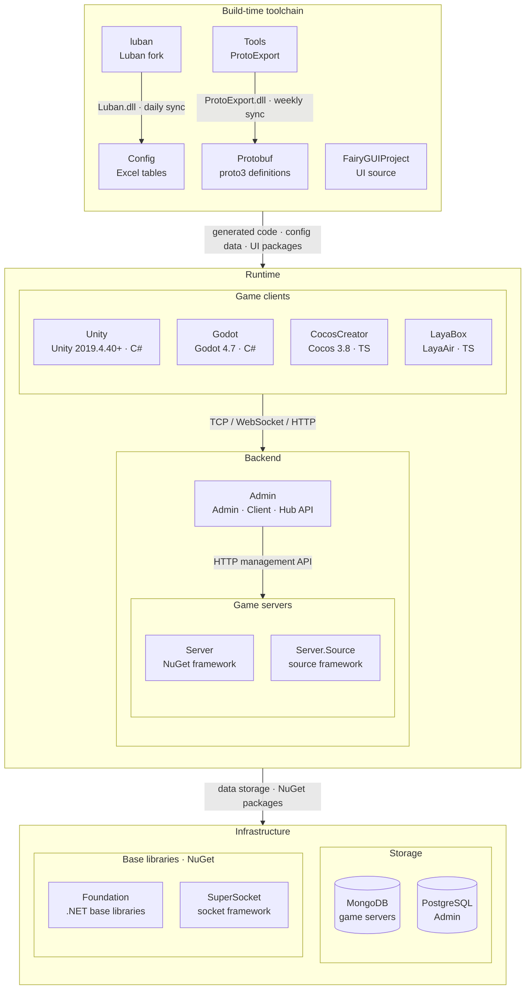

<div align="center">


# GameFrameX Server

[](https://dotnet.microsoft.com)
[](LICENSE.md)
[](https://gameframex.doc.alianblank.com)

**All-in-One Solution for Indie Game Development · Empowering Indie Developers' Dreams**

[📖 Documentation](https://gameframex.doc.alianblank.com) · [🚀 Quick Start](#quick-start) · [💬 QQ Group: 467608841](https://qm.qq.com/cgi-bin/qm/qr?k=sYFd1nv6m2KZIWFLorZ5pBR0AE5ZhbuL&jump_from=webapi&authKey=oCu+uoL3n35fT5SEt7iLgGtROPxh31n/rHUxRlp0w1f+j38W4tKBuWyRH3KEdwHN)

---

🌐 **Language**: **English** | [简体中文](README.zh-CN.md) | [繁體中文](README.zh-TW.md) | [日本語](README.ja.md) | [한국어](README.ko.md)

---

</div>

## Project Overview

GameFrameX Server is a high-performance game server framework built on C# .NET 10.0, featuring an **Actor Model** architecture with **hot-update** support. The framework enforces strict separation between persistent state and business logic, designed specifically for multiplayer online game scenarios.

> Design Philosophy: Simplicity over complexity

## Core Features

- **Actor Model** — Lock-free high-concurrency architecture based on TPL DataFlow, avoiding traditional lock contention through message passing
- **State-Logic Separation** — Strict separation between persistent data (Apps layer) and hot-updatable business logic (Hotfix layer)
- **Zero-Downtime Hot Updates** — Replace business logic assemblies at runtime without restarting the server
- **Multi-Protocol Networking** — Support for TCP, WebSocket, and HTTP protocols with built-in message encoding/decoding and compression
- **MongoDB Persistence** — Transparent ORM mapping based on CacheState with automatic serialization/deserialization
- **Source Generator** — Roslyn-based Agent code generation for automatic Actor message queue scheduling
- **Config Table System** — Integrated Luban config generation with JSON hot-reloading
- **OpenTelemetry** — Built-in Prometheus metrics export, health checks, and performance monitoring

## Architecture

```
┌──────────────────────────────────────────────────────────────┐
│                       Client Layer                           │
├──────────────────────────────────────────────────────────────┤
│                      Network Layer                           │
│  ┌──────────┐  ┌──────────┐  ┌──────────┐  ┌──────────┐    │
│  │   TCP    │  │WebSocket │  │   HTTP   │  │   KCP    │    │
│  └──────────┘  └──────────┘  └──────────┘  └──────────┘    │
├──────────────────────────────────────────────────────────────┤
│                  Hotfix Layer (Hot-updatable)                │
│  ┌──────────────────────────────────────────────────────┐   │
│  │  ComponentAgent  │  HttpHandler  │  EventHandler     │   │
│  └──────────────────────────────────────────────────────┘   │
├──────────────────────────────────────────────────────────────┤
│                  Apps Layer (Non-hot-updatable)              │
│  ┌──────────┐  ┌──────────┐  ┌──────────┐                  │
│  │  State   │  │Component │  │ActorType │                  │
│  └──────────┘  └──────────┘  └──────────┘                  │
├──────────────────────────────────────────────────────────────┤
│                 Framework Layer (NuGet Packages)             │
│  ┌──────────┐  ┌──────────┐  ┌──────────┐  ┌──────────┐    │
│  │  Core    │  │ NetWork  │  │ DataBase │  │ Monitor  │    │
│  └──────────┘  └──────────┘  └──────────┘  └──────────┘    │
├──────────────────────────────────────────────────────────────┤
│                     Database Layer                           │
│  ┌──────────────────────────────────────────────────────────┐ │
│  │                      MongoDB                             │ │
│  └──────────────────────────────────────────────────────────┘ │
└──────────────────────────────────────────────────────────────┘
```

## Quick Start

### Prerequisites

| Dependency | Version |
| :--- | :--- |
| [.NET SDK](https://dotnet.microsoft.com/download) | 10.0+ |
| [MongoDB](https://www.mongodb.com/try/download/community) | 4.x+ |
| IDE | Visual Studio 2022 / JetBrains Rider / VS Code |

### Installation & Run

Local development defaults:

- Prefer opening `Server.slnx`. It is smaller and easier to review. If your IDE does not support `.slnx`, open `Server.sln`.
- For normal local debugging, leave `Program arguments` / `Command line arguments` empty. Defaults are defined in `GameFrameX.Launcher/StartUp/AppStartUpGame.cs`.
- Use startup arguments only when you need to override those defaults, such as changing ports or using another MongoDB instance.

#### Option 1: Run Everything With Docker

```bash
git clone https://github.com/GameFrameX/Server_main.git
cd Server_main
docker compose up -d --build
```

#### Option 2: Run Locally From Terminal

Start MongoDB first:

```bash
docker compose up -d mongodb
```

Then build and run the launcher from the output directory:

```bash
git clone https://github.com/GameFrameX/Server_main.git
cd Server_main
dotnet restore
dotnet build Server.sln
cd bin/app_debug
dotnet GameFrameX.Launcher.dll \
    --ServerId=1000 \
    --ServerType=Game \
    --IsEnableTcp=true \
    --InnerPort=29100 \
    --MetricsPort=29090 \
    --IsEnableHttp=true \
    --HttpPort=28080 \
    --IsEnableWebSocket=true \
    --WsPort=29110 \
    --HttpIsDevelopment=true \
    --MinModuleId=10 \
    --MaxModuleId=9999 \
    --TagName=GameFrameX \
    --DatabaseProvider=Sqlite \
    --DataBaseUrl="Data Source=data/gameframex.db"
```

#### Option 3: Debug With Rider

1. Open `Server.slnx`; if your Rider version does not support `.slnx`, open `Server.sln`.
2. Start MongoDB: `docker compose up -d mongodb`.
3. Create or edit a `.NET Project` run configuration for `GameFrameX.Launcher`.
4. Set `Working directory` to `$SolutionDir$/bin/app_debug`.
5. Leave `Program arguments` empty.
6. Click Debug. If `bin/app_debug` does not exist yet, run `dotnet build Server.sln` once.

#### Option 4: Debug With Visual Studio

1. Open `Server.slnx`; if your Visual Studio version does not support `.slnx`, open `Server.sln`.
2. Set `GameFrameX.Launcher` as the startup project.
3. Start MongoDB: `docker compose up -d mongodb`.
4. Set `Working directory` to `bin\app_debug`.
5. Leave `Command line arguments` empty.
6. Press F5. If the output directory does not exist yet, run Build Solution once.

#### Override Defaults When Needed

```bash
dotnet GameFrameX.Launcher.dll \
    --ServerId=1000 \
    --ServerType=Game \
    --IsEnableTcp=true \
    --InnerPort=29100 \
    --MetricsPort=29090 \
    --IsEnableHttp=true \
    --HttpPort=28080 \
    --IsEnableWebSocket=true \
    --WsPort=29110 \
    --HttpIsDevelopment=true \
    --MinModuleId=10 \
    --MaxModuleId=9999 \
    --TagName=GameFrameX \
    --DatabaseProvider=Sqlite \
    --DataBaseUrl="Data Source=data/gameframex.db"
```

### Verify Deployment

| Endpoint | URL | Description |
| :--- | :--- | :--- |
| Health Check | `http://localhost:29090/health` | Service health status |
| Metrics | `http://localhost:29090/metrics` | Prometheus metrics |
| Test API | `http://localhost:28080/game/api/test` | HTTP connectivity test |

## Project Structure

```
Server_main/
├── GameFrameX.Launcher/         # Application entry point (Executable)
│   ├── Program.cs               # Bootstrap: register state types & protocol messages
│   └── StartUp/
│       └── AppStartUpGame.cs    # Game server startup flow
│
├── GameFrameX.Hotfix/           # Hot-update layer (Business logic, runtime-replaceable)
│   ├── Logic/
│   │   ├── Http/                # HTTP request handlers
│   │   │   ├── TestHttpHandler.cs
│   │   │   ├── ReloadHttpHandler.cs
│   │   │   ├── Player/          # Account login, online queries
│   │   │   └── Bag/             # Item sending
│   │   ├── Player/
│   │   │   ├── Bag/             # Bag component agent
│   │   │   ├── Login/           # Login/logout logic
│   │   │   └── Pet/             # Pet component agent
│   │   ├── Account/             # Account component agent
│   │   └── Server/              # Server global component agent
│   └── StartUp/                 # Hot-update startup flow
│       ├── AppStartUpHotfixGameByEntry.cs    # Entry point
│       ├── AppStartUpHotfixGameByMain.cs     # Network/connection management
│       ├── AppStartUpHotfixGameByHeart.cs    # Heartbeat handling
│       └── AppStartUpHotfixGameByGateWay.cs  # Gateway communication
│
├── GameFrameX.Apps/             # Application state layer (Non-hot-updatable)
│   ├── ActorType.cs             # Actor type enum definition
│   ├── Account/Login/           # Login state + component
│   ├── Player/
│   │   ├── Bag/                 # Bag state + component
│   │   ├── Player/              # Player state + component
│   │   └── Pet/                 # Pet state + component
│   ├── Server/                  # Server global state + component
│   └── Common/
│       ├── Session/             # Session management (SessionManager)
│       ├── Event/               # Event ID definitions
│       └── EventData/           # Event arguments
│
├── GameFrameX.Config/           # Config table system (Luban generated)
│   ├── ConfigComponent.cs       # Config loading singleton
│   ├── Tables/                  # Generated config table classes
│   ├── TablesItem/              # Config data models
│   └── json/                    # JSON config data files
│
├── GameFrameX.Proto/            # Network protocol definitions
│   ├── Basic_10.cs              # Basic protocols (heartbeat, etc.)
│   ├── Bag_100.cs               # Bag protocols
│   ├── User_300.cs              # User/account protocols
│   └── BuiltIn/                 # Built-in system protocols
│
├── GameFrameX.Architecture.Analyzers/        # Compile-time architecture rules
│
├── Server.slnx                  # Recommended solution for newer IDEs
├── Server.sln                   # Fallback solution for IDEs that do not support .slnx
├── Dockerfile                   # Docker multi-stage build
├── docker-compose.yml           # Docker Compose orchestration
└── LICENSE.md                   # Apache License 2.0
```

## Usage Examples

### Core Pattern: State - Component - Agent

GameFrameX uses a three-layer separation pattern that enables hot-updating business logic without server downtime.

```
┌──────────────┐     ┌──────────────┐     ┌──────────────┐
│   State      │────▶│  Component   │◀────│ ComponentAgent│
│  (Data Def)  │     │   (Shell)    │     │  (Logic)     │
│  Apps Layer  │     │  Apps Layer  │     │ Hotfix Layer │
│  Not Hot-fix │     │  Not Hot-fix │     │  Hot-fixable │
└──────────────┘     └──────────────┘     └──────────────┘
```

#### Step 1: Define State (Apps Layer)

Inherit `CacheState` to define persistent data structures. The framework handles MongoDB serialization automatically.

```csharp
// GameFrameX.Apps/Player/Bag/Entity/BagState.cs
public sealed class BagState : CacheState
{
    public Dictionary<int, BagItemState> List { get; set; } = new();
}

public sealed class BagItemState
{
    public long ItemId { get; set; }
    public long Count { get; set; }
}
```

#### Step 2: Create Component (Apps Layer)

Inherit `StateComponent<TState>` to serve as the bridge between state and logic.

```csharp
// GameFrameX.Apps/Player/Bag/Component/BagComponent.cs
[ComponentType(GlobalConst.ActorTypePlayer)]
public class BagComponent : StateComponent<BagState> { }
```

#### Step 3: Implement Business Logic (Hotfix Layer)

Inherit `StateComponentAgent<TComponent, TState>` to write hot-updatable business code.

```csharp
// GameFrameX.Hotfix/Logic/Player/Bag/BagComponentAgent.cs
public class BagComponentAgent : StateComponentAgent<BagComponent, BagState>
{
    public async Task OnAddBagItem(INetWorkChannel netWorkChannel,
        ReqAddItem message, RespAddItem response)
    {
        // Validate item config exists
        foreach (var item in message.ItemDic)
        {
            if (!ConfigComponent.Instance.GetConfig<TbItemConfig>()
                .TryGet(item.Key, out var _))
            {
                response.ErrorCode = (int)OperationStatusCode.NotFound;
                return;
            }
        }

        await UpdateChanged(netWorkChannel, message.ItemDic);
    }

    public async Task<BagState> UpdateChanged(INetWorkChannel netWorkChannel,
        Dictionary<int, long> itemDic)
    {
        var bagState = OwnerComponent.State;
        var notify = new NotifyBagInfoChanged();

        foreach (var item in itemDic)
        {
            if (bagState.List.TryGetValue(item.Key, out var value))
            {
                value.Count += item.Value;
            }
            else
            {
                bagState.List[item.Key] = new BagItemState
                {
                    Count = item.Value, ItemId = item.Key
                };
            }
        }

        await netWorkChannel.WriteAsync(notify);
        await OwnerComponent.WriteStateAsync(); // Auto-persist to MongoDB
        return bagState;
    }
}
```

### HTTP Handler

Inherit `BaseHttpHandler` and register with `[HttpMessageMapping]`.

```csharp
// GameFrameX.Hotfix/Logic/Http/TestHttpHandler.cs
[HttpMessageMapping(typeof(TestHttpHandler))]
[HttpMessageResponse(typeof(HttpTestResponse))]
[Description("Test API endpoint")]
public sealed class TestHttpHandler : BaseHttpHandler
{
    public override Task<string> Action(string ip, string url,
        Dictionary<string, object> parameters)
    {
        var response = new HttpTestResponse { Message = "hello" };
        return Task.FromResult(HttpJsonResult.SuccessString(response));
    }
}
```

### RPC Message Handler

The framework provides two RPC handler base classes with automatic ComponentAgent injection:

```csharp
// Player-level message (bound to a specific player Actor)
[MessageMapping(typeof(ReqAddItem))]
internal sealed class AddItemHandler
    : PlayerRpcComponentHandler<BagComponentAgent, ReqAddItem, RespAddItem>
{
    protected override async Task ActionAsync(ReqAddItem request, RespAddItem response)
    {
        await ComponentAgent.OnAddBagItem(NetWorkChannel, request, response);
    }
}

// Global-level message (bound to the server Actor)
[MessageMapping(typeof(ReqHeartBeat))]
internal sealed class HeartBeatHandler
    : GlobalRpcComponentHandler<ServerComponentAgent, ReqHeartBeat, RespHeartBeat>
{
    protected override Task ActionAsync(ReqHeartBeat request, RespHeartBeat response)
    {
        return Task.CompletedTask;
    }
}
```

### Event Handling

Use the `[Event]` attribute to bind event IDs. The framework automatically dispatches to the corresponding ComponentAgent.

```csharp
[Event(EventId.PlayerLogin)]
internal sealed class PlayerLoginEventHandler : EventListener<PlayerComponentAgent>
{
    protected override Task HandleEvent(PlayerComponentAgent agent, GameEventArgs args)
    {
        return agent.OnLogin();
    }
}
```

### Agent Method Attributes

The Roslyn source generator automatically handles Actor message queue scheduling. Control invocation behavior through attributes:

| Attribute | Description | Use Case |
| :--- | :--- | :--- |
| `[Service]` | Default mode; method calls are enqueued to the Actor message queue | All business methods |
| `[ThreadSafe]` | Skip message queue, invoke directly (requires thread-safe implementation) | Read-only operations, stateless computation |
| `[Discard]` | Fire-and-forget, do not await the return value | Logging, statistics where results are not needed |
| `[TimeOut(ms)]` | Set timeout for message queue invocation | Long operations requiring timeout control |

```csharp
public class ServerComponentAgent : StateComponentAgent<ServerComponent, ServerState>
{
    // Enqueued to Actor message queue
    [Service]
    public virtual Task<bool> IsOnline(long roleId) { ... }

    // Skip message queue, thread-safe direct call
    [Service]
    [ThreadSafe]
    public virtual long FirstStartTime()
    {
        return State.FirstStartTime;
    }

    // Fire-and-forget, non-blocking
    [Service]
    [Discard]
    public virtual ValueTask AddOnlineRole(long roleId)
    {
        OwnerComponent.OnlineSet.Add(roleId);
        return ValueTask.CompletedTask;
    }
}
```

### Config Table Access

Use the `ConfigComponent` singleton to access Luban-generated config tables:

```csharp
var config = ConfigComponent.Instance.GetConfig<TbItemConfig>();

// Safe query with TryGet
if (config.TryGet(itemId, out var itemConfig))
{
    // Use itemConfig.Name, itemConfig.Type, etc.
}
```

### Database Operations

Use the `GameDb` static class for MongoDB CRUD operations:

```csharp
// Query
var state = await GameDb.FindAsync<LoginState>(
    m => m.UserName == userName && m.Password == password);

// Add or update
await GameDb.AddOrUpdateAsync(loginState);

// List query
var list = await GameDb.FindListAsync<LoginState>(m => m.Id != 0);

// Delete
var count = await GameDb.DeleteAsync(state);
```

### Hot Update Mechanism

The hot-update system allows replacing business logic without stopping the server.

- **Apps Layer** (`GameFrameX.Apps`): Contains state definitions and component shells — **not hot-updatable**
- **Hotfix Layer** (`GameFrameX.Hotfix`): Contains all business logic — **hot-updatable**
- **Hotfix assembly** outputs to the `hotfix/` directory, loaded at runtime by `HotfixManager`

```bash
# Trigger via HTTP endpoint (with version number)
curl "http://localhost:28080/game/api/Reload?version=1.0.1"
```

### Architecture Analyzers

`GameFrameX.Architecture.Analyzers` is a Roslyn analyzer project that enforces the Apps/Hotfix architecture at compile time. It is referenced as an analyzer by `GameFrameX.Apps`, `GameFrameX.Hotfix`, and `GameFrameX.Launcher` only; `GameFrameX.Config`, `GameFrameX.Proto`, and test assemblies are ignored by design.

| ID | Rule |
| :--- | :--- |
| `GFX0001` | `BaseCacheState` subclasses must be defined in `GameFrameX.Apps`. |
| `GFX0002` | `StateComponent<TState>` subclasses must be defined in `GameFrameX.Apps`. |
| `GFX0003` | `BaseHttpHandler` subclasses must be defined in `GameFrameX.Hotfix`. |
| `GFX0004` | `IHotfixBridge` implementations must be defined in `GameFrameX.Hotfix`. |
| `GFX0005` | `IComponentAgent` implementations must be defined in `GameFrameX.Hotfix`. |
| `GFX0006` | `[MessageMapping]` handlers must be defined in `GameFrameX.Hotfix`. |
| `GFX0007` | `[MessageRpcMapping]` handlers must be defined in `GameFrameX.Hotfix`. |
| `GFX0008` | `IEventListener` implementations must be defined in `GameFrameX.Hotfix`. |
| `GFX0009` | `ITimerHandler` implementations must be defined in `GameFrameX.Hotfix`. |
| `GFX0010` | `[MessageMapping]` handlers must be `sealed`. |
| `GFX0011` | `IEventListener` implementations must be `sealed`. |
| `GFX0012` | `[MessageMapping]` handler type names must end with `Handler`. |
| `GFX0013` | `IEventListener` implementation type names must end with `EventListener`. |
| `GFX0014` | `IComponentAgent` implementation type names must end with `ComponentAgent`. |

## Ecosystem Architecture

GameFrameX consists of the repositories below: the build-time toolchain generates protocol and config code, while game clients, game servers and the operations backend cooperate at runtime.



### Core Projects

| Project | Role | Tech Stack | Integration |
|------|------|------|------|
| [Unity](https://github.com/GameFrameX/GameFrameX.Unity) | Unity client project: assembles 90+ framework packages from the GameFrameX UPM registry, HybridCLR hot update, login / bag / room samples | Unity 2019.4.40+, HybridCLR, YooAsset, FairyGUI, UniTask | Consumes Protobuf / Config / FairyGUIProject output; TCP 29100 + HTTP 28080 to Server, HTTP 20808 to Admin Client API |
| [Server](https://github.com/GameFrameX/GameFrameX.Server) | Actor-model game server: persistent Apps state layer strictly separated from the hot-updatable Hotfix logic layer; single- or multi-process deployment | .NET 10, MongoDB, Docker | Listens on TCP 29100 / WebSocket 29110 / HTTP 28080; HTTP management endpoints (mail, item grants, player management) for Admin |
| [Admin](https://github.com/GameFrameX/GameFrameX.Admin) | Multi-tenant operations backend: Admin (20802) / Client (20808) / Hub (20806) hosts + Vue console, covering game areas, announcements, mail, orders & payment, remote config, LiveOps | .NET 10, SqlSugar, PostgreSQL, Vue 3.5, PrimeVue | Calls Server through each game area's `HttpManageUrl`; Client API serves global info, login and payment callbacks to game clients |
| [luban](https://github.com/GameFrameX/luban) | GameFrameX fork of Luban: merged upstream v5.1.0, adds the `gameframex` table importer and `cs-dotnet-json` / `cs-dotnet-bin` code targets | .NET 10, Scriban | Publishes Luban tar.gz and Docker image; synced daily into Config `Tools/` |
| [Config](https://github.com/GameFrameX/GameFrameX.Config) | Config table repository: Excel data tables + schema + localization tables, one-click scripts generate client and server code and data | Excel, Luban | `gen-client-*` → Unity; `gen-server-json` → Server; `gen-server-bin` → Server.Source; `gen-godot-json` / `gen-cocos-json` / `gen-laya-json` → Godot / CocosCreator / LayaBox |
| [Protobuf](https://github.com/GameFrameX/GameFrameX.Protobuf) | Unified network protocol definitions: proto3, messages and error codes grouped by the numeric module ID in each file name (positive = client↔server, negative = server-internal) | proto3 | `Proto2CsExport_Server` → Server; `Proto2CsExport_Client` → Unity; `Proto2CsExport_Godot` / `Proto2TsExport_CocosCreator` / `Proto2TsExport_LayaBox` → other clients; CI publishes a six-language Release on every push |
| [Tools](https://github.com/GameFrameX/GameFrameX.Tools) | ProtoExport protocol code generator: C# / TypeScript / C++ / Lua / Go, available as CLI, Avalonia GUI and Docker image | .NET 10, Avalonia 12 | `ProtoExport.dll` synced weekly into Protobuf `Tools/`; Docker image `gameframex/gameframex-tools` |

### Peripheral Systems

| Project | Role | Tech Stack | Integration |
|------|------|------|------|
| [Foundation](https://github.com/GameFrameX/GameFrameX.Foundation) | Modular .NET libraries: localization, JSON, command-line options, logging, HTTP, encryption, hashing, ORM base entities, idempotency | .NET | NuGet packages referenced by Server, Server.Source, Admin, Tools |
| [SuperSocket](https://github.com/GameFrameX/GameFrameX.SuperSocket) | GameFrameX fork of SuperSocket: .NET 10 targets, dependency injection, KCP / ReliableSession for weak-network game traffic | .NET 10 | NuGet: Server (ClientEngine), Server.Source (Server / Kcp / Udp / WebSocket) |
| [Server.Source](https://github.com/GameFrameX/GameFrameX.Server.Source) | Server variant with the framework as in-repo source: service discovery, cross-process RemoteMessaging (TCP / KCP), multi-process deployment | .NET 10, MongoDB, Docker | Receives Config `gen-server-bin` output; multi-process via `docker-compose.multi.yml` |
| [Godot](https://github.com/GameFrameX/GameFrameX.Godot) | Godot .NET client with reusable runtime modules, editor plugins and hot-update assemblies | Godot 4.7, C# | Config `gen-godot-json`, Protobuf `Proto2CsExport_Godot`; TCP 29100 / WebSocket 29110 to Server |
| [CocosCreator](https://github.com/GameFrameX/GameFrameX.CocosCreator) | Cocos Creator client, migrated from the Unity version | Cocos Creator 3.8, TypeScript | `npm run gen:proto` / `gen:config` call Protobuf / Config scripts; WebSocket to Server |
| [LayaBox](https://github.com/GameFrameX/GameFrameX.LayaBox) | LayaBox client | LayaAir, TypeScript | Config `gen-laya-json`, Protobuf `Proto2TsExport_LayaBox`; WebSocket to Server |
| [FairyGUIProject](https://github.com/GameFrameX/GameFrameX.FairyGUIProject) | FairyGUI editor project: design source of all game UI | FairyGUI Editor | Publishes UI packages to Unity `Assets/Bundles/UI` and code to `Assets/Hotfix/UI/FairyGUI/` |

## Documentation & Resources

### Configuration Overrides

| Parameter | Description | Default | Example |
| :--- | :--- | :--- | :--- |
| `ServerType` | Server type | — | `Game` |
| `ServerId` | Unique server ID | — | `1000` |
| `IsEnableTcp` | Enable TCP service | `false` | `true` |
| `InnerPort` | TCP internal port | — | `29100` |
| `IsEnableHttp` | Enable HTTP service | `false` | `true` |
| `HttpPort` | HTTP service port | `0` | `28080` |
| `IsEnableWebSocket` | Enable WebSocket service | `false` | `true` |
| `WsPort` | WebSocket service port | `0` | `29110` |
| `MetricsPort` | Prometheus metrics port | `0` | `29090` |
| `HttpIsDevelopment` | Enable HTTP development mode | `false` | `true` |
| `MinModuleId` | Minimum module ID handled by the game server | — | `10` |
| `MaxModuleId` | Maximum module ID handled by the game server | — | `9999` |
| `TagName` | Runtime tag name | — | `GameFrameX` |
| `DataBaseUrl` | MongoDB connection string | — | `mongodb://localhost:27017` |
| `DataBaseName` | Database name | — | `gameframex` |

> **[!NOTE]**
> Local debugging can use the defaults in `GameFrameX.Launcher/StartUp/AppStartUpGame.cs` without passing arguments. The table above lists common override parameters. For the complete configuration reference (network, logging, actor, monitoring, security, etc.), see **[Configuration Management — GameFrameX.Server.Source](https://github.com/GameFrameX/GameFrameX.Server.Source#configuration-management)**.

```bash
dotnet GameFrameX.Launcher.dll \
    --ServerId=1000 \
    --ServerType=Game \
    --IsEnableTcp=true \
    --InnerPort=29100 \
    --MetricsPort=29090 \
    --IsEnableHttp=true \
    --HttpPort=28080 \
    --IsEnableWebSocket=true \
    --WsPort=29110 \
    --HttpIsDevelopment=true \
    --MinModuleId=10 \
    --MaxModuleId=9999 \
    --TagName=GameFrameX \
    --DatabaseProvider=Sqlite \
    --DataBaseUrl="Data Source=data/gameframex.db"
```

### Docker Deployment

```bash
docker-compose up --build
```

| Port | Protocol | Description |
| :--- | :--- | :--- |
| `29090` | HTTP | APM metrics / Health check |
| `29100` | TCP | Game client connections |
| `29110` | WebSocket | WebSocket connections |
| `28080` | HTTP | HTTP API |

### Message Protocol

Message IDs are calculated by module ID shift: `(moduleId << 16) + seqId`

| Module | ID Range | File | Description |
| :--- | :--- | :--- | :--- |
| System | -10 ~ -1 | `Player_-10.cs`, `Service_-3.cs` | Built-in system protocols |
| Basic | 10 | `Basic_10.cs` | Heartbeat, server ready notification |
| Bag | 100 | `Bag_100.cs` | Item CRUD, use, compose |
| User | 300 | `User_300.cs` | Login, register, character list |

### Tech Stack

| Component | Technology |
| :--- | :--- |
| Runtime | .NET 10.0 |
| Database | MongoDB |
| Networking | SuperSocket |
| Serialization | protobuf-net |
| Config Generation | Luban |
| Code Generation | Roslyn Source Generator |
| Monitoring | OpenTelemetry + Prometheus |
| Object Mapping | Mapster |
| Containerization | Docker + Docker Compose |

## Community & Support

- [Official Documentation](https://gameframex.doc.alianblank.com)
- [GitHub Organization](https://github.com/GameFrameX)
- [Gitee Mirror](https://gitee.com/GameFrameX)
- [Issue Tracker](https://github.com/GameFrameX/GameFrameX/issues)
- [Discussions](https://github.com/GameFrameX/GameFrameX/discussions)

### Contributing

1. Fork this repository
2. Create a feature branch (`git checkout -b feature/amazing-feature`)
3. Commit your changes (`git commit -m 'feat: add some feature'`)
4. Push to the branch (`git push origin feature/amazing-feature`)
5. Create a Pull Request

## License

This project is licensed under the [Apache License 2.0](https://www.apache.org/licenses/LICENSE-2.0). See the [LICENSE.md](LICENSE.md) file for details.
