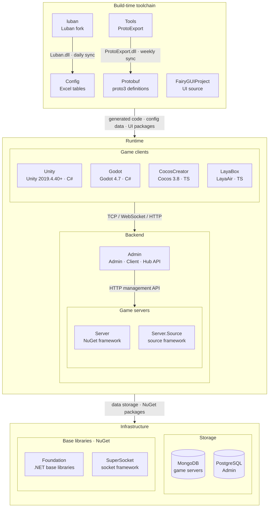

<div align="center">


# GameFrameX Server

[](https://dotnet.microsoft.com)
[](LICENSE.md)
[](https://gameframex.doc.alianblank.com)

**獨立遊戲前後端一體化解決方案 · 獨立遊戲開發者的圓夢大使**

[📖 文檔](https://gameframex.doc.alianblank.com) · [🚀 快速開始](#快速開始) · [💬 QQ群: 467608841](https://qm.qq.com/cgi-bin/qm/qr?k=sYFd1nv6m2KZIWFLorZ5pBR0AE5ZhbuL&jump_from=webapi&authKey=oCu+uoL3n35fT5SEt7iLgGtROPxh31n/rHUxRlp0w1f+j38W4tKBuWyRH3KEdwHN)

---

🌐 **語言**: [English](README.md) | [简体中文](README.zh-CN.md) | **繁體中文** | [日本語](README.ja.md) | [한국어](README.ko.md)

---

</div>

## 項目簡介

GameFrameX Server 是基於 C# .NET 10.0 開發的高效能遊戲伺服器框架，採用 **Actor 模型**設計，支援**熱更新**機制。框架將持久化狀態與業務邏輯嚴格分離，專為多人線上遊戲場景設計。

> 設計理念：大道至簡，以簡化繁

## 核心特性

- **Actor 模型** — 基於 TPL DataFlow 的無鎖高並行架構，透過訊息傳遞避免傳統鎖競爭
- **狀態-邏輯分離** — 持久化資料（Apps 層）與可熱更業務邏輯（Hotfix 層）嚴格分離
- **零停機熱更新** — 執行時替換業務邏輯組件，無需重啟伺服器
- **多協定網路** — 支援 TCP、WebSocket、HTTP 協定，內建訊息編解碼與壓縮
- **MongoDB 持久化** — 基於 CacheState 的透明 ORM 映射，自動序列化/反序列化
- **原始碼產生器** — 基於 Roslyn 的 Agent 程式碼產生，自動處理 Actor 訊息佇列排程
- **設定表系統** — 整合 Luban 設定產生，支援 JSON 熱載入
- **OpenTelemetry** — 內建 Prometheus 指標匯出、健康檢查、效能監控

## 架構概覽

```
┌──────────────────────────────────────────────────────────────┐
│                         客戶端層                              │
├──────────────────────────────────────────────────────────────┤
│                         網路層                                │
│  ┌──────────┐  ┌──────────┐  ┌──────────┐  ┌──────────┐    │
│  │   TCP    │  │WebSocket │  │   HTTP   │  │   KCP    │    │
│  └──────────┘  └──────────┘  └──────────┘  └──────────┘    │
├──────────────────────────────────────────────────────────────┤
│                     Hotfix 層（可熱更）                       │
│  ┌──────────────────────────────────────────────────────┐   │
│  │  ComponentAgent  │  HttpHandler  │  EventHandler     │   │
│  └──────────────────────────────────────────────────────┘   │
├──────────────────────────────────────────────────────────────┤
│                      Apps 層（不可熱更）                      │
│  ┌──────────┐  ┌──────────┐  ┌──────────┐                  │
│  │  State   │  │Component │  │ActorType │                  │
│  └──────────┘  └──────────┘  └──────────┘                  │
├──────────────────────────────────────────────────────────────┤
│                    框架層（NuGet 套件）                       │
│  ┌──────────┐  ┌──────────┐  ┌──────────┐  ┌──────────┐    │
│  │  Core    │  │ NetWork  │  │ DataBase │  │ Monitor  │    │
│  └──────────┘  └──────────┘  └──────────┘  └──────────┘    │
├──────────────────────────────────────────────────────────────┤
│                      資料庫層                                │
│  ┌──────────────────────────────────────────────────────────┐ │
│  │                      MongoDB                             │ │
│  └──────────────────────────────────────────────────────────┘ │
└──────────────────────────────────────────────────────────────┘
```

## 快速開始

### 環境要求

| 依賴 | 版本要求 |
| :--- | :--- |
| [.NET SDK](https://dotnet.microsoft.com/download) | 10.0+ |
| [MongoDB](https://www.mongodb.com/try/download/community) | 4.x+ |
| IDE | Visual Studio 2022 / JetBrains Rider / VS Code |

### 安裝與執行

本機開發預設規則：

- 優先開啟 `Server.slnx`。它更簡潔、更容易審查；如果 IDE 不支援 `.slnx`，再開啟 `Server.sln`。
- 一般本機偵錯時 `Program arguments` / `Command line arguments` 留空。預設設定在 `GameFrameX.Launcher/StartUp/AppStartUpGame.cs`。
- 只有需要覆蓋預設值時才傳啟動參數，例如換連接埠或連接其他 MongoDB。

#### 方式 1：Docker 一鍵啟動

```bash
git clone https://github.com/GameFrameX/Server_main.git
cd Server_main
docker compose up -d --build
```

#### 方式 2：命令列本機啟動

先啟動 MongoDB：

```bash
docker compose up -d mongodb
```

再編譯並從輸出目錄啟動 Launcher：

```bash
git clone https://github.com/GameFrameX/Server_main.git
cd Server_main
dotnet restore
dotnet build Server.sln
cd bin/app_debug
dotnet GameFrameX.Launcher.dll \
    --ServerId=1000 \
    --ServerType=Game \
    --IsEnableTcp=true \
    --InnerPort=29100 \
    --MetricsPort=29090 \
    --IsEnableHttp=true \
    --HttpPort=28080 \
    --IsEnableWebSocket=true \
    --WsPort=29110 \
    --HttpIsDevelopment=true \
    --MinModuleId=10 \
    --MaxModuleId=9999 \
    --TagName=GameFrameX \
    --DatabaseProvider=Sqlite \
    --DataBaseUrl="Data Source=data/gameframex.db"
```

#### 方式 3：Rider 偵錯

1. 開啟 `Server.slnx`；如果 Rider 版本不支援 `.slnx`，再開啟 `Server.sln`。
2. 啟動 MongoDB：`docker compose up -d mongodb`。
3. 建立或編輯 `GameFrameX.Launcher` 的 `.NET Project` 執行設定。
4. `Working directory` 設定為 `$SolutionDir$/bin/app_debug`。
5. `Program arguments` 留空。
6. 點擊 Debug。第一次偵錯前如果 `bin/app_debug` 不存在，先執行一次 `dotnet build Server.sln`。

#### 方式 4：Visual Studio 偵錯

1. 開啟 `Server.slnx`；如果 Visual Studio 版本不支援 `.slnx`，再開啟 `Server.sln`。
2. 將 `GameFrameX.Launcher` 設為啟動專案。
3. 啟動 MongoDB：`docker compose up -d mongodb`。
4. `Working directory` 設定為解決方案目錄下的 `bin\app_debug`。
5. `Command line arguments` 留空。
6. 按 F5 啟動偵錯。第一次偵錯前如果輸出目錄不存在，先執行一次 Build Solution。

#### 需要時覆蓋預設設定

```bash
dotnet GameFrameX.Launcher.dll \
    --ServerId=1000 \
    --ServerType=Game \
    --IsEnableTcp=true \
    --InnerPort=29100 \
    --MetricsPort=29090 \
    --IsEnableHttp=true \
    --HttpPort=28080 \
    --IsEnableWebSocket=true \
    --WsPort=29110 \
    --HttpIsDevelopment=true \
    --MinModuleId=10 \
    --MaxModuleId=9999 \
    --TagName=GameFrameX \
    --DatabaseProvider=Sqlite \
    --DataBaseUrl="Data Source=data/gameframex.db"
```

### 驗證部署

| 端點 | 位址 | 說明 |
| :--- | :--- | :--- |
| 健康檢查 | `http://localhost:29090/health` | 服務健康狀態 |
| 指標監控 | `http://localhost:29090/metrics` | Prometheus 指標 |
| 測試介面 | `http://localhost:28080/game/api/test` | HTTP 連通性測試 |

## 專案結構

```
Server_main/
├── GameFrameX.Launcher/         # 應用入口點（可執行程式）
│   ├── Program.cs               # 啟動引導：註冊狀態類型與協定訊息
│   └── StartUp/
│       └── AppStartUpGame.cs    # 遊戲伺服器啟動流程
│
├── GameFrameX.Hotfix/           # 熱更新層（業務邏輯，可執行時替換）
│   ├── Logic/
│   │   ├── Http/                # HTTP 請求處理器
│   │   │   ├── TestHttpHandler.cs
│   │   │   ├── ReloadHttpHandler.cs
│   │   │   ├── Player/          # 帳戶登入、線上查詢
│   │   │   └── Bag/             # 道具發放
│   │   ├── Player/
│   │   │   ├── Bag/             # 背包組件代理
│   │   │   ├── Login/           # 登入/登出邏輯
│   │   │   └── Pet/             # 寵物組件代理
│   │   ├── Account/             # 帳號組件代理
│   │   └── Server/              # 伺服器全域組件代理
│   └── StartUp/                 # 熱更新啟動流程
│       ├── AppStartUpHotfixGameByEntry.cs    # 載入入口
│       ├── AppStartUpHotfixGameByMain.cs     # 網路/連線管理
│       ├── AppStartUpHotfixGameByHeart.cs    # 心跳處理
│       └── AppStartUpHotfixGameByGateWay.cs  # 網關通訊
│
├── GameFrameX.Apps/             # 應用狀態層（不可熱更）
│   ├── ActorType.cs             # Actor 類型列舉定義
│   ├── Account/Login/           # 登入狀態 + 組件
│   ├── Player/
│   │   ├── Bag/                 # 背包狀態 + 組件
│   │   ├── Player/              # 玩家狀態 + 組件
│   │   └── Pet/                 # 寵物狀態 + 組件
│   ├── Server/                  # 伺服器全域狀態 + 組件
│   └── Common/
│       ├── Session/             # 工作階段管理（SessionManager）
│       ├── Event/               # 事件 ID 定義
│       └── EventData/           # 事件參數
│
├── GameFrameX.Config/           # 設定表系統（Luban 產生）
│   ├── ConfigComponent.cs       # 設定載入單例
│   ├── Tables/                  # 產生的設定表類別
│   ├── TablesItem/              # 設定資料模型
│   └── json/                    # JSON 設定資料檔案
│
├── GameFrameX.Proto/            # 網路協定定義
│   ├── Basic_10.cs              # 基礎協定（心跳等）
│   ├── Bag_100.cs               # 背包協定
│   ├── User_300.cs              # 使用者/帳號協定
│   └── BuiltIn/                 # 內建系統協定
│
├── GameFrameX.Architecture.Analyzers/        # 編譯期架構規則檢查器
│
├── Server.slnx                  # 新版本 IDE 推薦使用的解決方案檔案
├── Server.sln                   # 不支援 .slnx 的 IDE 備用解決方案
├── Dockerfile                   # Docker 多階段建置
├── docker-compose.yml           # Docker Compose 編排
└── LICENSE.md                   # Apache License 2.0
```

## 使用範例

### 核心模式：狀態-組件-代理

GameFrameX 採用三層分離的開發模式，確保業務邏輯可以在不停服的情況下熱更新。

```
┌──────────────┐     ┌──────────────┐     ┌──────────────┐
│   State      │────▶│  Component   │◀────│ ComponentAgent│
│  （資料定義）  │     │  （組件外殼） │     │  （業務邏輯）  │
│   Apps 層    │     │   Apps 層    │     │  Hotfix 層   │
│  不可熱更    │     │  不可熱更    │     │   可熱更      │
└──────────────┘     └──────────────┘     └──────────────┘
```

#### 第 1 步：定義狀態（Apps 層）

繼承 `CacheState`，定義持久化資料結構。框架自動處理 MongoDB 序列化。

```csharp
// GameFrameX.Apps/Player/Bag/Entity/BagState.cs
public sealed class BagState : CacheState
{
    public Dictionary<int, BagItemState> List { get; set; } = new();
}

public sealed class BagItemState
{
    public long ItemId { get; set; }
    public long Count { get; set; }
}
```

#### 第 2 步：建立組件（Apps 層）

繼承 `StateComponent<TState>`，作為狀態和邏輯的橋樑。

```csharp
// GameFrameX.Apps/Player/Bag/Component/BagComponent.cs
[ComponentType(GlobalConst.ActorTypePlayer)]
public class BagComponent : StateComponent<BagState> { }
```

#### 第 3 步：實作業務邏輯（Hotfix 層）

繼承 `StateComponentAgent<TComponent, TState>`，撰寫可熱更的業務程式碼。

```csharp
// GameFrameX.Hotfix/Logic/Player/Bag/BagComponentAgent.cs
public class BagComponentAgent : StateComponentAgent<BagComponent, BagState>
{
    public async Task OnAddBagItem(INetWorkChannel netWorkChannel,
        ReqAddItem message, RespAddItem response)
    {
        // 校驗物品設定是否存在
        foreach (var item in message.ItemDic)
        {
            if (!ConfigComponent.Instance.GetConfig<TbItemConfig>()
                .TryGet(item.Key, out var _))
            {
                response.ErrorCode = (int)OperationStatusCode.NotFound;
                return;
            }
        }

        await UpdateChanged(netWorkChannel, message.ItemDic);
    }

    public async Task<BagState> UpdateChanged(INetWorkChannel netWorkChannel,
        Dictionary<int, long> itemDic)
    {
        var bagState = OwnerComponent.State;
        var notify = new NotifyBagInfoChanged();

        foreach (var item in itemDic)
        {
            if (bagState.List.TryGetValue(item.Key, out var value))
            {
                value.Count += item.Value;
            }
            else
            {
                bagState.List[item.Key] = new BagItemState
                {
                    Count = item.Value, ItemId = item.Key
                };
            }
        }

        await netWorkChannel.WriteAsync(notify);
        await OwnerComponent.WriteStateAsync(); // 自動持久化到 MongoDB
        return bagState;
    }
}
```

### HTTP 處理器

繼承 `BaseHttpHandler`，使用 `[HttpMessageMapping]` 註冊路由。

```csharp
// GameFrameX.Hotfix/Logic/Http/TestHttpHandler.cs
[HttpMessageMapping(typeof(TestHttpHandler))]
[HttpMessageResponse(typeof(HttpTestResponse))]
[Description("測試通訊介面")]
public sealed class TestHttpHandler : BaseHttpHandler
{
    public override Task<string> Action(string ip, string url,
        Dictionary<string, object> parameters)
    {
        var response = new HttpTestResponse { Message = "hello" };
        return Task.FromResult(HttpJsonResult.SuccessString(response));
    }
}
```

### RPC 訊息處理器

框架提供兩種 RPC 處理器基類，自動注入 ComponentAgent：

```csharp
// 玩家級別訊息（綁定特定玩家 Actor）
[MessageMapping(typeof(ReqAddItem))]
internal sealed class AddItemHandler
    : PlayerRpcComponentHandler<BagComponentAgent, ReqAddItem, RespAddItem>
{
    protected override async Task ActionAsync(ReqAddItem request, RespAddItem response)
    {
        await ComponentAgent.OnAddBagItem(NetWorkChannel, request, response);
    }
}

// 全域級別訊息（綁定伺服器 Actor）
[MessageMapping(typeof(ReqHeartBeat))]
internal sealed class HeartBeatHandler
    : GlobalRpcComponentHandler<ServerComponentAgent, ReqHeartBeat, RespHeartBeat>
{
    protected override Task ActionAsync(ReqHeartBeat request, RespHeartBeat response)
    {
        return Task.CompletedTask;
    }
}
```

### 事件處理

使用 `[Event]` 特性綁定事件 ID，框架自動分發給對應的 ComponentAgent。

```csharp
[Event(EventId.PlayerLogin)]
internal sealed class PlayerLoginEventHandler : EventListener<PlayerComponentAgent>
{
    protected override Task HandleEvent(PlayerComponentAgent agent, GameEventArgs args)
    {
        return agent.OnLogin();
    }
}
```

### Agent 方法標註

使用 Roslyn 原始碼產生器自動處理 Actor 訊息佇列排程。透過特性標註控制呼叫行為：

| 特性 | 說明 | 適用場景 |
| :--- | :--- | :--- |
| `[Service]` | 預設模式，方法呼叫進入 Actor 訊息佇列排隊執行 | 所有業務方法 |
| `[ThreadSafe]` | 跳過訊息佇列，直接呼叫（要求方法執行緒安全） | 純讀操作、無狀態計算 |
| `[Discard]` | 即發即棄，不等待傳回值 | 日誌、統計等不需要結果的場景 |
| `[TimeOut(ms)]` | 為訊息佇列呼叫設定逾時時間 | 需要逾時控制的長操作 |

```csharp
public class ServerComponentAgent : StateComponentAgent<ServerComponent, ServerState>
{
    // 進入 Actor 訊息佇列排隊執行
    [Service]
    public virtual Task<bool> IsOnline(long roleId) { ... }

    // 跳過訊息佇列，執行緒安全直接呼叫
    [Service]
    [ThreadSafe]
    public virtual long FirstStartTime()
    {
        return State.FirstStartTime;
    }

    // 即發即棄，不阻塞呼叫方
    [Service]
    [Discard]
    public virtual ValueTask AddOnlineRole(long roleId)
    {
        OwnerComponent.OnlineSet.Add(roleId);
        return ValueTask.CompletedTask;
    }
}
```

### 設定表存取

使用 `ConfigComponent` 單例存取 Luban 產生的設定表：

```csharp
var config = ConfigComponent.Instance.GetConfig<TbItemConfig>();

// 使用 TryGet 安全查詢
if (config.TryGet(itemId, out var itemConfig))
{
    // 使用 itemConfig.Name, itemConfig.Type 等
}
```

### 資料庫操作

透過 `GameDb` 靜態類別進行 MongoDB CRUD 操作：

```csharp
// 查詢
var state = await GameDb.FindAsync<LoginState>(
    m => m.UserName == userName && m.Password == password);

// 新增/更新
await GameDb.AddOrUpdateAsync(loginState);

// 列表查詢
var list = await GameDb.FindListAsync<LoginState>(m => m.Id != 0);

// 刪除
var count = await GameDb.DeleteAsync(state);
```

### 熱更新機制

熱更新系統允許在不停服的情況下替換業務邏輯。

- **Apps 層**（`GameFrameX.Apps`）：包含狀態定義和組件外殼，**不可熱更**
- **Hotfix 層**（`GameFrameX.Hotfix`）：包含所有業務邏輯，**可熱更**
- **Hotfix 組件**輸出到 `hotfix/` 目錄，執行時由 `HotfixManager` 載入

```bash
# 透過 HTTP 介面觸發（指定版本號）
curl "http://localhost:28080/game/api/Reload?version=1.0.1"
```

### 架構分析器

`GameFrameX.Architecture.Analyzers` 是 Roslyn 分析器專案，用於在編譯期強制約束 Apps/Hotfix 分層架構。它只作為 analyzer 參考到 `GameFrameX.Apps`、`GameFrameX.Hotfix` 和 `GameFrameX.Launcher`；`GameFrameX.Config`、`GameFrameX.Proto` 和測試組件會依設計忽略。

| ID | 規則 |
| :--- | :--- |
| `GFX0001` | `BaseCacheState` 子類別必須定義在 `GameFrameX.Apps`。 |
| `GFX0002` | `StateComponent<TState>` 子類別必須定義在 `GameFrameX.Apps`。 |
| `GFX0003` | `BaseHttpHandler` 子類別必須定義在 `GameFrameX.Hotfix`。 |
| `GFX0004` | `IHotfixBridge` 實作類別必須定義在 `GameFrameX.Hotfix`。 |
| `GFX0005` | `IComponentAgent` 實作類別必須定義在 `GameFrameX.Hotfix`。 |
| `GFX0006` | `[MessageMapping]` 處理器必須定義在 `GameFrameX.Hotfix`。 |
| `GFX0007` | `[MessageRpcMapping]` 處理器必須定義在 `GameFrameX.Hotfix`。 |
| `GFX0008` | `IEventListener` 實作類別必須定義在 `GameFrameX.Hotfix`。 |
| `GFX0009` | `ITimerHandler` 實作類別必須定義在 `GameFrameX.Hotfix`。 |
| `GFX0010` | `[MessageMapping]` 處理器必須標記為 `sealed`。 |
| `GFX0011` | `IEventListener` 實作類別必須標記為 `sealed`。 |
| `GFX0012` | `[MessageMapping]` 處理器型別名稱必須以 `Handler` 結尾。 |
| `GFX0013` | `IEventListener` 實作類別型別名稱必須以 `EventListener` 結尾。 |
| `GFX0014` | `IComponentAgent` 實作類別型別名稱必須以 `ComponentAgent` 結尾。 |

## 生態架構

GameFrameX 由以下倉庫組成：建置期工具鏈產生協議與配置程式碼，執行時由遊戲用戶端、遊戲伺服器與營運後台協作。



### 核心專案

| 專案 | 作用 | 技術棧 | 產物與對接 |
|------|------|------|------|
| [Unity](https://github.com/GameFrameX/GameFrameX.Unity) | Unity 用戶端工程：從 GameFrameX UPM 源按需組裝 90+ 框架元件，HybridCLR 熱更新，內建登入、背包、房間等範例 | Unity 2019.4.40+, HybridCLR, YooAsset, FairyGUI, UniTask | 使用 Protobuf / Config / FairyGUIProject 產物；TCP 29100 + HTTP 28080 連線 Server，HTTP 20808 連線 Admin Client API |
| [Server](https://github.com/GameFrameX/GameFrameX.Server) | Actor 模型遊戲伺服器：Apps 持久化狀態層與 Hotfix 可熱更邏輯層嚴格分離，支援單程序與多程序部署 | .NET 10, MongoDB, Docker | 監聽 TCP 29100 / WebSocket 29110 / HTTP 28080；為 Admin 提供郵件、發道具、玩家管理等 HTTP 管理介面 |
| [Admin](https://github.com/GameFrameX/GameFrameX.Admin) | 多租戶營運後台：Admin（20802）/ Client（20808）/ Hub（20806）三個 host + Vue 管理端，涵蓋區服、公告、郵件、訂單支付、遠端配置、線上營運 | .NET 10, SqlSugar, PostgreSQL, Vue 3.5, PrimeVue | 依區服 `HttpManageUrl` 呼叫 Server；Client API 為遊戲用戶端提供全域資訊、登入與支付回呼 |
| [luban](https://github.com/GameFrameX/luban) | Luban 配置工具的 GameFrameX 分支：合入官方 v5.1.0，新增 `gameframex` 表匯入器與 `cs-dotnet-json` / `cs-dotnet-bin` 等產生目標 | .NET 10, Scriban | 發佈 Luban tar.gz 與 Docker 映像；每日同步至 Config 的 `Tools/` |
| [Config](https://github.com/GameFrameX/GameFrameX.Config) | 配置表倉庫：Excel 資料表 + schema + 在地化表，一鍵腳本產生前後端程式碼與資料 | Excel, Luban | `gen-client-*` → Unity; `gen-server-json` → Server; `gen-server-bin` → Server.Source; `gen-godot-json` / `gen-cocos-json` / `gen-laya-json` → Godot / CocosCreator / LayaBox |
| [Protobuf](https://github.com/GameFrameX/GameFrameX.Protobuf) | 統一網路協議定義：proto3，依檔名中的數字模組 ID 組織訊息與錯誤碼（正數為用戶端↔伺服器，負數為伺服器內部） | proto3 | `Proto2CsExport_Server` → Server; `Proto2CsExport_Client` → Unity; `Proto2CsExport_Godot` / `Proto2TsExport_CocosCreator` / `Proto2TsExport_LayaBox` → 其他用戶端；每次 push 由 CI 發佈六種語言的 Release |
| [Tools](https://github.com/GameFrameX/GameFrameX.Tools) | ProtoExport 協議程式碼產生器：C# / TypeScript / C++ / Lua / Go 五種語言，提供 CLI、Avalonia GUI 與 Docker 三種形態 | .NET 10, Avalonia 12 | `ProtoExport.dll` 每週同步至 Protobuf 的 `Tools/`；Docker 映像 `gameframex/gameframex-tools` |

### 周邊系統

| 專案 | 作用 | 技術棧 | 產物與對接 |
|------|------|------|------|
| [Foundation](https://github.com/GameFrameX/GameFrameX.Foundation) | 模組化 .NET 類別庫合集：在地化、JSON、命令列參數、日誌、HTTP、加密、雜湊、ORM 基底實體、冪等性 | .NET | 以 NuGet 套件被 Server、Server.Source、Admin、Tools 引用 |
| [SuperSocket](https://github.com/GameFrameX/GameFrameX.SuperSocket) | SuperSocket 的 GameFrameX 分支：.NET 10 建置目標、相依性注入支援、面向弱網遊戲流量的 KCP / ReliableSession | .NET 10 | NuGet：Server（ClientEngine）、Server.Source（Server / Kcp / Udp / WebSocket） |
| [Server.Source](https://github.com/GameFrameX/GameFrameX.Server.Source) | 框架層以原始碼形式放在倉庫內的伺服器版本：服務發現、跨程序 RemoteMessaging（TCP / KCP）、多程序部署 | .NET 10, MongoDB, Docker | 接收 Config `gen-server-bin` 產物；`docker-compose.multi.yml` 多程序部署 |
| [Godot](https://github.com/GameFrameX/GameFrameX.Godot) | Godot .NET 用戶端：可重用執行時模組、編輯器外掛、熱更新組件 | Godot 4.7, C# | Config `gen-godot-json`, Protobuf `Proto2CsExport_Godot`；TCP 29100 / WebSocket 29110 連線 Server |
| [CocosCreator](https://github.com/GameFrameX/GameFrameX.CocosCreator) | Cocos Creator 用戶端，以 Unity 版為基準遷移 | Cocos Creator 3.8, TypeScript | `npm run gen:proto` / `gen:config` 呼叫 Protobuf / Config 腳本；WebSocket 連線 Server |
| [LayaBox](https://github.com/GameFrameX/GameFrameX.LayaBox) | LayaBox 用戶端 | LayaAir, TypeScript | Config `gen-laya-json`, Protobuf `Proto2TsExport_LayaBox`；WebSocket 連線 Server |
| [FairyGUIProject](https://github.com/GameFrameX/GameFrameX.FairyGUIProject) | FairyGUI 編輯器工程：所有遊戲介面的設計原始檔 | FairyGUI Editor | 發佈 UI 包至 Unity `Assets/Bundles/UI`，程式碼至 `Assets/Hotfix/UI/FairyGUI/` |

## 文檔與資源

### 設定覆蓋參數

| 設定項 | 說明 | 預設值 | 範例 |
| :--- | :--- | :--- | :--- |
| `ServerType` | 伺服器類型 | — | `Game` |
| `ServerId` | 伺服器唯一識別 | — | `1000` |
| `IsEnableTcp` | 是否啟用 TCP 服務 | `false` | `true` |
| `InnerPort` | TCP 內部通訊埠 | — | `29100` |
| `IsEnableHttp` | 是否啟用 HTTP 服務 | `false` | `true` |
| `HttpPort` | HTTP 服務埠 | `0` | `28080` |
| `IsEnableWebSocket` | 是否啟用 WebSocket 服務 | `false` | `true` |
| `WsPort` | WebSocket 服務埠 | `0` | `29110` |
| `MetricsPort` | Prometheus 指標埠 | `0` | `29090` |
| `HttpIsDevelopment` | 是否啟用 HTTP 開發模式 | `false` | `true` |
| `MinModuleId` | 遊戲伺服器處理的最小模組 ID | — | `10` |
| `MaxModuleId` | 遊戲伺服器處理的最大模組 ID | — | `9999` |
| `TagName` | 執行時標籤名稱 | — | `GameFrameX` |
| `DataBaseUrl` | MongoDB 連線字串 | — | `mongodb://localhost:27017` |
| `DataBaseName` | 資料庫名稱 | — | `gameframex` |

> **[!NOTE]**
> 本機偵錯可以直接使用 `GameFrameX.Launcher/StartUp/AppStartUpGame.cs` 中的預設設定，不需要傳參。上表列出的是常見覆蓋參數。完整配置項（網路、日誌、Actor、監控、安全等）請查閱 **[Configuration Management — GameFrameX.Server.Source](https://github.com/GameFrameX/GameFrameX.Server.Source#configuration-management)**。

```bash
dotnet GameFrameX.Launcher.dll \
    --ServerId=1000 \
    --ServerType=Game \
    --IsEnableTcp=true \
    --InnerPort=29100 \
    --MetricsPort=29090 \
    --IsEnableHttp=true \
    --HttpPort=28080 \
    --IsEnableWebSocket=true \
    --WsPort=29110 \
    --HttpIsDevelopment=true \
    --MinModuleId=10 \
    --MaxModuleId=9999 \
    --TagName=GameFrameX \
    --DatabaseProvider=Sqlite \
    --DataBaseUrl="Data Source=data/gameframex.db"
```

### Docker 部署

```bash
docker-compose up --build
```

| 埠 | 協定 | 說明 |
| :--- | :--- | :--- |
| `29090` | HTTP | APM 指標 / 健康檢查 |
| `29100` | TCP | 遊戲客戶端連線 |
| `29110` | WebSocket | WebSocket 連線 |
| `28080` | HTTP | HTTP API |

### 訊息協定

訊息 ID 由模組 ID 位移計算：`(moduleId << 16) + seqId`

| 模組 | ID 範圍 | 檔案 | 說明 |
| :--- | :--- | :--- | :--- |
| 系統 | -10 ~ -1 | `Player_-10.cs`, `Service_-3.cs` | 內建系統協定 |
| 基礎 | 10 | `Basic_10.cs` | 心跳、伺服器就緒通知 |
| 背包 | 100 | `Bag_100.cs` | 物品增刪改查、使用、合成 |
| 使用者 | 300 | `User_300.cs` | 登入、註冊、角色列表 |

### 技術棧

| 元件 | 技術 |
| :--- | :--- |
| 執行時 | .NET 10.0 |
| 資料庫 | MongoDB |
| 網路框架 | SuperSocket |
| 序列化 | protobuf-net |
| 設定產生 | Luban |
| 程式碼產生 | Roslyn Source Generator |
| 監控 | OpenTelemetry + Prometheus |
| 物件映射 | Mapster |
| 容器化 | Docker + Docker Compose |

## 社區與支援

- [官方文檔](https://gameframex.doc.alianblank.com)
- [GitHub 組織](https://github.com/GameFrameX)
- [Gitee 鏡像](https://gitee.com/GameFrameX)
- [問題回饋](https://github.com/GameFrameX/GameFrameX/issues)
- [社群討論](https://github.com/GameFrameX/GameFrameX/discussions)

### 貢獻指南

1. Fork 本倉庫
2. 建立功能分支（`git checkout -b feature/amazing-feature`）
3. 提交變更（`git commit -m 'feat: 新增某個功能'`）
4. 推送到分支（`git push origin feature/amazing-feature`）
5. 建立 Pull Request

## 開源協議

本專案採用 [Apache License 2.0](https://www.apache.org/licenses/LICENSE-2.0) 分發。詳見 [LICENSE.md](LICENSE.md) 檔案。
