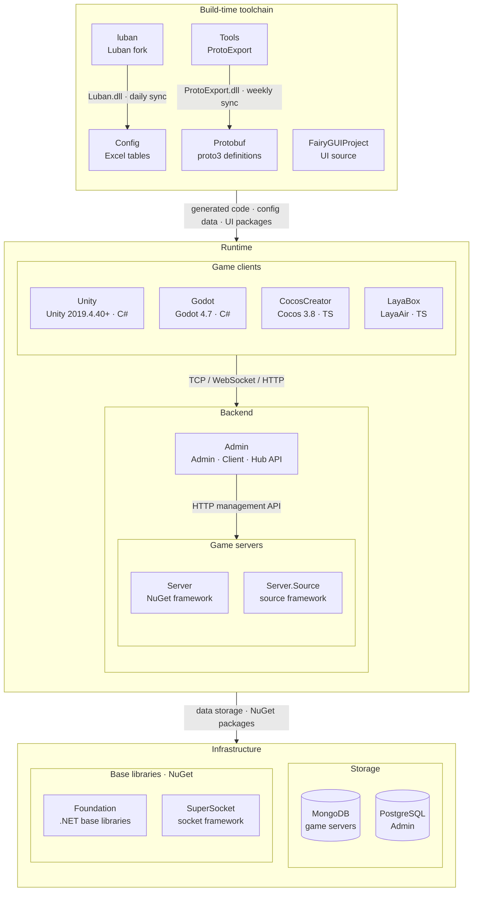

<div align="center">


# GameFrameX.Tools

[](LICENSE.md)
[](https://github.com/GameFrameX/GameFrameX.Tools/releases)
[](https://gameframex.doc.alianblank.com)

[](https://discord.gg/VDWUjWMDw9)
[](https://github.com/GameFrameX/gameframex)
[](https://www.bilibili.com/video/BV1yrpeepEn7)
[](https://gitee.com/GameFrameX/gameframex)

**インディゲーム開発者向けオールインワンソリューション · インディ開発者の夢を支援**

<br />

[ドキュメント](https://gameframex.doc.alianblank.com) · [クイックスタート](#クイックスタート) · QQグループ: 467608841 / 233840761

<br />

[English](README.md) | [简体中文](README.zh-CN.md) | [繁體中文](README.zh-TW.md) | **日本語** | [한국어](README.ko.md)

</div>

## プロジェクト概要

ProtoExport はマルチ言語向けの Proto プロトコルコード生成ツールです。C#、TypeScript、C++、Lua、Go の 5 つのターゲット言語へのエクスポートに対応し、CLI、クロスプラットフォーム GUI、Docker イメージの 3 つの利用方法を提供します。

### 機能概要

- マルチ言語エクスポート: C#（`.cs`）、TypeScript（`.ts`）、C++（`.h`）、Lua（`.lua`）、Go（`.go`）
- 3 つの利用方法: CLI（`dotnet ProtoExport.dll`）、Avalonia GUI（ProtoExporterGUI）、Docker イメージ（`linux/amd64`、`linux/arm64`）
- メッセージ ID の安定性: lock ファイルが `(Module, メッセージ名) → SubId` のマッピングを永続化し、プロトコル番号は proto テキストの編集ではずれません
- サーバー専用プロトコル: `-s` / `_s` で終わる proto ファイルは、サーバー向けエクスポート時にのみ含まれます
- コメント検証: `none` / `container` / `member` / `all` の 4 段階によるコメント完全性チェック
- GUI 設定の永続化: モードごとに `Setting.json` に保存し、デフォルト値と深くマージして無損失アップグレード

## クイックスタート

### インストール

`ProtoExport` プロジェクトは、ビルド成果物を**固定の同階層パス** `../Protobuf/Tools/`（リポジトリルート相対、すなわち `<ワークスペース>/Protobuf/Tools/`）に出力するよう設定されています。パスは `.csproj` の位置を `$(MSBuildThisFileDirectory)` で基準にするため、`Tools` と `Protobuf` を同階層にクローンすればどの環境でも同じように解決されます。

この固定パスは `Protobuf` リポジトリの `Proto2*Export.{sh,bat}` スクリプト（例: `dotnet ./Tools/ProtoExport.dll ...`）が消費し、DLL は `Protobuf/Tools/ProtoExport.dll` にあることを前提とします。

```bash
# Tools/ProtoExport ディレクトリ（またはリポジトリルート）で実行
dotnet build ProtoExport/ProtoExport.csproj -c Release
# 成果物は ../Protobuf/Tools/ProtoExport.dll に配置（TFM/RID サブディレクトリなし）
```

固定パスを成立させるビルド プロパティ（`ProtoExport/ProtoExport.csproj` で設定）:

- `OutputPath` = `$(MSBuildThisFileDirectory)../../Protobuf/Tools/` — Debug/Release 共通の出力ディレクトリ。
- `AppendTargetFrameworkToOutputPath` = `false` — `net10.0/` サブディレクトリを生成しない。
- `AppendRuntimeIdentifierToOutputPath` = `false` — `win-x64/`、`linux-arm64/` サブディレクトリを生成しない。

> SDK デフォルトの `output-paths` target に上書きされないよう、`OutDir` ではなく `OutputPath` を使用します。

## 使用例

| モード | 出力言語 | ファイル拡張子 | 説明 |
|--------|---------|--------------|------|
| `csharp` | C# | `.cs` | Server、Unity、Godot、Stride、Flax などに対応 |
| `typescript` | TypeScript | `.ts` | LayaAir、Cocos Creator、Phaser などに対応 |
| `cpp` | C++ | `.h` | Unreal Engine などに対応 |
| `lua` | Lua | `.lua` | Defold、Solar2D、Dora SSR などに対応 |
| `go` | Go | `.go` | Go ゲームサーバーなどに対応 |

### Docker イメージ

`linux/amd64` および `linux/arm64` 向けのプリビルド済み Docker イメージが提供されています。

**Docker Hub**

```bash
docker pull gameframex/gameframex-tools:latest
```

**GitHub Container Registry (GHCR)**

```bash
docker pull ghcr.io/gameframex/gameframex.tools:latest
```

**使用例**

```bash
docker run --rm \
  -v /path/to/protos:/protos \
  -v /path/to/output:/output \
  gameframex/gameframex-tools:latest \
  --mode csharp --isServer true --usingStatements "using System|using ProtoBuf|using System.Collections.Generic|using GameFrameX.NetWork.Abstractions|using GameFrameX.NetWork.Messages" --isGenerateDescription true --inputPath /protos --outputPath /output --namespaceName GameFrameX.Proto.Proto
```

### C# モード

`[ProtoContract]` / `[ProtoMember]` 属性付きの C# コードを生成します。すべての動作は CLI パラメータで制御され、エンジン固有のハードコードはありません。

#### サーバーエクスポート

サーバー用の using 文、`[Description]` 属性付きのコードを生成し、サーバー専用 proto ファイルを含めます。

**ローカル実行：**

```bash
dotnet ProtoExport.dll \
  --mode csharp \
  --isServer true \
  --usingStatements "using System|using ProtoBuf|using System.Collections.Generic|using GameFrameX.NetWork.Abstractions|using GameFrameX.NetWork.Messages" \
  --isGenerateDescription true \
  --inputPath ./../../../../../Protobuf \
  --outputPath ./../../../../../Server/GameFrameX.Proto/Proto \
  --namespaceName GameFrameX.Proto.Proto \
  --isGenerateErrorCode true
```

**Docker 実行：**

```bash
docker run --rm \
  -v ./Protobuf:/protos \
  -v ./Server/GameFrameX.Proto/Proto:/output \
  gameframex/gameframex-tools:latest \
  --mode csharp --isServer true \
  --usingStatements "using System|using ProtoBuf|using System.Collections.Generic|using GameFrameX.NetWork.Abstractions|using GameFrameX.NetWork.Messages" \
  --isGenerateDescription true \
  --inputPath /protos --outputPath /output --namespaceName GameFrameX.Proto.Proto
```

#### Unity エクスポート

Unity 用の using 文付きコードを生成し、サーバー専用 proto ファイルは自動的にスキップされます。

```bash
dotnet ProtoExport.dll \
  --mode csharp \
  --usingStatements "using System|using ProtoBuf|using System.Collections.Generic|using GameFrameX.Network.Runtime" \
  --inputPath ./../../../../../Protobuf \
  --outputPath ./../../../../../Unity/Assets/Hotfix/Proto \
  --namespaceName Hotfix.Proto \
  --isGenerateErrorCode true
```

#### Godot エクスポート

Unity と同様ですが、Godot 固有の名前空間を使用します。

```bash
dotnet ProtoExport.dll \
  --mode csharp \
  --usingStatements "using System|using ProtoBuf|using System.Collections.Generic|using GameFrameX.Network.Runtime" \
  --inputPath ./../../../../../Protobuf \
  --outputPath ./../../../../../Godot/Proto \
  --namespaceName Proto \
  --isGenerateErrorCode true
```

### TypeScript モード

`export namespace`、`export class`、`export enum` を含む `.ts` ファイルと、集約ファイル `ProtoMessageRegister.ts` を生成します。サーバー専用 proto ファイルは自動的にスキップされます。

#### デフォルト import パス

```bash
dotnet ProtoExport.dll \
  --mode typescript \
  --inputPath ./../../../../../Protobuf \
  --outputPath ./../../../../../Laya/src/gameframex/protobuf \
  --isGenerateErrorCode true
```

#### カスタム import パス

```bash
dotnet ProtoExport.dll \
  --mode typescript \
  --importPath "./lib/network/" \
  --inputPath ./../../../../../Protobuf \
  --outputPath ./../../../../../CocosCreator/assets/scripts/protobuf \
  --isGenerateErrorCode true
```

**Docker 実行：**

```bash
docker run --rm \
  -v ./Protobuf:/protos \
  -v ./Laya/src/gameframex/protobuf:/output \
  gameframex/gameframex-tools:latest \
  --mode typescript --inputPath /protos --outputPath /output
```

### C++ モード

`#pragma once`、名前空間、`enum class`、クラス定義を含む C++ ヘッダファイルを生成します。`MessageObject` を継承するクラスには `MESSAGE_ID` と `Clear()` メソッドが含まれます。

```bash
dotnet ProtoExport.dll \
  --mode cpp \
  --usingStatements "#include <cstdint>|#include <string>|#include <vector>|#include <unordered_map>" \
  --inputPath ./../../../../../Protobuf \
  --outputPath ./../../../../../Unreal/Source/Proto \
  --namespaceName GameFrameX.Proto
```

### Lua モード

LuaDoc（EmmyLua）スタイルの型アノテーションとモジュールベースのメッセージ定義を含む `.lua` ファイルを生成します。集約ファイル `ProtoMessageRegister.lua` も生成されます。

```bash
dotnet ProtoExport.dll \
  --mode lua \
  --importPath "./network/" \
  --inputPath ./../../../../../Protobuf \
  --outputPath ./../../../../../Defold/scripts/protobuf
```

**Docker 実行：**

```bash
docker run --rm \
  -v ./Protobuf:/protos \
  -v ./Defold/scripts/protobuf:/output \
  gameframex/gameframex-tools:latest \
  --mode lua --importPath "./network/" --inputPath /protos --outputPath /output
```

### Go モード

protobuf タグ付きの Go struct 定義、enum 型定義、集約ファイル `message_register.go` を生成します。`--namespaceName` は Go パッケージ名として使用されます（ドット区切りの場合は最後のセグメント）。

```bash
dotnet ProtoExport.dll \
  --mode go \
  --usingStatements "google.golang.org/protobuf/runtime/protoimpl" \
  --inputPath ./../../../../../Protobuf \
  --outputPath ./../../../../../GoServer/proto \
  --namespaceName proto
```

**Docker 実行：**

```bash
docker run --rm \
  -v ./Protobuf:/protos \
  -v ./GoServer/proto:/output \
  gameframex/gameframex-tools:latest \
  --mode go --inputPath /protos --outputPath /output --namespaceName proto
```

### GUI ツール（ProtoExporterGUI）

ProtoExport CLI をラップするクロスプラットフォームの Avalonia GUI で、コマンドライン引数を手打ちする手間を省けます。

#### 機能概要

- 7種類のエクスポートモード（Server / Unity / Godot / TypeScript / C++ / Lua / Go）をドロップダウンで切り替え
- すべての CLI パラメータを視覚的に編集（名前空間、using/import、コメント検証レベル、エラーコード、Description、サーバーモード）
- フォルダピッカーでパスを参照して選択（手打ち不要）
- 中国語 / 英語の UI をリアルタイムに切り替え
- 設定の永続化（モードごとにプログラムディレクトリの `Setting.json` に保存、デフォルト値と深くマージして無損失アップグレード）
- リアルタイムログ出力パネル

#### ビルドと発行

```bash
dotnet publish ProtoExporterGUI/ProtoExporterGUI.csproj -c Release -r win-x64 --no-self-contained
# その他の RID: osx-arm64 / osx-x64 / linux-x64 / linux-arm64
```

成果物はシングルファイルの実行可能ファイルです（ランタイムを含まないため、対象マシンに .NET 10 ランタイムの事前インストールが必要です）。

#### 使い方

1. アプリを起動する
2. エクスポートモードを選択する
3. 入力 / 出力パスを入力または参照して選択する
4. エクスポートをクリックする
5. ログパネルを確認する

GUI は CLI と機能的に等価です。CI / 自動化のシナリオでは、引き続き CLI または Docker の使用を推奨します。

### クイックエクスポートスクリプト

`Protobuf/` ディレクトリにプリセットのエクスポートスクリプトが用意されています：

| スクリプト | 説明 |
|-----------|------|
| `Proto2CsExport_Server.sh/.bat` | C# サーバー用コードのエクスポート |
| `Proto2CsExport_Client.sh/.bat` | C# Unity クライアント用コードのエクスポート |
| `Proto2TsExport.sh/.bat` | TypeScript コードのエクスポート |
| `Proto2CppExport.sh/.bat` | C++ コードのエクスポート |
| `Proto2LuaExport.sh/.bat` | Lua コードのエクスポート |
| `Proto2GoExport.sh/.bat` | Go コードのエクスポート |

## API リファレンス

### Proto プロトコル仕様

本ツールは `.proto` ファイルの書式について特定の要件があります。正しくコードを生成するために、以下のルールに従ってください。

#### ファイルフォーマット要件

```protobuf
syntax = "proto3";     // 必須: proto3 のみサポート
package Basic;
option module = 10;    // モジュール ID: ファイル名プレフィックス（_0010_Name.proto）またはこの宣言のどちらか。併存時は一致必須

// ハートビートリクエスト
message ReqHeartBeat
{
    int64 Timestamp = 1; // タイムスタンプ
}
```

#### メッセージ命名規則

- **リクエストメッセージ**: `Req` で始まる必要があります（例: `ReqLogin`、`ReqHeartBeat`）
- **レスポンスメッセージ**: `Resp` で始まる必要があります（例: `RespLogin`）
- **通知メッセージ**: `Notify` で始まる必要があります（例: `NotifyBagInfoChanged`）
- メッセージ名、フィールド名、enum名、enum値はすべて **UpperCamelCase**（アッパーキャメルケース）を使用

#### モジュール ID ルール

モジュール ID は 2 つの方法で宣言でき、**ファイル名プレフィックスが優先**されます:

1. **ファイル名プレフィックス**: `_<モジュールID>_<名前>.proto`（例: `_0010_Basic.proto` → モジュール 10、`_-0120_Inner_Social.proto` → モジュール -120。区切りには `-` も使用可能、例: `_0010-Basic.proto`）
2. **option 宣言**: `option module = <id>;`

ルール:

- 両方存在する場合は一致が必須。不一致はビルドエラー
- `_` + 数字で始まるが 2 番目の区切り記号がないファイル名（例: `_0010Basic`）は命名エラーとなりビルドエラー
- 両方存在しない場合もビルドエラー

| ID 範囲 | 用途 |
|---------|------|
| `0` ~ `32767` | クライアント-サーバー間通信 |
| `-32768` ~ `-1` | サーバー-サーバー間通信 |

#### フィールド番号ルール

- メッセージのフィールド番号は **800 未満**である必要があります（800 以上はシステム予約であり、パースエラーの原因になります）
- `ErrorCode` はレスポンスメッセージの予約フィールド名です。手動で定義しないでください。`Resp` メッセージには自動的に `ErrorCode` フィールドが生成されます

#### 制限事項

- **ネスト型非対応**: message 内部での `message`、`enum`、その他カスタム型のネストはサポートされていません
- **RPC 定義非対応**: proto ファイル内での RPC サービス定義はサポートされていません
- **proto3 のみ対応**: `syntax = "proto3";` の宣言が必須です。proto2 はサポートされていません

#### コメント規約

- message と enum 定義の**上**にコメントを追加:

```protobuf
// ハートビートリクエスト
message ReqHeartBeat
{
    int64 Timestamp = 1;
}
```

- フィールド行の**末尾**にインラインコメントを追加:

```protobuf
// プレイヤー情報
message PlayerInfo
{
    int64 Id = 1;         // プレイヤーID
    string Name = 2;      // プレイヤー名
    uint32 Level = 3;     // プレイヤーレベル
    int32 State = 4;      // プレイヤー状態
}
```

#### サンプル Proto ファイル

[TestProtos/](TestProtos/) ディレクトリには、主要なパターンを網羅したサンプル proto ファイルが含まれています:

| ファイル | パターン | モジュール ID |
|----------|----------|--------------|
| `heartbeat.proto` | 基本的な Req/Resp | `1`（クライアント-サーバー） |
| `player.proto` | Req/Resp/Notify + enum + map | `2`（クライアント-サーバー） |
| `bag.proto` | enum + repeated + map + Notify | `3`（クライアント-サーバー） |
| `admin-s.proto` | サーバー専用プロトコル（`-s` 接尾辞） | `99`（クライアント-サーバー） |
| `server-internal-s.proto` | サーバー間通信（負のモジュール ID） | `-1`（サーバー-サーバー） |

### パラメータ解説

#### コアパラメータ

| パラメータ | 必須 | デフォルト | 説明 |
|-----------|------|-----------|------|
| `--mode` | はい | - | 言語モード: `csharp`、`typescript`、`cpp`、`lua`、`go` |
| `--inputPath` | はい | - | `.proto` ファイルのディレクトリパス |
| `--outputPath` | はい | - | 生成ファイルの出力パス |
| `--namespaceName` | いいえ | `""` | 生成コードの名前空間（C# のみ有効、TypeScript では無視） |
| `--isGenerateErrorCode` | いいえ | `true` | レスポンスメッセージに `ErrorCode` フィールドを自動生成するか |
| `--requireComments` | いいえ | `none` | コメント検証レベル: `none`（検証なし）、`container`（message/enum にコメント必須）、`member`（フィールド/enum メンバーにコメント必須）、`all`（すべて） |

#### C# 専用パラメータ

| パラメータ | 必須 | デフォルト | 説明 |
|-----------|------|-----------|------|
| `--usingStatements` | いいえ | `""` | using 文を `\|` で区切って指定（例: `"using System\|using ProtoBuf\|using System.Collections.Generic"`） |
| `--isGenerateDescription` | いいえ | `false` | `[System.ComponentModel.Description]` 属性を生成するか |
| `--isServer` | いいえ | `false` | サーバー専用 proto ファイル（`-s` または `_s` で終わるファイル）を含めるか |

> 注：ブール型パラメータ（`--isGenerateErrorCode`、`--isGenerateDescription`、`--isServer` など）はフラグ方式です：**指定すれば有効**になり、`--xxx false` では無効化できません（`false` は無視されます）。表の「デフォルト」はパラメータ省略時の値です（例：`--isGenerateErrorCode` は省略時も有効）。

#### TypeScript 専用パラメータ

| パラメータ | 必須 | デフォルト | 説明 |
|-----------|------|-----------|------|
| `--importPath` | いいえ | `"../network/"` | 生成される import 文のパスプレフィックス |
| `--isGenerateDescription` | いいえ | `false` | JSDoc スタイルのコメントを生成するか |

#### その他のパラメータ

| パラメータ | 必須 | デフォルト | 説明 |
|-----------|------|-----------|------|
| `--isGenerateErrorCodeExcelFile` | いいえ | `true` | エラーコード Excel ファイルを生成するか |
| `--errorCodeExcelFilePath` | いいえ | `""` | エラーコード Excel ファイルのカスタムパス |

### サブ ID の安定性（lock ファイル）

#### 問題: 行順自動採番がプロトコルを壊す

旧バージョンの `MessageIdHandler` は、proto ファイル内の**行順**で自動採番して SubId を割り当てていました（各モジュールは 10 から開始）。このため、proto ファイルに構造的な編集を加えると、そのモジュールの SubId が全体としてずれてしまいます:

| 操作 | 結果 |
|------|------|
| 途中にメッセージを 1 つ挿入 | それ以降のすべてのメッセージの SubId が +1 |
| message 定義の順序を入れ替える | 対応するメッセージの SubId が入れ替わる |
| メッセージを 1 つ削除 | それ以降のすべてのメッセージの SubId が -1 |

SubId はランタイムのネットワークプロトコルにおけるアドレッシングキーです（`MessageID = (Module << 16) | SubId`）。ひとたびずれると、C# / C++ / Go / Lua / TypeScript の各端で生成されるレジストリが、稼働中の旧クライアントと**全体としてずれ込みます**: 旧パケットが保持する過去の Opcode が、別のメッセージとして解釈されてしまいます。行順はあくまでテキスト上の属性であり、プロトコルの意味論に関与すべきではありません。

#### lock 仕組み

有効にすると、`MessageIdCoordinator` は `(Module, メッセージ名) → SubId` のマッピングを JSON lock ファイル（`proto-message-ids.lock.json`）に永続化します。割り当ての判断は名前のみを参照し、行順は使いません:

| シナリオ | 割り当て判断 |
|---------|-------------|
| メッセージ名が lock 内に既に存在する | 過去の SubId を**そのまま使用**し、決して書き換えない |
| メッセージ名が lock 内に存在しない | **max(使用済み番号) + 1**。空き番号は埋めない |
| lock 内に存在するが今回の proto にない（削除・リネーム） | `retired` セクションへ移動し、**決して再利用しない** |

重要なルール:

- `schemaVersion`: lock ファイルは schema バージョン番号を持ち、バージョン非互換の場合はエクスポートが即座にエラーになります。黙って並べ替えることは決してありません
- 各モジュール（`option module = <id>`）は**独立して採番**され、モジュールをまたいだ ID 空間は共有されません
- SubId の有効範囲は `1..65535`（16 ビット）で、モジュール内の開始番号は `10` です
- シリアライズは key の辞書順で出力され、diff には実際の変更のみが含まれるため PR review が容易です
- lock ファイルの書き込みはアトミック操作です（`.tmp` に書き出してから rename）

#### 移行手順

```bash
# 1. シードを一度だけ生成: 「現在この瞬間」の Opcode を lock の起点として凍結する
bash tools/migrate-message-id-lock.sh
#    同等の CLI:
#    dotnet ProtoExport.dll --inputPath <protos> --outputPath <out> \
#      --mode csharp --messageIdLockPath ./proto-message-ids.lock.json --regenerate-lock

# 2. lock ファイルを確認し、git にコミットする
git add proto-message-ids.lock.json && git commit -m "chore(proto): freeze message id lock"

# 3. 以降のすべてのエクスポート（ローカル + CI + Docker）で lock パスを必ず渡す
dotnet ProtoExport.dll ... --messageIdLockPath ./proto-message-ids.lock.json
```

> **注意**: 移行は**過去のずれをロールバックしません**。旧バージョンの行順自動採番によるずれはすでに発生しており、シードはあくまで「現在この瞬間を凍結」し、以降の割り当てを安定させるものです。すでに稼働環境でずれが発生している場合は、別途プロトコルの整合化を行う必要があります。

関連 CLI パラメータ:

| パラメータ | 説明 |
|-----------|------|
| `--messageIdLockPath` | lock ファイルのパス。**空の場合は lock モードが無効**になり、旧来の行順自動採番の動作にフォールバックします（後方互換） |
| `--print-lock` | lock ファイルの内容を読み取って表示するだけで、エクスポートは実行しません（review 用） |
| `--regenerate-lock` | 現在パースした Opcode を lock シードとしてシリアライズします（一回限りの移行用） |

#### merge conflict の扱い

2 人が同じモジュールに同時にメッセージを追加すると、それぞれが同じ `max+1` を算出するため、マージ時に lock ファイルのコンフリクトは避けられません。対処方法:

1. どちらか一方の lock の内容を採用します（コンフリクトした両者の内容は等価で、エントリの並び順が異なるだけです）
2. エクスポートをもう一度実行します（`--messageIdLockPath` 付き）。後からマージされた新メッセージには、次に利用可能な番号が自動的に割り当て直されます
3. lock ファイルを再コミットします

**これはバグではなく仕様です**: コンフリクトを明示化することで「1 つの番号が決して 2 つのメッセージに割り当たらない」ことを保証します。黙って自動マージすると、逆に 2 つのメッセージが同じ SubId を共有し、ランタイムでパースのずれを引き起こす恐れがあります。`retired` セクションも同様です: 削除・リネームされた旧番号は永久に占有され、新メッセージは `max+1` しか取得できません。

### Docker パスマッピング

Docker 使用時のパスマッピングは以下の通りです:

- `-v <ホストパス>:<コンテナパス>` でホストのディレクトリをコンテナにマウントします
- `--inputPath` と `--outputPath` には**コンテナ内パス**（例: `/protos`、`/output`）を指定します（ホストパスではありません）

```bash
# 例: ホスト ./my-protos -> コンテナ /protos
docker run --rm \
  -v $(pwd)/my-protos:/protos \
  -v $(pwd)/my-output:/output \
  gameframex/gameframex-tools:latest \
  --mode csharp --isServer true \
  --usingStatements "using System|using ProtoBuf|using System.Collections.Generic|using GameFrameX.NetWork.Abstractions|using GameFrameX.NetWork.Messages" \
  --isGenerateDescription true \
  --inputPath /protos --outputPath /output --namespaceName GameFrameX.Proto.Proto
```

## エコシステム構成

GameFrameX は以下のリポジトリで構成されます。ビルド時のツールチェーンがプロトコルと設定のコードを生成し、実行時はゲームクライアント・ゲームサーバー・運営バックエンドが連携します。



### コアプロジェクト

| プロジェクト | 役割 | 技術スタック | 成果物と連携 |
|------|------|------|------|
| [Unity](https://github.com/GameFrameX/GameFrameX.Unity) | Unity クライアントプロジェクト：GameFrameX UPM レジストリから 90+ のフレームワークパッケージを必要に応じて導入、HybridCLR によるホットアップデート、ログイン・バッグ・ルームのサンプル付き | Unity 2019.4.40+, HybridCLR, YooAsset, FairyGUI, UniTask | Protobuf / Config / FairyGUIProject の成果物を利用；TCP 29100 + HTTP 28080 で Server、HTTP 20808 で Admin Client API に接続 |
| [Server](https://github.com/GameFrameX/GameFrameX.Server) | Actor モデルのゲームサーバー：永続化状態の Apps 層とホットアップデート可能な Hotfix ロジック層を厳密に分離、単一／マルチプロセス構成に対応 | .NET 10, MongoDB, Docker | TCP 29100 / WebSocket 29110 / HTTP 28080 で待ち受け；Admin 向けにメール・アイテム付与・プレイヤー管理などの HTTP 管理 API を提供 |
| [Admin](https://github.com/GameFrameX/GameFrameX.Admin) | マルチテナント運営バックエンド：Admin（20802）/ Client（20808）/ Hub（20806）の 3 ホスト + Vue 管理画面。サーバー区、お知らせ、メール、注文・決済、リモート設定、ライブ運営をカバー | .NET 10, SqlSugar, PostgreSQL, Vue 3.5, PrimeVue | サーバー区ごとの `HttpManageUrl` で Server を呼び出し；Client API がゲームクライアントにグローバル情報・ログイン・決済コールバックを提供 |
| [luban](https://github.com/GameFrameX/luban) | Luban 設定ツールの GameFrameX フォーク：公式 v5.1.0 をマージし、`gameframex` テーブルインポーターと `cs-dotnet-json` / `cs-dotnet-bin` などの生成ターゲットを追加 | .NET 10, Scriban | Luban の tar.gz と Docker イメージを公開；毎日 Config の `Tools/` に同期 |
| [Config](https://github.com/GameFrameX/GameFrameX.Config) | 設定テーブルリポジトリ：Excel データ表 + スキーマ + ローカライズ表。スクリプト一つでクライアント・サーバーのコードとデータを生成 | Excel, Luban | `gen-client-*` → Unity; `gen-server-json` → Server; `gen-server-bin` → Server.Source; `gen-godot-json` / `gen-cocos-json` / `gen-laya-json` → Godot / CocosCreator / LayaBox |
| [Protobuf](https://github.com/GameFrameX/GameFrameX.Protobuf) | 統一ネットワークプロトコル定義：proto3。ファイル名の数値モジュール ID ごとにメッセージとエラーコードを整理（正数＝クライアント↔サーバー、負数＝サーバー内部） | proto3 | `Proto2CsExport_Server` → Server; `Proto2CsExport_Client` → Unity; `Proto2CsExport_Godot` / `Proto2TsExport_CocosCreator` / `Proto2TsExport_LayaBox` → 他のクライアント；push ごとに CI が 6 言語の Release を公開 |
| [Tools](https://github.com/GameFrameX/GameFrameX.Tools) | ProtoExport プロトコルコード生成ツール：C# / TypeScript / C++ / Lua / Go の 5 言語、CLI・Avalonia GUI・Docker の 3 形態 | .NET 10, Avalonia 12 | `ProtoExport.dll` を毎週 Protobuf の `Tools/` に同期；Docker イメージ `gameframex/gameframex-tools` |

### 周辺システム

| プロジェクト | 役割 | 技術スタック | 成果物と連携 |
|------|------|------|------|
| [Foundation](https://github.com/GameFrameX/GameFrameX.Foundation) | モジュール化された .NET ライブラリ群：ローカライズ、JSON、コマンドライン引数、ログ、HTTP、暗号化、ハッシュ、ORM 基底エンティティ、冪等性 | .NET | NuGet パッケージとして Server・Server.Source・Admin・Tools が参照 |
| [SuperSocket](https://github.com/GameFrameX/GameFrameX.SuperSocket) | SuperSocket の GameFrameX フォーク：.NET 10 ターゲット、依存性注入、弱いネットワーク向け KCP / ReliableSession | .NET 10 | NuGet：Server（ClientEngine）、Server.Source（Server / Kcp / Udp / WebSocket） |
| [Server.Source](https://github.com/GameFrameX/GameFrameX.Server.Source) | フレームワーク層をリポジトリ内ソースとして持つサーバー版：サービスディスカバリ、プロセス間 RemoteMessaging（TCP / KCP）、マルチプロセス構成 | .NET 10, MongoDB, Docker | Config `gen-server-bin` の出力先；`docker-compose.multi.yml` でマルチプロセス起動 |
| [Godot](https://github.com/GameFrameX/GameFrameX.Godot) | Godot .NET クライアント：再利用可能なランタイムモジュール、エディタープラグイン、ホットアップデートアセンブリ | Godot 4.7, C# | Config `gen-godot-json`, Protobuf `Proto2CsExport_Godot`；TCP 29100 / WebSocket 29110 で Server に接続 |
| [CocosCreator](https://github.com/GameFrameX/GameFrameX.CocosCreator) | Unity 版をベースに移植した Cocos Creator クライアント | Cocos Creator 3.8, TypeScript | `npm run gen:proto` / `gen:config` が Protobuf / Config のスクリプトを呼び出し；WebSocket で Server に接続 |
| [LayaBox](https://github.com/GameFrameX/GameFrameX.LayaBox) | LayaBox クライアント | LayaAir, TypeScript | Config `gen-laya-json`, Protobuf `Proto2TsExport_LayaBox`；WebSocket で Server に接続 |
| [FairyGUIProject](https://github.com/GameFrameX/GameFrameX.FairyGUIProject) | FairyGUI エディタープロジェクト：全ゲーム UI のデザインソース | FairyGUI Editor | UI パッケージを Unity `Assets/Bundles/UI`、コードを `Assets/Hotfix/UI/FairyGUI/` に出力 |

## 依存関係

- [.NET 10 SDK](https://dotnet.microsoft.com/download/dotnet/10.0) — ビルドと CLI 実行
- [Avalonia](https://avaloniaui.net/) — GUI ツール（ProtoExporterGUI）のクロスプラットフォーム UI フレームワーク
- [Docker](https://www.docker.com/)（オプション）— コンテナとしてエクスポーターを実行

## ドキュメントとリソース

- [公式ドキュメント](https://gameframex.doc.alianblank.com)
- [通信プロトコル仕様](https://gameframex.doc.alianblank.com/zh-CN/protobuf/require.html)
- [注意事項](https://gameframex.doc.alianblank.com/zh-CN/protobuf/note.html)

## コミュニティとサポート

[](https://discord.gg/VDWUjWMDw9)
[](https://github.com/GameFrameX/gameframex)
[](https://www.linkedin.com/in/alianblank)
[](https://www.reddit.com/r/GameFrameX/)
[](https://x.com/alian_blank)
[](https://www.youtube.com/channel/UCD9QhSFJ5xZkn5NTSV-DVAw)
[](https://bsky.app/profile/alianblank.bsky.social)
[](https://www.bilibili.com/video/BV1yrpeepEn7)
[](https://gitee.com/GameFrameX/gameframex)


## 変更履歴

詳しくは [CHANGELOG.md](CHANGELOG.md) を参照してください。

## ライセンス

詳しくは [LICENSE.md](LICENSE.md) をご参照ください。

<!--
EN: See [LICENSE.md](LICENSE.md) for license information.
zh-CN: 详见 [LICENSE.md](LICENSE.md) 文件。
zh-TW: 詳見 [LICENSE.md](LICENSE.md) 檔案。
ja: 詳しくは [LICENSE.md](LICENSE.md) をご参照ください。
ko: 자세한 내용은 [LICENSE.md](LICENSE.md) 파일을 참조하세요.
-->
