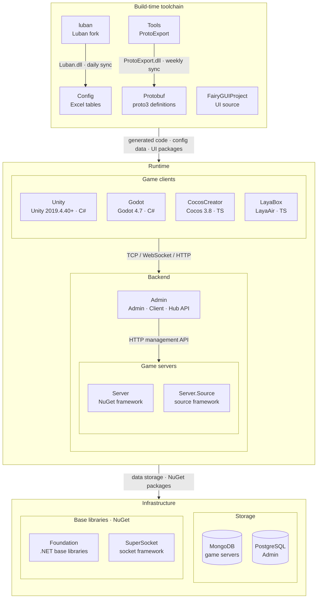

<div align="center">


# GameFrameX.Tools

[](LICENSE.md)
[](https://github.com/GameFrameX/GameFrameX.Tools/releases)
[](https://gameframex.doc.alianblank.com)

[](https://discord.gg/VDWUjWMDw9)
[](https://github.com/GameFrameX/gameframex)
[](https://www.bilibili.com/video/BV1yrpeepEn7)
[](https://gitee.com/GameFrameX/gameframex)

**All-in-One Solution for Indie Game Development · Empowering Indie Developers' Dreams**

<br />

[Documentation](https://gameframex.doc.alianblank.com) · [Quick Start](#quick-start) · QQ Group: 467608841 / 233840761

<br />

**English** | [简体中文](README.zh-CN.md) | [繁體中文](README.zh-TW.md) | [日本語](README.ja.md) | [한국어](README.ko.md)

</div>

## Project Overview

ProtoExport is a multi-language code generator for Proto protocol files. It exports five target languages — C#, TypeScript, C++, Lua, and Go — and offers three usage options: CLI, a cross-platform GUI, and Docker images.

### Features

- Multi-language export: C# (`.cs`), TypeScript (`.ts`), C++ (`.h`), Lua (`.lua`), Go (`.go`)
- Three usage options: CLI (`dotnet ProtoExport.dll`), Avalonia GUI (ProtoExporterGUI), and Docker images (`linux/amd64`, `linux/arm64`)
- Stable message IDs: a lock file persists the `(Module, message name) → SubId` mapping, so protocol numbers no longer drift when proto files are edited
- Server-only protocols: proto files ending with `-s` / `_s` are included only in server-side exports
- Comment validation: four levels of comment completeness checks — `none` / `container` / `member` / `all`
- Persistent GUI configuration: saved per mode to `Setting.json`, deep-merged with defaults for lossless upgrades

## Quick Start

### Installation

The `ProtoExport` project is configured to emit its build output to a **fixed sibling path**: `../Protobuf/Tools/` (relative to the repository root, i.e. `<workspace>/Protobuf/Tools/`). The path is anchored to the `.csproj` location via `$(MSBuildThisFileDirectory)`, so it resolves identically on any machine that clones `Tools` and `Protobuf` as sibling directories.

This fixed location is consumed by the `Proto2*Export.{sh,bat}` scripts in the `Protobuf` repo (e.g. `dotnet ./Tools/ProtoExport.dll ...`), which expect the DLL at `Protobuf/Tools/ProtoExport.dll`.

```bash
# From the Tools/ProtoExport directory (or the repo root)
dotnet build ProtoExport/ProtoExport.csproj -c Release
# Output lands at: ../Protobuf/Tools/ProtoExport.dll  (no TFM/RID subdirectory)
```

Build properties that make the fixed path work (set in `ProtoExport/ProtoExport.csproj`):

- `OutputPath` = `$(MSBuildThisFileDirectory)../../Protobuf/Tools/` — single output dir for Debug and Release.
- `AppendTargetFrameworkToOutputPath` = `false` — no `net10.0/` subdirectory.
- `AppendRuntimeIdentifierToOutputPath` = `false` — no `win-x64/`, `linux-arm64/` subdirectory.

> `OutputPath` is used instead of `OutDir` to avoid being overridden by the SDK's default `output-paths` target.

## Usage Examples

| Mode | Output Language | File Extension | Description |
|------|----------------|----------------|-------------|
| `csharp` | C# | `.cs` | For Server, Unity, Godot, Stride, Flax, etc. |
| `typescript` | TypeScript | `.ts` | For LayaAir, Cocos Creator, Phaser, etc. |
| `cpp` | C++ | `.h` | For Unreal Engine, etc. |
| `lua` | Lua | `.lua` | For Defold, Solar2D, Dora SSR, etc. |
| `go` | Go | `.go` | For Go game servers, etc. |

### Docker

Pre-built Docker images are available for `linux/amd64` and `linux/arm64`.

**Docker Hub**

```bash
docker pull gameframex/gameframex-tools:latest
```

**GitHub Container Registry (GHCR)**

```bash
docker pull ghcr.io/gameframex/gameframex.tools:latest
```

**Usage**

```bash
docker run --rm \
  -v /path/to/protos:/protos \
  -v /path/to/output:/output \
  gameframex/gameframex-tools:latest \
  --mode csharp --isServer true --usingStatements "using System|using ProtoBuf|using System.Collections.Generic|using GameFrameX.NetWork.Abstractions|using GameFrameX.NetWork.Messages" --isGenerateDescription true --inputPath /protos --outputPath /output --namespaceName GameFrameX.Proto.Proto
```

### C# Mode

Generates C# code with `[ProtoContract]` / `[ProtoMember]` attributes. All behavior is controlled via CLI parameters — no hardcoded engine-specific logic.

#### Server Export

Generates code with server-specific using statements, `[Description]` attributes, and includes server-only proto files.

**Local:**

```bash
dotnet ProtoExport.dll \
  --mode csharp \
  --isServer true \
  --usingStatements "using System|using ProtoBuf|using System.Collections.Generic|using GameFrameX.NetWork.Abstractions|using GameFrameX.NetWork.Messages" \
  --isGenerateDescription true \
  --inputPath ./../../../../../Protobuf \
  --outputPath ./../../../../../Server/GameFrameX.Proto/Proto \
  --namespaceName GameFrameX.Proto.Proto \
  --isGenerateErrorCode true
```

**Docker:**

```bash
docker run --rm \
  -v ./Protobuf:/protos \
  -v ./Server/GameFrameX.Proto/Proto:/output \
  gameframex/gameframex-tools:latest \
  --mode csharp --isServer true \
  --usingStatements "using System|using ProtoBuf|using System.Collections.Generic|using GameFrameX.NetWork.Abstractions|using GameFrameX.NetWork.Messages" \
  --isGenerateDescription true \
  --inputPath /protos --outputPath /output --namespaceName GameFrameX.Proto.Proto
```

#### Unity Export

Generates code with Unity-specific using statements. Server-only proto files are automatically skipped.

```bash
dotnet ProtoExport.dll \
  --mode csharp \
  --usingStatements "using System|using ProtoBuf|using System.Collections.Generic|using GameFrameX.Network.Runtime" \
  --inputPath ./../../../../../Protobuf \
  --outputPath ./../../../../../Unity/Assets/Hotfix/Proto \
  --namespaceName Hotfix.Proto \
  --isGenerateErrorCode true
```

#### Godot Export

Same as Unity but with Godot-specific namespace.

```bash
dotnet ProtoExport.dll \
  --mode csharp \
  --usingStatements "using System|using ProtoBuf|using System.Collections.Generic|using GameFrameX.Network.Runtime" \
  --inputPath ./../../../../../Protobuf \
  --outputPath ./../../../../../Godot/Proto \
  --namespaceName Proto \
  --isGenerateErrorCode true
```

### TypeScript Mode

Generates `.ts` files with `export namespace`, `export class`, and `export enum`, plus an aggregated `ProtoMessageRegister.ts` file. Server-only proto files are automatically skipped.

#### Default Import Path

```bash
dotnet ProtoExport.dll \
  --mode typescript \
  --inputPath ./../../../../../Protobuf \
  --outputPath ./../../../../../Laya/src/gameframex/protobuf \
  --isGenerateErrorCode true
```

#### Custom Import Path

```bash
dotnet ProtoExport.dll \
  --mode typescript \
  --importPath "./lib/network/" \
  --inputPath ./../../../../../Protobuf \
  --outputPath ./../../../../../CocosCreator/assets/scripts/protobuf \
  --isGenerateErrorCode true
```

**Docker:**

```bash
docker run --rm \
  -v ./Protobuf:/protos \
  -v ./Laya/src/gameframex/protobuf:/output \
  gameframex/gameframex-tools:latest \
  --mode typescript --inputPath /protos --outputPath /output
```

### C++ Mode

Generates C++ header files with `#pragma once`, namespace, `enum class`, and class definitions. Classes with `MessageObject` base include `MESSAGE_ID` and `Clear()` method.

```bash
dotnet ProtoExport.dll \
  --mode cpp \
  --usingStatements "#include <cstdint>|#include <string>|#include <vector>|#include <unordered_map>" \
  --inputPath ./../../../../../Protobuf \
  --outputPath ./../../../../../Unreal/Source/Proto \
  --namespaceName GameFrameX.Proto
```

### Lua Mode

Generates `.lua` files with LuaDoc (EmmyLua) type annotations and module-based message definitions. Includes a `ProtoMessageRegister.lua` aggregate file.

```bash
dotnet ProtoExport.dll \
  --mode lua \
  --importPath "./network/" \
  --inputPath ./../../../../../Protobuf \
  --outputPath ./../../../../../Defold/scripts/protobuf
```

**Docker:**

```bash
docker run --rm \
  -v ./Protobuf:/protos \
  -v ./Defold/scripts/protobuf:/output \
  gameframex/gameframex-tools:latest \
  --mode lua --importPath "./network/" --inputPath /protos --outputPath /output
```

### Go Mode

Generates Go struct definitions with protobuf tags, enum type definitions, and a `message_register.go` aggregate file. Uses `--namespaceName` as the Go package name (last segment if dot-separated).

```bash
dotnet ProtoExport.dll \
  --mode go \
  --usingStatements "google.golang.org/protobuf/runtime/protoimpl" \
  --inputPath ./../../../../../Protobuf \
  --outputPath ./../../../../../GoServer/proto \
  --namespaceName proto
```

**Docker:**

```bash
docker run --rm \
  -v ./Protobuf:/protos \
  -v ./GoServer/proto:/output \
  gameframex/gameframex-tools:latest \
  --mode go --inputPath /protos --outputPath /output --namespaceName proto
```

### GUI Tool (ProtoExporterGUI)

A cross-platform Avalonia GUI that wraps the ProtoExport CLI, so you can generate code without typing command-line arguments by hand.

#### Features

- Switch between 7 export modes (Server / Unity / Godot / TypeScript / C++ / Lua / Go) from a dropdown
- Edit every CLI parameter visually (namespace, using/import, comment validation level, error codes, Description, server mode)
- Browse and pick paths with the folder picker (no more typing paths by hand)
- Switch the UI between Chinese and English on the fly
- Persistent configuration (saved per mode to `Setting.json` in the program directory, deep-merged with defaults for lossless upgrades)
- Real-time log output panel

#### Build & Publish

```bash
dotnet publish ProtoExporterGUI/ProtoExporterGUI.csproj -c Release -r win-x64 --no-self-contained
# Other RIDs: osx-arm64 / osx-x64 / linux-x64 / linux-arm64
```

The output is a single-file executable (runtime not included; the target machine needs the .NET 10 runtime preinstalled).

#### Usage

1. Launch the app
2. Select the export mode
3. Fill in or browse for the input/output paths
4. Click Export
5. Check the log panel

The GUI is functionally equivalent to the CLI; for CI/automation scenarios, the CLI or Docker is still recommended.

### Quick Export Scripts

Pre-built scripts are available in the `Protobuf/` directory:

| Script | Description |
|--------|-------------|
| `Proto2CsExport_Server.sh/.bat` | Export C# for Server |
| `Proto2CsExport_Client.sh/.bat` | Export C# for Unity Client |
| `Proto2TsExport.sh/.bat` | Export TypeScript |
| `Proto2CppExport.sh/.bat` | Export C++ |
| `Proto2LuaExport.sh/.bat` | Export Lua |
| `Proto2GoExport.sh/.bat` | Export Go |

## API Reference

### Proto Protocol Specification

This tool has specific requirements for `.proto` file formatting. Please follow the rules below to ensure correct code generation.

#### File Format Requirements

```protobuf
syntax = "proto3";     // Required: only proto3 is supported
package Basic;
option module = 10;    // Module ID: file name prefix (_0010_Name.proto) or this declaration; must match when both present

// Request heartbeat
message ReqHeartBeat
{
    int64 Timestamp = 1; // Timestamp
}
```

#### Message Naming Rules

- **Request messages**: Must start with `Req` (e.g., `ReqLogin`, `ReqHeartBeat`)
- **Response messages**: Must start with `Resp` (e.g., `RespLogin`)
- **Notification messages**: Must start with `Notify` (e.g., `NotifyBagInfoChanged`)
- All message names, field names, enum names, and enum values must use **UpperCamelCase**

#### Module ID Rules

Module ID can be declared in two ways, with the **file name prefix taking precedence**:

1. **File name prefix**: `_<moduleID>_<name>.proto` (e.g., `_0010_Basic.proto` → module 10, `_-0120_Inner_Social.proto` → module -120; `-` is also accepted as the separator, e.g., `_0010-Basic.proto`)
2. **option declaration**: `option module = <id>;`

Rules:

- When both are present they must match, otherwise the build fails
- A file name starting with `_` + digits but missing the second separator (e.g., `_0010Basic`) is treated as a naming error and fails the build
- When neither is present the build fails

| ID Range | Purpose |
|----------|---------|
| `0` ~ `32767` | Client-Server communication |
| `-32768` ~ `-1` | Server-Server communication |

#### Field Numbering Rules

- Message field numbers must be **less than 800** (values >= 800 are system-reserved and will cause parse errors)
- `ErrorCode` is a reserved field name in response messages — do not define it manually. `Resp` messages automatically generate an `ErrorCode` field

#### Restrictions

- **No nested types**: Nesting of `message`, `enum`, or any custom type inside another message is not supported
- **No RPC definitions**: RPC service definitions in proto files are not supported
- **Only proto3**: `syntax = "proto3";` is required; proto2 is not supported

#### Comment Standards

- Add a comment line **above** message and enum definitions:

```protobuf
// Request heartbeat
message ReqHeartBeat
{
    int64 Timestamp = 1;
}
```

- Add **inline** comments at the end of field lines:

```protobuf
// Player information
message PlayerInfo
{
    int64 Id = 1;         // Player ID
    string Name = 2;      // Player name
    uint32 Level = 3;     // Player level
    int32 State = 4;      // Player state
}
```

#### Example Proto Files

The [TestProtos/](TestProtos/) directory contains example proto files covering all major patterns:

| File | Pattern | Module ID |
|------|---------|-----------|
| `heartbeat.proto` | Basic Req/Resp | `1` (client-server) |
| `player.proto` | Req/Resp/Notify + enum + map | `2` (client-server) |
| `bag.proto` | enum + repeated + map + Notify | `3` (client-server) |
| `admin-s.proto` | Server-only proto (`-s` suffix) | `99` (client-server) |
| `server-internal-s.proto` | Server-server communication (negative module ID) | `-1` (server-server) |

### Parameter Reference

#### Core Parameters

| Parameter | Required | Default | Description |
|-----------|----------|---------|-------------|
| `--mode` | Yes | - | Language mode: `csharp`, `typescript`, `cpp`, `lua`, `go` |
| `--inputPath` | Yes | - | Path to the `.proto` files directory |
| `--outputPath` | Yes | - | Output path for generated files |
| `--namespaceName` | No | `""` | Namespace for generated code (C# only, ignored by TypeScript) |
| `--isGenerateErrorCode` | No | `true` | Whether to auto-generate `ErrorCode` field in response messages |
| `--requireComments` | No | `none` | Comment validation level: `none` (no validation), `container` (message/enum must have comments), `member` (fields/enum members must have comments), `all` (both) |

#### C# Parameters

| Parameter | Required | Default | Description |
|-----------|----------|---------|-------------|
| `--usingStatements` | No | `""` | Using statements separated by `\|` (e.g., `"using System\|using ProtoBuf\|using System.Collections.Generic"`) |
| `--isGenerateDescription` | No | `false` | Whether to generate `[System.ComponentModel.Description]` attributes |
| `--isServer` | No | `false` | Whether to include server-only proto files (files ending with `-s` or `_s`) |

> Note: boolean options (`--isGenerateErrorCode`, `--isGenerateDescription`, `--isServer`, etc.) are presence-based flags: **passing the flag turns it on** — `--xxx false` cannot turn it off (the `false` literal is ignored). The "Default" column is the value used when the option is omitted (e.g. `--isGenerateErrorCode` is on even when omitted).

#### TypeScript Parameters

| Parameter | Required | Default | Description |
|-----------|----------|---------|-------------|
| `--importPath` | No | `"../network/"` | Import path prefix for generated import statements |
| `--isGenerateDescription` | No | `false` | Whether to generate JSDoc-style comments |

#### Legacy Parameters

| Parameter | Required | Default | Description |
|-----------|----------|---------|-------------|
| `--isGenerateErrorCodeExcelFile` | No | `true` | Whether to generate error code Excel file |
| `--errorCodeExcelFilePath` | No | `""` | Custom path for error code Excel file |

### Sub ID Stability (lock file)

#### The Problem: Line-Order Auto-Increment Breaks the Protocol

The legacy `MessageIdHandler` assigned SubIds by auto-incrementing in **line order** within each proto file (starting from 10 per module). This means any structural edit to a proto file shifts the entire module's SubIds:

| Operation | Consequence |
|------|------|
| Insert a message in the middle | All messages after it get SubId +1 |
| Reorder message definitions | The affected messages swap SubIds |
| Delete a message | All messages after it get SubId -1 |

SubId is the addressing key of the runtime network protocol (`MessageID = (Module << 16) | SubId`). Once it drifts, the registries generated for C# / C++ / Go / Lua / TypeScript become **wholesale misaligned** with old online clients: historical Opcodes carried by old packets get parsed as a different message. Line order is merely a textual property and should never participate in protocol semantics.

#### The Lock Mechanism

Once enabled, `MessageIdCoordinator` persists the `(Module, message name) → SubId` mapping to a JSON lock file (`proto-message-ids.lock.json`). Allocation decisions are based purely on names, never on line order:

| Scenario | Allocation Decision |
|------|----------|
| Message name already in the lock | **Reuse** the historical SubId; never rewritten |
| Message name not in the lock | **max(used IDs) + 1**; gaps are never backfilled |
| Present in the lock but missing from the current protos (deleted/renamed) | Moved to the `retired` section, **never recycled** |

Key rules:

- `schemaVersion`: the lock file carries a schema version; on an incompatible version the exporter fails outright instead of silently reshuffling
- Each module (`option module = <id>`) counts **independently**; ID spaces are not shared across modules
- The valid SubId range is `1..65535` (16 bits); the starting point within a module is `10`
- Serialization emits keys in dictionary order, so diffs contain only real changes and are easy to review in PRs
- Lock file writes are atomic (write to `.tmp` first, then rename)

#### Migration Steps

```bash
# 1. Generate the seed once: freeze the Opcodes "as of this moment" as the lock starting point
bash tools/migrate-message-id-lock.sh
#    Equivalent CLI:
#    dotnet ProtoExport.dll --inputPath <protos> --outputPath <out> \
#      --mode csharp --messageIdLockPath ./proto-message-ids.lock.json --regenerate-lock

# 2. Review and commit the lock file to git
git add proto-message-ids.lock.json && git commit -m "chore(proto): freeze message id lock"

# 3. Every export from now on (local + CI + Docker) must pass the lock path
dotnet ProtoExport.dll ... --messageIdLockPath ./proto-message-ids.lock.json
```

> **Note**: Migration does **not** roll back historical drift. The misalignment caused by the old version's line-order auto-increment has already happened; the seed merely freezes the current state so that allocation stays stable from here on. If drift has already reached production, a separate protocol alignment effort is required.

Related CLI parameters:

| Parameter | Description |
|------|------|
| `--messageIdLockPath` | Path to the lock file; **leave it empty to disable lock mode** and fall back to the legacy line-order auto-increment behavior (backward compatible) |
| `--print-lock` | Read and print the lock file contents without triggering an export (for review) |
| `--regenerate-lock` | Serialize the currently parsed Opcodes into a lock seed (one-time migration use) |

#### Handling Merge Conflicts

When two people add messages to the same module concurrently, both compute the same `max+1`, so the lock file is bound to conflict on merge. Resolution:

1. Take either side of the lock file (the two conflicting versions are equivalent in content, differing only in entry ordering)
2. Re-run the exporter once (with `--messageIdLockPath`) so the message merged later is automatically reassigned the next available ID
3. Commit the lock file again

**This is a feature, not a defect**: surfacing the conflict guarantees that "one SubId never has two owners" — silent auto-merge could instead let two messages share the same SubId and cause parsing misalignment at runtime. The same applies to the `retired` section: IDs of deleted/renamed messages stay occupied forever, and new messages can only take `max+1`.

### Docker Path Mapping

When using Docker, paths are mapped as follows:

- `-v <host-path>:<container-path>` mounts a host directory into the container
- `--inputPath` and `--outputPath` must reference the **container-side** paths (e.g. `/protos`, `/output`), not the host paths

```bash
# Example: host ./my-protos -> container /protos
docker run --rm \
  -v $(pwd)/my-protos:/protos \
  -v $(pwd)/my-output:/output \
  gameframex/gameframex-tools:latest \
  --mode csharp --isServer true \
  --usingStatements "using System|using ProtoBuf|using System.Collections.Generic|using GameFrameX.NetWork.Abstractions|using GameFrameX.NetWork.Messages" \
  --isGenerateDescription true \
  --inputPath /protos --outputPath /output --namespaceName GameFrameX.Proto.Proto
```

## Ecosystem Architecture

GameFrameX consists of the repositories below: the build-time toolchain generates protocol and config code, while game clients, game servers and the operations backend cooperate at runtime.



### Core Projects

| Project | Role | Tech Stack | Integration |
|------|------|------|------|
| [Unity](https://github.com/GameFrameX/GameFrameX.Unity) | Unity client project: assembles 90+ framework packages from the GameFrameX UPM registry, HybridCLR hot update, login / bag / room samples | Unity 2019.4.40+, HybridCLR, YooAsset, FairyGUI, UniTask | Consumes Protobuf / Config / FairyGUIProject output; TCP 29100 + HTTP 28080 to Server, HTTP 20808 to Admin Client API |
| [Server](https://github.com/GameFrameX/GameFrameX.Server) | Actor-model game server: persistent Apps state layer strictly separated from the hot-updatable Hotfix logic layer; single- or multi-process deployment | .NET 10, MongoDB, Docker | Listens on TCP 29100 / WebSocket 29110 / HTTP 28080; HTTP management endpoints (mail, item grants, player management) for Admin |
| [Admin](https://github.com/GameFrameX/GameFrameX.Admin) | Multi-tenant operations backend: Admin (20802) / Client (20808) / Hub (20806) hosts + Vue console, covering game areas, announcements, mail, orders & payment, remote config, LiveOps | .NET 10, SqlSugar, PostgreSQL, Vue 3.5, PrimeVue | Calls Server through each game area's `HttpManageUrl`; Client API serves global info, login and payment callbacks to game clients |
| [luban](https://github.com/GameFrameX/luban) | GameFrameX fork of Luban: merged upstream v5.1.0, adds the `gameframex` table importer and `cs-dotnet-json` / `cs-dotnet-bin` code targets | .NET 10, Scriban | Publishes Luban tar.gz and Docker image; synced daily into Config `Tools/` |
| [Config](https://github.com/GameFrameX/GameFrameX.Config) | Config table repository: Excel data tables + schema + localization tables, one-click scripts generate client and server code and data | Excel, Luban | `gen-client-*` → Unity; `gen-server-json` → Server; `gen-server-bin` → Server.Source; `gen-godot-json` / `gen-cocos-json` / `gen-laya-json` → Godot / CocosCreator / LayaBox |
| [Protobuf](https://github.com/GameFrameX/GameFrameX.Protobuf) | Unified network protocol definitions: proto3, messages and error codes grouped by the numeric module ID in each file name (positive = client↔server, negative = server-internal) | proto3 | `Proto2CsExport_Server` → Server; `Proto2CsExport_Client` → Unity; `Proto2CsExport_Godot` / `Proto2TsExport_CocosCreator` / `Proto2TsExport_LayaBox` → other clients; CI publishes a six-language Release on every push |
| [Tools](https://github.com/GameFrameX/GameFrameX.Tools) | ProtoExport protocol code generator: C# / TypeScript / C++ / Lua / Go, available as CLI, Avalonia GUI and Docker image | .NET 10, Avalonia 12 | `ProtoExport.dll` synced weekly into Protobuf `Tools/`; Docker image `gameframex/gameframex-tools` |

### Peripheral Systems

| Project | Role | Tech Stack | Integration |
|------|------|------|------|
| [Foundation](https://github.com/GameFrameX/GameFrameX.Foundation) | Modular .NET libraries: localization, JSON, command-line options, logging, HTTP, encryption, hashing, ORM base entities, idempotency | .NET | NuGet packages referenced by Server, Server.Source, Admin, Tools |
| [SuperSocket](https://github.com/GameFrameX/GameFrameX.SuperSocket) | GameFrameX fork of SuperSocket: .NET 10 targets, dependency injection, KCP / ReliableSession for weak-network game traffic | .NET 10 | NuGet: Server (ClientEngine), Server.Source (Server / Kcp / Udp / WebSocket) |
| [Server.Source](https://github.com/GameFrameX/GameFrameX.Server.Source) | Server variant with the framework as in-repo source: service discovery, cross-process RemoteMessaging (TCP / KCP), multi-process deployment | .NET 10, MongoDB, Docker | Receives Config `gen-server-bin` output; multi-process via `docker-compose.multi.yml` |
| [Godot](https://github.com/GameFrameX/GameFrameX.Godot) | Godot .NET client with reusable runtime modules, editor plugins and hot-update assemblies | Godot 4.7, C# | Config `gen-godot-json`, Protobuf `Proto2CsExport_Godot`; TCP 29100 / WebSocket 29110 to Server |
| [CocosCreator](https://github.com/GameFrameX/GameFrameX.CocosCreator) | Cocos Creator client, migrated from the Unity version | Cocos Creator 3.8, TypeScript | `npm run gen:proto` / `gen:config` call Protobuf / Config scripts; WebSocket to Server |
| [LayaBox](https://github.com/GameFrameX/GameFrameX.LayaBox) | LayaBox client | LayaAir, TypeScript | Config `gen-laya-json`, Protobuf `Proto2TsExport_LayaBox`; WebSocket to Server |
| [FairyGUIProject](https://github.com/GameFrameX/GameFrameX.FairyGUIProject) | FairyGUI editor project: design source of all game UI | FairyGUI Editor | Publishes UI packages to Unity `Assets/Bundles/UI` and code to `Assets/Hotfix/UI/FairyGUI/` |

## Dependencies

- [.NET 10 SDK](https://dotnet.microsoft.com/download/dotnet/10.0) — build the project and run the CLI
- [Avalonia](https://avaloniaui.net/) — cross-platform UI framework for the GUI tool (ProtoExporterGUI)
- [Docker](https://www.docker.com/) (optional) — run the exporter as a container

## Documentation & Resources

- [Documentation](https://gameframex.doc.alianblank.com)
- [Protocol Specification](https://gameframex.doc.alianblank.com/en-US/protobuf/require.html)
- [Notes](https://gameframex.doc.alianblank.com/en-US/protobuf/note.html)

## Community & Support

[](https://discord.gg/VDWUjWMDw9)
[](https://github.com/GameFrameX/gameframex)
[](https://www.linkedin.com/in/alianblank)
[](https://www.reddit.com/r/GameFrameX/)
[](https://x.com/alian_blank)
[](https://www.youtube.com/channel/UCD9QhSFJ5xZkn5NTSV-DVAw)
[](https://bsky.app/profile/alianblank.bsky.social)
[](https://www.bilibili.com/video/BV1yrpeepEn7)
[](https://gitee.com/GameFrameX/gameframex)


## Changelog

See [CHANGELOG.md](CHANGELOG.md).

## License

See [LICENSE.md](LICENSE.md) for license information.

<!--
EN: See [LICENSE.md](LICENSE.md) for license information.
zh-CN: 详见 [LICENSE.md](LICENSE.md) 文件。
zh-TW: 詳見 [LICENSE.md](LICENSE.md) 檔案。
ja: 詳しくは [LICENSE.md](LICENSE.md) をご参照ください。
ko: 자세한 내용은 [LICENSE.md](LICENSE.md) 파일을 참조하세요.
-->
