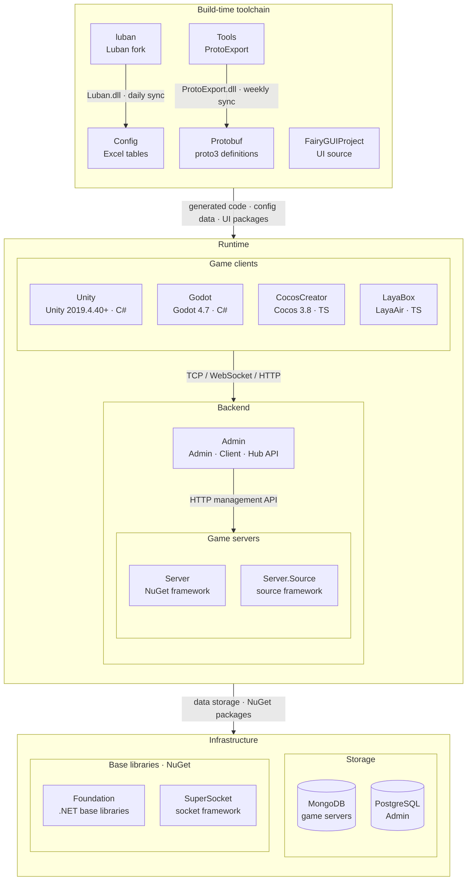

<div align="center">


# GameFrameX Unity

[](https://github.com/GameFrameX/GameFrameX.Unity/releases)
[](LICENSE.md)
[](https://gameframex.doc.alianblank.com)

**インディゲーム開発者向けオールインワンソリューション · インディ開発者の夢を支援**

[📖 ドキュメント](https://gameframex.doc.alianblank.com) · [🚀 クイックスタート](#クイックスタート) · [💬 QQグループ：467608841](https://qm.qq.com/q/467608841)

---

🌐 **言語**: [简体中文](README.zh-CN.md) | [繁體中文](README.zh-TW.md) | [English](README.md) | **日本語** | [한국어](README.ko.md)

---

</div>

## プロジェクト概要

GameFrameX Unity は、GameFrameX 総合ソリューションの Unity クライアント実装です。90 以上のモジュラーコンポーネントを提供し、コアフレームワーク、アセット管理、UI システム、ネットワーク通信から広告、決済、ログイン、アナリティクスなどの運用機能まで、ゲーム開発の全工程をカバーします。Unity 2019.4.40 以降に対応しています。

## 特徴

- **モジュラー設計** — 各コンポーネントは独立したパッケージとして提供され、必要に応じて導入可能
- **ホットアップデート対応** — HybridCLR を統合し、C# ホットアップデートをサポート
- **複数 UI ソリューション** — FairyGUI と UGUI の両方に対応
- **非同期優先** — UniTask ベースの async/await 非同期プログラミングモデル
- **全プラットフォーム対応** — iOS、Android、WebGL、WeChat/Douyin/Alipay ミニゲームなど
- **豊富な運用コンポーネント** — 広告（穿山甲、TopOn）、決済（Alipay、Apple、Google）、ログイン（QQ、WeChat、Apple、Facebook、Google）、アナリティクス、オブジェクトストレージなど

## クイックスタート

### 1. Scoped Registry の設定

プロジェクトの `Packages/manifest.json` に GameFrameX の scoped registry を追加します：

```json
{
  "scopedRegistries": [
    {
      "name": "GameFrameX",
      "url": "https://gameframex.upm.alianblank.uk",
      "scopes": [
        "com.gameframex"
      ]
    }
  ],
  "dependencies": {
    "com.gameframex.unity": "1.11.0"
  }
}
```

### 2. 必要なコンポーネントの追加

`dependencies` に必要なパッケージを追加します。バージョン番号は [Releases](https://github.com/GameFrameX/GameFrameX.Unity/releases) ページで確認できます。

<details>
<summary>例：よく使うコンポーネントの追加</summary>

```json
{
  "dependencies": {
    "com.gameframex.unity": "1.11.0",
    "com.gameframex.unity.asset": "2.0.0",
    "com.gameframex.unity.ui": "2.1.1",
    "com.gameframex.unity.ui.fairygui": "3.0.0",
    "com.gameframex.unity.procedure": "1.0.4",
    "com.gameframex.unity.event": "1.0.2",
    "com.gameframex.unity.fsm": "1.0.3",
    "com.gameframex.unity.network": "2.5.1",
    "com.gameframex.unity.sound": "1.0.6",
    "com.gameframex.unity.localization": "2.0.0"
  }
}
```

</details>

## コンポーネント一覧

バージョン番号は [GameFrameX UPM Registry](https://gameframex.upm.alianblank.uk) から自動取得されます。`-` とマークされているパッケージは Git URL 経由でインストールされるサードパーティコンポーネントです。

### コアフレームワーク

| パッケージ名 | 説明 | バージョン |
|:-----|:-----|:----:|
| com.gameframex.unity | コアランタイムおよびエディタ基盤（イベントプール、参照プール、タスクプール、オブジェクトプール、変数システムなど） |  |
| com.gameframex.unity.entry | フレームワークエントリコンポーネント |  |
| com.gameframex.unity.event | イベントシステム |  |
| com.gameframex.unity.fsm | 有限ステートマシン |  |
| com.gameframex.unity.procedure | プロシージャ管理 |  |
| com.gameframex.unity.mono | MonoBehaviour ラッパー |  |
| com.gameframex.unity.coroutine | コルーチンコンポーネント |  |
| com.gameframex.unity.timer | タイマー |  |
| com.gameframex.unity.entity | エンティティコンポーネントシステム |  |
| com.gameframex.unity.globalconfig | グローバル設定管理 |  |
| com.gameframex.unity.debugger | デバッガー |  |

### アセット管理

| パッケージ名 | 説明 | バージョン |
|:-----|:-----|:----:|
| com.gameframex.unity.asset | アセットの読み込みと管理 |  |
| com.gameframex.unity.download | ファイルダウンロードコンポーネント |  |
| com.gameframex.unity.tuyoogame.yooasset | YooAsset アセット管理（カスタム版） |  |
| com.gameframex.unity.gwiazdorrr.betterstreamingassets | StreamingAssets 直接アクセス |  |
| com.gameframex.unity.builder | ビルドパイプラインツール |  |

### UI フレームワーク

| パッケージ名 | 説明 | バージョン |
|:-----|:-----|:----:|
| com.gameframex.unity.ui | UI 基本フレームワーク |  |
| com.gameframex.unity.ui.fairygui | FairyGUI アダプター |  |
| com.gameframex.unity.ui.ugui | UGUI アダプター |  |

### ネットワーク通信

| パッケージ名 | 説明 | バージョン |
|:-----|:-----|:----:|
| com.gameframex.unity.web | HTTP ネットワークリクエスト（async/await 対応） |  |
| com.gameframex.unity.web.protobuff | ProtoBuf ネットワーク通信 |  |
| com.gameframex.unity.psygames.unitywebsocket | WebSocket ネットワークライブラリ |  |
| com.gameframex.unity.webview | WebView インラインブラウザ |  |

### データと設定

| パッケージ名 | 説明 | バージョン |
|:-----|:-----|:----:|
| com.gameframex.unity.config | 設定管理 |  |
| com.gameframex.unity.localization | ローカライゼーション/多言語対応 |  |
| com.gameframex.unity.focus-creative-games.luban | Luban 設定データ生成 |  |
| com.gameframex.unity.google.protobuf | Protocol Buffers シリアライズ |  |
| com.gameframex.unity.google.flatbuffers | FlatBuffers シリアライズ |  |
| com.gameframex.unity.json.simplejson | SimpleJSON ライブラリ |  |
| com.gameframex.unity.xincger.litjson | LitJSON ライブラリ |  |

### オーディオとアニメーション

| パッケージ名 | 説明 | バージョン |
|:-----|:-----|:----:|
| com.gameframex.unity.sound | オーディオの再生と管理 |  |
| com.gameframex.unity.demigiant.dotween | DoTween アニメーションプラグイン |  |
| com.gameframex.unity.esotericsoftware.spine.spine-unity | Spine アニメーションランタイム |  |

### シーンと設定

| パッケージ名 | 説明 | バージョン |
|:-----|:-----|:----:|
| com.gameframex.unity.scene | シーン管理 |  |
| com.gameframex.unity.setting | 設定管理 |  |

### ホットアップデート

| パッケージ名 | 説明 | バージョン |
|:-----|:-----|:----:|
| com.gameframex.unity.tencent.xlua | XLua（Tencent 版） |  |
| com.gameframex.unity.xlua | XLua アダプター |  |

### 広告

| パッケージ名 | 説明 | バージョン |
|:-----|:-----|:----:|
| com.gameframex.unity.advertisement | 広告基本コンポーネント |  |
| com.gameframex.unity.advertisement.csj | 穿山甲広告 |  |
| com.gameframex.unity.advertisement.topon | TopOn アグリゲーション広告 |  |
| com.gameframex.unity.advertisement.wechatminigame | WeChat ミニゲーム広告 |  |
| com.gameframex.unity.advertisement.douyinminigame | Douyin ミニゲーム広告 |  |
| com.gameframex.unity.advertisement.alipayminigame | Alipay ミニゲーム広告 |  |
| com.gameframex.unity.advertisement.kuaishouminigame | Kuaishou ミニゲーム広告 |  |

### 決済

| パッケージ名 | 説明 | バージョン |
|:-----|:-----|:----:|
| com.gameframex.unity.payment | 決済基本コンポーネント |  |
| com.gameframex.unity.payment.alipay | Alipay 決済 |  |
| com.gameframex.unity.payment.apple | Apple アプリ内課金 |  |
| com.gameframex.unity.payment.google | Google Play アプリ内課金 |  |

### ログイン

| パッケージ名 | 説明 | バージョン |
|:-----|:-----|:----:|
| com.gameframex.unity.login.apple | Apple ログイン |  |
| com.gameframex.unity.login.facebook | Facebook ログイン |  |
| com.gameframex.unity.login.google | Google ログイン |  |
| com.gameframex.unity.login.qq | QQ ログイン |  |
| com.gameframex.unity.login.wechat | WeChat ログイン |  |

### アナリティクス

| パッケージ名 | 説明 | バージョン |
|:-----|:-----|:----:|
| com.gameframex.unity.gameanalytics | アナリティクス基盤 |  |
| com.gameframex.unity.gameanalytics.gameanalytics | GameAnalytics SDK |  |
| com.gameframex.unity.gameanalytics.gravity-engine | Gravity Engine |  |
| com.gameframex.unity.gameanalytics.talkingdata | TalkingData |  |
| com.gameframex.unity.gameanalytics.talkingdata.sdk | TalkingData SDK |  |
| com.gameframex.unity.gameanalytics.grafanaloki | Grafana Loki ログ |  |
| com.gameframex.unity.gravityinfinite.gravity-engine | Gravity Engine アダプター |  |
| com.gameframex.unity.sentry | Sentry エラートラッキング |  |
| com.gameframex.unity.adjust | Adjust アトリビューション分析 |  |

### オブジェクトストレージ

| パッケージ名 | 説明 | バージョン |
|:-----|:-----|:----:|
| com.gameframex.unity.objectstorage | オブジェクトストレージ基盤 |  |
| com.gameframex.unity.objectstorage.aliyun | Alibaba Cloud OSS |  |
| com.gameframex.unity.objectstorage.qiniu | Qiniu Cloud Kodo |  |
| com.gameframex.unity.objectstorage.tencent | Tencent Cloud COS |  |

### ミニゲーム

| パッケージ名 | 説明 | バージョン |
|:-----|:-----|:----:|
| com.gameframex.unity.minigame.wechat | WeChat ミニゲームアダプター | - |
| com.gameframex.unity.tuyoogame.yooasset.minigame.alipay | YooAsset Alipay ミニゲーム |  |
| com.gameframex.unity.tuyoogame.yooasset.minigame.taptap | YooAsset TapTap ミニゲーム |  |
| com.gameframex.unity.tuyoogame.yooasset.minigame.tiktok | YooAsset Douyin ミニゲーム |  |

### プラットフォームツール

| パッケージ名 | 説明 | バージョン |
|:-----|:-----|:----:|
| com.gameframex.unity.getchannel | チャネル情報の取得 |  |
| com.gameframex.unity.operationclipboard | クリップボード操作 |  |
| com.gameframex.unity.readassets | StreamingAssets ファイル読み込み |  |
| com.gameframex.unity.xcode | Xcode ビルド後自動設定 |  |
| com.gameframex.unity.systeminfo | デバイス一意識別子（OAID/IDFA） |  |
| com.gameframex.unity.sharesdk | ShareSDK ソーシャルシェア |  |
| com.gameframex.unity.android | Android ネイティブツール |  |

### 開発ツール

| パッケージ名 | 説明 | バージョン |
|:-----|:-----|:----:|
| com.gameframex.unity.yasirkula.debugconsole | ランタイムデバッグコンソール |  |

### サードパーティライブラリ

| パッケージ名 | 説明 | バージョン |
|:-----|:-----|:----:|
| com.gameframex.unity.cysharp.unitask | UniTask async/await |  |

## エコシステム構成

GameFrameX は以下のリポジトリで構成されます。ビルド時のツールチェーンがプロトコルと設定のコードを生成し、実行時はゲームクライアント・ゲームサーバー・運営バックエンドが連携します。



### コアプロジェクト

| プロジェクト | 役割 | 技術スタック | 成果物と連携 |
|------|------|------|------|
| [Unity](https://github.com/GameFrameX/GameFrameX.Unity) | Unity クライアントプロジェクト：GameFrameX UPM レジストリから 90+ のフレームワークパッケージを必要に応じて導入、HybridCLR によるホットアップデート、ログイン・バッグ・ルームのサンプル付き | Unity 2019.4.40+, HybridCLR, YooAsset, FairyGUI, UniTask | Protobuf / Config / FairyGUIProject の成果物を利用；TCP 29100 + HTTP 28080 で Server、HTTP 20808 で Admin Client API に接続 |
| [Server](https://github.com/GameFrameX/GameFrameX.Server) | Actor モデルのゲームサーバー：永続化状態の Apps 層とホットアップデート可能な Hotfix ロジック層を厳密に分離、単一／マルチプロセス構成に対応 | .NET 10, MongoDB, Docker | TCP 29100 / WebSocket 29110 / HTTP 28080 で待ち受け；Admin 向けにメール・アイテム付与・プレイヤー管理などの HTTP 管理 API を提供 |
| [Admin](https://github.com/GameFrameX/GameFrameX.Admin) | マルチテナント運営バックエンド：Admin（20802）/ Client（20808）/ Hub（20806）の 3 ホスト + Vue 管理画面。サーバー区、お知らせ、メール、注文・決済、リモート設定、ライブ運営をカバー | .NET 10, SqlSugar, PostgreSQL, Vue 3.5, PrimeVue | サーバー区ごとの `HttpManageUrl` で Server を呼び出し；Client API がゲームクライアントにグローバル情報・ログイン・決済コールバックを提供 |
| [luban](https://github.com/GameFrameX/luban) | Luban 設定ツールの GameFrameX フォーク：公式 v5.1.0 をマージし、`gameframex` テーブルインポーターと `cs-dotnet-json` / `cs-dotnet-bin` などの生成ターゲットを追加 | .NET 10, Scriban | Luban の tar.gz と Docker イメージを公開；毎日 Config の `Tools/` に同期 |
| [Config](https://github.com/GameFrameX/GameFrameX.Config) | 設定テーブルリポジトリ：Excel データ表 + スキーマ + ローカライズ表。スクリプト一つでクライアント・サーバーのコードとデータを生成 | Excel, Luban | `gen-client-*` → Unity; `gen-server-json` → Server; `gen-server-bin` → Server.Source; `gen-godot-json` / `gen-cocos-json` / `gen-laya-json` → Godot / CocosCreator / LayaBox |
| [Protobuf](https://github.com/GameFrameX/GameFrameX.Protobuf) | 統一ネットワークプロトコル定義：proto3。ファイル名の数値モジュール ID ごとにメッセージとエラーコードを整理（正数＝クライアント↔サーバー、負数＝サーバー内部） | proto3 | `Proto2CsExport_Server` → Server; `Proto2CsExport_Client` → Unity; `Proto2CsExport_Godot` / `Proto2TsExport_CocosCreator` / `Proto2TsExport_LayaBox` → 他のクライアント；push ごとに CI が 6 言語の Release を公開 |
| [Tools](https://github.com/GameFrameX/GameFrameX.Tools) | ProtoExport プロトコルコード生成ツール：C# / TypeScript / C++ / Lua / Go の 5 言語、CLI・Avalonia GUI・Docker の 3 形態 | .NET 10, Avalonia 12 | `ProtoExport.dll` を毎週 Protobuf の `Tools/` に同期；Docker イメージ `gameframex/gameframex-tools` |

### 周辺システム

| プロジェクト | 役割 | 技術スタック | 成果物と連携 |
|------|------|------|------|
| [Foundation](https://github.com/GameFrameX/GameFrameX.Foundation) | モジュール化された .NET ライブラリ群：ローカライズ、JSON、コマンドライン引数、ログ、HTTP、暗号化、ハッシュ、ORM 基底エンティティ、冪等性 | .NET | NuGet パッケージとして Server・Server.Source・Admin・Tools が参照 |
| [SuperSocket](https://github.com/GameFrameX/GameFrameX.SuperSocket) | SuperSocket の GameFrameX フォーク：.NET 10 ターゲット、依存性注入、弱いネットワーク向け KCP / ReliableSession | .NET 10 | NuGet：Server（ClientEngine）、Server.Source（Server / Kcp / Udp / WebSocket） |
| [Server.Source](https://github.com/GameFrameX/GameFrameX.Server.Source) | フレームワーク層をリポジトリ内ソースとして持つサーバー版：サービスディスカバリ、プロセス間 RemoteMessaging（TCP / KCP）、マルチプロセス構成 | .NET 10, MongoDB, Docker | Config `gen-server-bin` の出力先；`docker-compose.multi.yml` でマルチプロセス起動 |
| [Godot](https://github.com/GameFrameX/GameFrameX.Godot) | Godot .NET クライアント：再利用可能なランタイムモジュール、エディタープラグイン、ホットアップデートアセンブリ | Godot 4.7, C# | Config `gen-godot-json`, Protobuf `Proto2CsExport_Godot`；TCP 29100 / WebSocket 29110 で Server に接続 |
| [CocosCreator](https://github.com/GameFrameX/GameFrameX.CocosCreator) | Unity 版をベースに移植した Cocos Creator クライアント | Cocos Creator 3.8, TypeScript | `npm run gen:proto` / `gen:config` が Protobuf / Config のスクリプトを呼び出し；WebSocket で Server に接続 |
| [LayaBox](https://github.com/GameFrameX/GameFrameX.LayaBox) | LayaBox クライアント | LayaAir, TypeScript | Config `gen-laya-json`, Protobuf `Proto2TsExport_LayaBox`；WebSocket で Server に接続 |
| [FairyGUIProject](https://github.com/GameFrameX/GameFrameX.FairyGUIProject) | FairyGUI エディタープロジェクト：全ゲーム UI のデザインソース | FairyGUI Editor | UI パッケージを Unity `Assets/Bundles/UI`、コードを `Assets/Hotfix/UI/FairyGUI/` に出力 |

## ドキュメントとリソース

- **ドキュメント**: https://gameframex.doc.alianblank.com
- **ミラーサイト**: https://gameframex-docs.pages.dev
- **ミラーサイト**: https://gameframex.doc.cloudflare.alianblank.com
- **ミラーサイト**: https://gameframex.doc.vercel.alianblank.com

> すべてのサイトの内容は同一です。

## コミュニティとサポート

- **QQ グループ**: 467608841

## ライセンス

[Apache License 2.0](LICENSE.md)

---

**免責事項**: 一部のコンポーネントはインターネット上のオープンソースプロジェクトに由来しており、学習・交流目的でのみ提供されています。権利侵害に該当する場合は、Issue またはメールにてご連絡ください。速やかに対応いたします。
