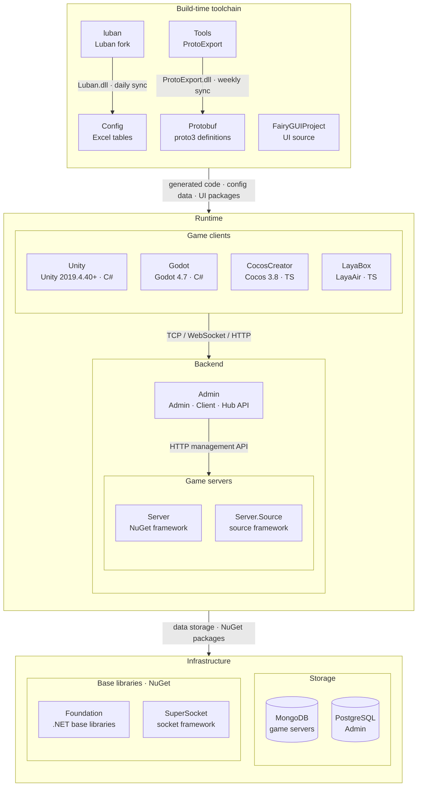

<div align="center">


# GameFrameX Unity

[](https://github.com/GameFrameX/GameFrameX.Unity/releases)
[](LICENSE.md)
[](https://gameframex.doc.alianblank.com)

**인디 게임 개발자를 위한 올인원 솔루션 · 인디 개발자의 꿈을 실현**

[📖 문서](https://gameframex.doc.alianblank.com) · [🚀 빠른 시작](#빠른-시작) · [💬 QQ 그룹: 467608841](https://qm.qq.com/q/467608841)

---

🌐 **언어**: [简体中文](README.zh-CN.md) | [繁體中文](README.zh-TW.md) | [English](README.md) | [日本語](README.ja.md) | **한국어**

---

</div>

## 프로젝트 개요

GameFrameX Unity는 GameFrameX 통합 솔루션의 Unity 클라이언트 구현으로, 90개 이상의 모듈식 컴포넌트를 제공합니다. 핵심 프레임워크, 에셋 관리, UI 시스템, 네트워크 통신부터 광고, 결제, 로그인, 데이터 분석 등 운영 기능까지 게임 개발 전 과정을 아우릅니다. Unity 2019.4.40 이상 버전과 호환됩니다.

## 특징

- **모듈식 설계** — 각 컴포넌트가 독립적인 패키지로, 필요에 따라 선택적으로 도입 가능
- **핫 업데이트 지원** — HybridCLR 통합, C# 핫 업데이트 지원
- **다중 UI 솔루션** — FairyGUI와 UGUI 동시 지원
- **비동기 우선** — UniTask 기반 async/await 비동기 프로그래밍 모델
- **전 플랫폼 지원** — iOS, Android, WebGL, 위챗/도우인/알리페이 미니 게임 등
- **풍부한 운영 컴포넌트** — 광고(츠산자, TopOn), 결제(알리페이, Apple, Google), 로그인(QQ, 위챗, Apple, Facebook, Google), 데이터 분석, 오브젝트 스토리지 등

## 빠른 시작

### 1. Scoped Registry 설정

프로젝트의 `Packages/manifest.json`에 GameFrameX의 scoped registry를 추가합니다:

```json
{
  "scopedRegistries": [
    {
      "name": "GameFrameX",
      "url": "https://gameframex.upm.alianblank.uk",
      "scopes": [
        "com.gameframex"
      ]
    }
  ],
  "dependencies": {
    "com.gameframex.unity": "1.11.0"
  }
}
```

### 2. 필요한 컴포넌트 추가

`dependencies`에 필요한 패키지를 추가하면 됩니다. 버전 번호는 [Releases](https://github.com/GameFrameX/GameFrameX.Unity/releases) 페이지에서 확인할 수 있습니다.

<details>
<summary>예시: 자주 사용하는 컴포넌트 추가</summary>

```json
{
  "dependencies": {
    "com.gameframex.unity": "1.11.0",
    "com.gameframex.unity.asset": "2.0.0",
    "com.gameframex.unity.ui": "2.1.1",
    "com.gameframex.unity.ui.fairygui": "3.0.0",
    "com.gameframex.unity.procedure": "1.0.4",
    "com.gameframex.unity.event": "1.0.2",
    "com.gameframex.unity.fsm": "1.0.3",
    "com.gameframex.unity.network": "2.5.1",
    "com.gameframex.unity.sound": "1.0.6",
    "com.gameframex.unity.localization": "2.0.0"
  }
}
```

</details>

## 컴포넌트 목록

버전 번호는 [GameFrameX UPM Registry](https://gameframex.upm.alianblank.uk)에서 자동으로 가져옵니다. `-`로 표시된 패키지는 Git URL을 통해 설치되는 서드파티 컴포넌트입니다.

### 핵심 프레임워크

| 패키지명 | 설명 | 버전 |
|:-----|:-----|:----:|
| com.gameframex.unity | 핵심 런타임 및 에디터 기반 (이벤트 풀, 참조 풀, 태스크 풀, 오브젝트 풀, 변수 시스템 등) |  |
| com.gameframex.unity.entry | 프레임워크 진입점 컴포넌트 |  |
| com.gameframex.unity.event | 이벤트 시스템 |  |
| com.gameframex.unity.fsm | 유한 상태 머신 |  |
| com.gameframex.unity.procedure | 프로시저 관리 |  |
| com.gameframex.unity.mono | MonoBehaviour 래퍼 |  |
| com.gameframex.unity.coroutine | 코루틴 컴포넌트 |  |
| com.gameframex.unity.timer | 타이머 |  |
| com.gameframex.unity.entity | 엔티티 컴포넌트 시스템 |  |
| com.gameframex.unity.globalconfig | 전역 설정 관리 |  |
| com.gameframex.unity.debugger | 디버거 |  |

### 에셋 관리

| 패키지명 | 설명 | 버전 |
|:-----|:-----|:----:|
| com.gameframex.unity.asset | 에셋 로딩 및 관리 |  |
| com.gameframex.unity.download | 파일 다운로드 컴포넌트 |  |
| com.gameframex.unity.tuyoogame.yooasset | YooAsset 에셋 관리 (커스텀 버전) |  |
| com.gameframex.unity.gwiazdorrr.betterstreamingassets | StreamingAssets 직접 접근 |  |
| com.gameframex.unity.builder | 빌드 파이프라인 도구 |  |

### UI 프레임워크

| 패키지명 | 설명 | 버전 |
|:-----|:-----|:----:|
| com.gameframex.unity.ui | UI 기본 프레임워크 |  |
| com.gameframex.unity.ui.fairygui | FairyGUI 어댑터 레이어 |  |
| com.gameframex.unity.ui.ugui | UGUI 어댑터 레이어 |  |

### 네트워크 통신

| 패키지명 | 설명 | 버전 |
|:-----|:-----|:----:|
| com.gameframex.unity.web | HTTP 네트워크 요청 (async/await 지원) |  |
| com.gameframex.unity.web.protobuff | ProtoBuf 네트워크 통신 |  |
| com.gameframex.unity.psygames.unitywebsocket | WebSocket 네트워크 라이브러리 |  |
| com.gameframex.unity.webview | WebView 내장 브라우저 |  |

### 데이터 및 설정

| 패키지명 | 설명 | 버전 |
|:-----|:-----|:----:|
| com.gameframex.unity.config | 설정 관리 |  |
| com.gameframex.unity.localization | 현지화/다국어 |  |
| com.gameframex.unity.focus-creative-games.luban | Luban 설정 데이터 생성 |  |
| com.gameframex.unity.google.protobuf | Protocol Buffers 직렬화 |  |
| com.gameframex.unity.google.flatbuffers | FlatBuffers 직렬화 |  |
| com.gameframex.unity.json.simplejson | SimpleJSON 라이브러리 |  |
| com.gameframex.unity.xincger.litjson | LitJSON 라이브러리 |  |

### 오디오 및 애니메이션

| 패키지명 | 설명 | 버전 |
|:-----|:-----|:----:|
| com.gameframex.unity.sound | 오디오 재생 및 관리 |  |
| com.gameframex.unity.demigiant.dotween | DoTween 애니메이션 플러그인 |  |
| com.gameframex.unity.esotericsoftware.spine.spine-unity | Spine 애니메이션 런타임 |  |

### 씬 및 설정

| 패키지명 | 설명 | 버전 |
|:-----|:-----|:----:|
| com.gameframex.unity.scene | 씬 관리 |  |
| com.gameframex.unity.setting | 설정 관리 |  |

### 핫 업데이트

| 패키지명 | 설명 | 버전 |
|:-----|:-----|:----:|
| com.gameframex.unity.tencent.xlua | XLua (텐센트 버전) |  |
| com.gameframex.unity.xlua | XLua 어댑터 |  |

### 광고

| 패키지명 | 설명 | 버전 |
|:-----|:-----|:----:|
| com.gameframex.unity.advertisement | 광고 기본 컴포넌트 |  |
| com.gameframex.unity.advertisement.csj | 츠산자(穿山甲) 광고 |  |
| com.gameframex.unity.advertisement.topon | TopOn 통합 광고 |  |
| com.gameframex.unity.advertisement.wechatminigame | 위챗 미니 게임 광고 |  |
| com.gameframex.unity.advertisement.douyinminigame | 도우인 미니 게임 광고 |  |
| com.gameframex.unity.advertisement.alipayminigame | 알리페이 미니 게임 광고 |  |
| com.gameframex.unity.advertisement.kuaishouminigame | 콰이서우 미니 게임 광고 |  |

### 결제

| 패키지명 | 설명 | 버전 |
|:-----|:-----|:----:|
| com.gameframex.unity.payment | 결제 기본 컴포넌트 |  |
| com.gameframex.unity.payment.alipay | 알리페이 결제 |  |
| com.gameframex.unity.payment.apple | Apple 인앱 결제 |  |
| com.gameframex.unity.payment.google | Google Play 인앱 결제 |  |

### 로그인

| 패키지명 | 설명 | 버전 |
|:-----|:-----|:----:|
| com.gameframex.unity.login.apple | Apple 로그인 |  |
| com.gameframex.unity.login.facebook | Facebook 로그인 |  |
| com.gameframex.unity.login.google | Google 로그인 |  |
| com.gameframex.unity.login.qq | QQ 로그인 |  |
| com.gameframex.unity.login.wechat | 위챗 로그인 |  |

### 데이터 분석

| 패키지명 | 설명 | 버전 |
|:-----|:-----|:----:|
| com.gameframex.unity.gameanalytics | 데이터 분석 기본 |  |
| com.gameframex.unity.gameanalytics.gameanalytics | GameAnalytics SDK |  |
| com.gameframex.unity.gameanalytics.gravity-engine | Gravity Engine |  |
| com.gameframex.unity.gameanalytics.talkingdata | TalkingData |  |
| com.gameframex.unity.gameanalytics.talkingdata.sdk | TalkingData SDK |  |
| com.gameframex.unity.gameanalytics.grafanaloki | Grafana Loki 로그 |  |
| com.gameframex.unity.gravityinfinite.gravity-engine | Gravity Engine 어댑터 |  |
| com.gameframex.unity.sentry | Sentry 오류 추적 |  |
| com.gameframex.unity.adjust | Adjust 어트리뷰션 분석 |  |

### 오브젝트 스토리지

| 패키지명 | 설명 | 버전 |
|:-----|:-----|:----:|
| com.gameframex.unity.objectstorage | 오브젝트 스토리지 기본 |  |
| com.gameframex.unity.objectstorage.aliyun | 알리윈 OSS |  |
| com.gameframex.unity.objectstorage.qiniu | 치니우 클라우드 Kodo |  |
| com.gameframex.unity.objectstorage.tencent | 텐센트 클라우드 COS |  |

### 미니 게임

| 패키지명 | 설명 | 버전 |
|:-----|:-----|:----:|
| com.gameframex.unity.minigame.wechat | 위챗 미니 게임 어댑터 | - |
| com.gameframex.unity.tuyoogame.yooasset.minigame.alipay | YooAsset 알리페이 미니 게임 |  |
| com.gameframex.unity.tuyoogame.yooasset.minigame.taptap | YooAsset TapTap 미니 게임 |  |
| com.gameframex.unity.tuyoogame.yooasset.minigame.tiktok | YooAsset 도우인 미니 게임 |  |

### 플랫폼 도구

| 패키지명 | 설명 | 버전 |
|:-----|:-----|:----:|
| com.gameframex.unity.getchannel | 채널 정보 가져오기 |  |
| com.gameframex.unity.operationclipboard | 클립보드 조작 |  |
| com.gameframex.unity.readassets | StreamingAssets 파일 읽기 |  |
| com.gameframex.unity.xcode | Xcode 빌드 후 자동 설정 |  |
| com.gameframex.unity.systeminfo | 기기 고유 식별자 (OAID/IDFA) |  |
| com.gameframex.unity.sharesdk | ShareSDK 소셜 공유 |  |
| com.gameframex.unity.android | Android 네이티브 도구 |  |

### 개발 도구

| 패키지명 | 설명 | 버전 |
|:-----|:-----|:----:|
| com.gameframex.unity.yasirkula.debugconsole | 런타임 디버그 콘솔 |  |

### 서드파티 라이브러리

| 패키지명 | 설명 | 버전 |
|:-----|:-----|:----:|
| com.gameframex.unity.cysharp.unitask | UniTask async/await |  |

## 생태계 아키텍처

GameFrameX는 아래 저장소로 구성됩니다. 빌드 시 도구 체인이 프로토콜과 설정 코드를 생성하고, 런타임에는 게임 클라이언트·게임 서버·운영 백오피스가 협력합니다.



### 핵심 프로젝트

| 프로젝트 | 역할 | 기술 스택 | 산출물 및 연동 |
|------|------|------|------|
| [Unity](https://github.com/GameFrameX/GameFrameX.Unity) | Unity 클라이언트 프로젝트: GameFrameX UPM 레지스트리에서 90개 이상의 프레임워크 패키지를 필요에 따라 조합, HybridCLR 핫 업데이트, 로그인·가방·룸 예제 포함 | Unity 2019.4.40+, HybridCLR, YooAsset, FairyGUI, UniTask | Protobuf / Config / FairyGUIProject 산출물 사용; TCP 29100 + HTTP 28080으로 Server, HTTP 20808로 Admin Client API에 연결 |
| [Server](https://github.com/GameFrameX/GameFrameX.Server) | Actor 모델 게임 서버: 영속 상태 Apps 계층과 핫 업데이트 가능한 Hotfix 로직 계층을 엄격히 분리, 단일/다중 프로세스 배포 지원 | .NET 10, MongoDB, Docker | TCP 29100 / WebSocket 29110 / HTTP 28080 수신; Admin용 메일·아이템 지급·플레이어 관리 등 HTTP 관리 API 제공 |
| [Admin](https://github.com/GameFrameX/GameFrameX.Admin) | 멀티 테넌트 운영 백오피스: Admin(20802) / Client(20808) / Hub(20806) 3개 호스트 + Vue 관리 화면, 서버 구역·공지·메일·주문 결제·원격 설정·라이브 운영 지원 | .NET 10, SqlSugar, PostgreSQL, Vue 3.5, PrimeVue | 서버 구역별 `HttpManageUrl`로 Server 호출; Client API가 게임 클라이언트에 전역 정보·로그인·결제 콜백 제공 |
| [luban](https://github.com/GameFrameX/luban) | Luban 설정 도구의 GameFrameX 포크: 공식 v5.1.0 병합, `gameframex` 테이블 임포터와 `cs-dotnet-json` / `cs-dotnet-bin` 등 생성 타깃 추가 | .NET 10, Scriban | Luban tar.gz와 Docker 이미지 배포; 매일 Config의 `Tools/`로 동기화 |
| [Config](https://github.com/GameFrameX/GameFrameX.Config) | 설정 테이블 저장소: Excel 데이터 표 + 스키마 + 현지화 표, 스크립트 한 번으로 클라이언트·서버 코드와 데이터 생성 | Excel, Luban | `gen-client-*` → Unity; `gen-server-json` → Server; `gen-server-bin` → Server.Source; `gen-godot-json` / `gen-cocos-json` / `gen-laya-json` → Godot / CocosCreator / LayaBox |
| [Protobuf](https://github.com/GameFrameX/GameFrameX.Protobuf) | 통합 네트워크 프로토콜 정의: proto3, 파일 이름의 숫자 모듈 ID별로 메시지와 오류 코드 구성(양수=클라이언트↔서버, 음수=서버 내부) | proto3 | `Proto2CsExport_Server` → Server; `Proto2CsExport_Client` → Unity; `Proto2CsExport_Godot` / `Proto2TsExport_CocosCreator` / `Proto2TsExport_LayaBox` → 기타 클라이언트; push마다 CI가 6개 언어 Release 배포 |
| [Tools](https://github.com/GameFrameX/GameFrameX.Tools) | ProtoExport 프로토콜 코드 생성기: C# / TypeScript / C++ / Lua / Go 5개 언어, CLI·Avalonia GUI·Docker 3가지 형태 제공 | .NET 10, Avalonia 12 | `ProtoExport.dll`을 매주 Protobuf의 `Tools/`로 동기화; Docker 이미지 `gameframex/gameframex-tools` |

### 주변 시스템

| 프로젝트 | 역할 | 기술 스택 | 산출물 및 연동 |
|------|------|------|------|
| [Foundation](https://github.com/GameFrameX/GameFrameX.Foundation) | 모듈형 .NET 라이브러리 모음: 현지화, JSON, 명령줄 인수, 로그, HTTP, 암호화, 해시, ORM 기본 엔티티, 멱등성 | .NET | NuGet 패키지로 Server·Server.Source·Admin·Tools에서 참조 |
| [SuperSocket](https://github.com/GameFrameX/GameFrameX.SuperSocket) | SuperSocket의 GameFrameX 포크: .NET 10 타깃, 의존성 주입, 약한 네트워크 게임 트래픽용 KCP / ReliableSession | .NET 10 | NuGet: Server(ClientEngine), Server.Source(Server / Kcp / Udp / WebSocket) |
| [Server.Source](https://github.com/GameFrameX/GameFrameX.Server.Source) | 프레임워크 계층을 저장소 내 소스로 포함한 서버 버전: 서비스 디스커버리, 프로세스 간 RemoteMessaging(TCP / KCP), 다중 프로세스 배포 | .NET 10, MongoDB, Docker | Config `gen-server-bin` 출력 대상; `docker-compose.multi.yml`로 다중 프로세스 실행 |
| [Godot](https://github.com/GameFrameX/GameFrameX.Godot) | Godot .NET 클라이언트: 재사용 가능한 런타임 모듈, 에디터 플러그인, 핫 업데이트 어셈블리 | Godot 4.7, C# | Config `gen-godot-json`, Protobuf `Proto2CsExport_Godot`; TCP 29100 / WebSocket 29110으로 Server에 연결 |
| [CocosCreator](https://github.com/GameFrameX/GameFrameX.CocosCreator) | Unity 버전을 기준으로 이식한 Cocos Creator 클라이언트 | Cocos Creator 3.8, TypeScript | `npm run gen:proto` / `gen:config`가 Protobuf / Config 스크립트 호출; WebSocket으로 Server에 연결 |
| [LayaBox](https://github.com/GameFrameX/GameFrameX.LayaBox) | LayaBox 클라이언트 | LayaAir, TypeScript | Config `gen-laya-json`, Protobuf `Proto2TsExport_LayaBox`; WebSocket으로 Server에 연결 |
| [FairyGUIProject](https://github.com/GameFrameX/GameFrameX.FairyGUIProject) | FairyGUI 에디터 프로젝트: 모든 게임 UI의 디자인 원본 | FairyGUI Editor | UI 패키지를 Unity `Assets/Bundles/UI`, 코드를 `Assets/Hotfix/UI/FairyGUI/`로 게시 |

## 문서 및 자료

- **문서 주소**: https://gameframex.doc.alianblank.com
- **백업 문서**: https://gameframex-docs.pages.dev
- **백업 문서**: https://gameframex.doc.cloudflare.alianblank.com
- **백업 문서**: https://gameframex.doc.vercel.alianblank.com

> 모든 사이트의 내용은 동일합니다.

## 커뮤니티 및 지원

- **QQ 그룹**: 467608841

## 라이선스

[Apache License 2.0](LICENSE.md)

---

**면책 조항**: 일부 컴포넌트는 인터넷 오픈소스 프로젝트에서 가져온 것으로, 학습 및 교류 목적으로만 사용됩니다. 저작권 침해가 있는 경우 Issue를 등록하거나 이메일로 연락해 주시면 신속히 삭제하겠습니다.
