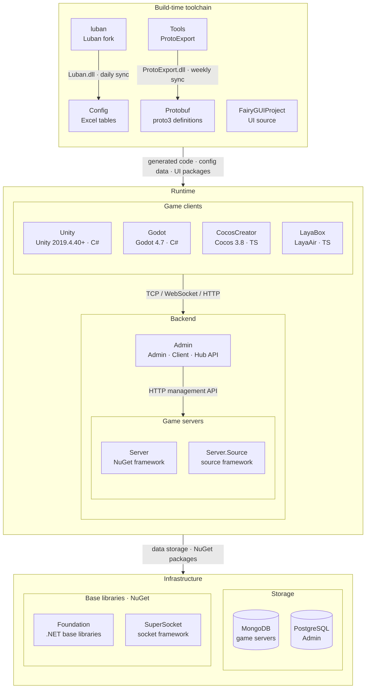

<div align="center">


# GameFrameX Unity

[](https://github.com/GameFrameX/GameFrameX.Unity/releases)
[](LICENSE.md)
[](https://gameframex.doc.alianblank.com)

**All-in-One Solution for Indie Game Development · Empowering Indie Developers' Dreams**

[📖 Documentation](https://gameframex.doc.alianblank.com) · [🚀 Quick Start](#quick-start) · [💬 QQ Group: 467608841](https://qm.qq.com/q/467608841)

---

🌐 **Language**: [简体中文](README.zh-CN.md) | [繁體中文](README.zh-TW.md) | **English** | [日本語](README.ja.md) | [한국어](README.ko.md)

---

</div>

## Project Overview

GameFrameX Unity is the Unity client implementation of the GameFrameX comprehensive solution, providing 90+ modular components covering the entire game development pipeline: from core framework, asset management, UI systems, and network communication to advertising, payment, login, data analytics, and more. Compatible with Unity 2019.4.40 and above.

## Features

- **Modular Design** — Each component is an independent package, import on demand
- **Hot Update Support** — Integrated HybridCLR for C# hot updates
- **Multi-UI Solutions** — Supports both FairyGUI and UGUI
- **Async-First** — UniTask-based async/await programming model
- **Cross-Platform** — iOS, Android, WebGL, WeChat/Douyin/Alipay mini games, and more
- **Rich Operations Components** — Advertising (CSJ, TopOn), Payment (Alipay, Apple, Google), Login (QQ, WeChat, Apple, Facebook, Google), Data Analytics, Object Storage, and more

## Quick Start

### 1. Configure Scoped Registry

Add the GameFrameX scoped registry to your project's `Packages/manifest.json`:

```json
{
  "scopedRegistries": [
    {
      "name": "GameFrameX",
      "url": "https://gameframex.upm.alianblank.uk",
      "scopes": [
        "com.gameframex"
      ]
    }
  ],
  "dependencies": {
    "com.gameframex.unity": "1.11.0"
  }
}
```

### 2. Add Components

Add the packages you need under `dependencies`. Check the [Releases](https://github.com/GameFrameX/GameFrameX.Unity/releases) page for available versions.

<details>
<summary>Example: Adding common components</summary>

```json
{
  "dependencies": {
    "com.gameframex.unity": "1.11.0",
    "com.gameframex.unity.asset": "2.0.0",
    "com.gameframex.unity.ui": "2.1.1",
    "com.gameframex.unity.ui.fairygui": "3.0.0",
    "com.gameframex.unity.procedure": "1.0.4",
    "com.gameframex.unity.event": "1.0.2",
    "com.gameframex.unity.fsm": "1.0.3",
    "com.gameframex.unity.network": "2.5.1",
    "com.gameframex.unity.sound": "1.0.6",
    "com.gameframex.unity.localization": "2.0.0"
  }
}
```

</details>

## Component List

Version numbers are fetched automatically from the [GameFrameX UPM Registry](https://gameframex.upm.alianblank.uk). Packages marked with `-` are third-party components installed via Git URL.

### Core Framework

| Package | Description | Version |
|:--------|:------------|:-------:|
| com.gameframex.unity | Core runtime and editor base (event pool, reference pool, task pool, object pool, variable system, etc.) |  |
| com.gameframex.unity.entry | Framework entry component |  |
| com.gameframex.unity.event | Event system |  |
| com.gameframex.unity.fsm | Finite state machine |  |
| com.gameframex.unity.procedure | Procedure management |  |
| com.gameframex.unity.mono | MonoBehaviour wrapper |  |
| com.gameframex.unity.coroutine | Coroutine component |  |
| com.gameframex.unity.timer | Timer |  |
| com.gameframex.unity.entity | Entity component system |  |
| com.gameframex.unity.globalconfig | Global configuration management |  |
| com.gameframex.unity.debugger | Debugger |  |

### Asset Management

| Package | Description | Version |
|:--------|:------------|:-------:|
| com.gameframex.unity.asset | Asset loading and management |  |
| com.gameframex.unity.download | File download component |  |
| com.gameframex.unity.tuyoogame.yooasset | YooAsset asset management (customized) |  |
| com.gameframex.unity.gwiazdorrr.betterstreamingassets | StreamingAssets direct access |  |
| com.gameframex.unity.builder | Build pipeline tools |  |

### UI Framework

| Package | Description | Version |
|:--------|:------------|:-------:|
| com.gameframex.unity.ui | UI base framework |  |
| com.gameframex.unity.ui.fairygui | FairyGUI adapter |  |
| com.gameframex.unity.ui.ugui | UGUI adapter |  |

### Networking

| Package | Description | Version |
|:--------|:------------|:-------:|
| com.gameframex.unity.web | HTTP network requests (with async/await) |  |
| com.gameframex.unity.web.protobuff | ProtoBuf network communication |  |
| com.gameframex.unity.psygames.unitywebsocket | WebSocket networking library |  |
| com.gameframex.unity.webview | WebView embedded browser |  |

### Data & Configuration

| Package | Description | Version |
|:--------|:------------|:-------:|
| com.gameframex.unity.config | Configuration management |  |
| com.gameframex.unity.localization | Localization / i18n |  |
| com.gameframex.unity.focus-creative-games.luban | Luban config data generation |  |
| com.gameframex.unity.google.protobuf | Protocol Buffers serialization |  |
| com.gameframex.unity.google.flatbuffers | FlatBuffers serialization |  |
| com.gameframex.unity.json.simplejson | SimpleJSON library |  |
| com.gameframex.unity.xincger.litjson | LitJSON library |  |

### Audio & Animation

| Package | Description | Version |
|:--------|:------------|:-------:|
| com.gameframex.unity.sound | Audio playback and management |  |
| com.gameframex.unity.demigiant.dotween | DoTween animation plugin |  |
| com.gameframex.unity.esotericsoftware.spine.spine-unity | Spine animation runtime |  |

### Scene & Settings

| Package | Description | Version |
|:--------|:------------|:-------:|
| com.gameframex.unity.scene | Scene management |  |
| com.gameframex.unity.setting | Settings management |  |

### Hot Update

| Package | Description | Version |
|:--------|:------------|:-------:|
| com.gameframex.unity.tencent.xlua | XLua (Tencent version) |  |
| com.gameframex.unity.xlua | XLua adapter |  |

### Advertising

| Package | Description | Version |
|:--------|:------------|:-------:|
| com.gameframex.unity.advertisement | Advertising base component |  |
| com.gameframex.unity.advertisement.csj | CSJ (穿山甲) Advertising |  |
| com.gameframex.unity.advertisement.topon | TopOn aggregated advertising |  |
| com.gameframex.unity.advertisement.wechatminigame | WeChat Mini Game ads |  |
| com.gameframex.unity.advertisement.douyinminigame | Douyin Mini Game ads |  |
| com.gameframex.unity.advertisement.alipayminigame | Alipay Mini Game ads |  |
| com.gameframex.unity.advertisement.kuaishouminigame | Kuaishou Mini Game ads |  |

### Payment

| Package | Description | Version |
|:--------|:------------|:-------:|
| com.gameframex.unity.payment | Payment base component |  |
| com.gameframex.unity.payment.alipay | Alipay payment |  |
| com.gameframex.unity.payment.apple | Apple in-app purchase |  |
| com.gameframex.unity.payment.google | Google Play in-app purchase |  |

### Login

| Package | Description | Version |
|:--------|:------------|:-------:|
| com.gameframex.unity.login.apple | Apple Sign-In |  |
| com.gameframex.unity.login.facebook | Facebook Login |  |
| com.gameframex.unity.login.google | Google Sign-In |  |
| com.gameframex.unity.login.qq | QQ Login |  |
| com.gameframex.unity.login.wechat | WeChat Login |  |

### Analytics

| Package | Description | Version |
|:--------|:------------|:-------:|
| com.gameframex.unity.gameanalytics | Analytics base |  |
| com.gameframex.unity.gameanalytics.gameanalytics | GameAnalytics SDK |  |
| com.gameframex.unity.gameanalytics.gravity-engine | Gravity Engine |  |
| com.gameframex.unity.gameanalytics.talkingdata | TalkingData |  |
| com.gameframex.unity.gameanalytics.talkingdata.sdk | TalkingData SDK |  |
| com.gameframex.unity.gameanalytics.grafanaloki | Grafana Loki logging |  |
| com.gameframex.unity.gravityinfinite.gravity-engine | Gravity Engine adapter |  |
| com.gameframex.unity.sentry | Sentry error tracking |  |
| com.gameframex.unity.adjust | Adjust attribution analytics |  |

### Object Storage

| Package | Description | Version |
|:--------|:------------|:-------:|
| com.gameframex.unity.objectstorage | Object storage base |  |
| com.gameframex.unity.objectstorage.aliyun | Alibaba Cloud OSS |  |
| com.gameframex.unity.objectstorage.qiniu | Qiniu Cloud Kodo |  |
| com.gameframex.unity.objectstorage.tencent | Tencent Cloud COS |  |

### Mini Games

| Package | Description | Version |
|:--------|:------------|:-------:|
| com.gameframex.unity.minigame.wechat | WeChat Mini Game adapter | - |
| com.gameframex.unity.tuyoogame.yooasset.minigame.alipay | YooAsset Alipay Mini Game |  |
| com.gameframex.unity.tuyoogame.yooasset.minigame.taptap | YooAsset TapTap Mini Game |  |
| com.gameframex.unity.tuyoogame.yooasset.minigame.tiktok | YooAsset Douyin Mini Game |  |

### Platform Tools

| Package | Description | Version |
|:--------|:------------|:-------:|
| com.gameframex.unity.getchannel | Channel information retrieval |  |
| com.gameframex.unity.operationclipboard | Clipboard operations |  |
| com.gameframex.unity.readassets | StreamingAssets file reading |  |
| com.gameframex.unity.xcode | Xcode post-build auto configuration |  |
| com.gameframex.unity.systeminfo | Device unique identifier (OAID/IDFA) |  |
| com.gameframex.unity.sharesdk | ShareSDK social sharing |  |
| com.gameframex.unity.android | Android native tools |  |

### Development Tools

| Package | Description | Version |
|:--------|:------------|:-------:|
| com.gameframex.unity.yasirkula.debugconsole | Runtime debug console |  |

### Third-party Libraries

| Package | Description | Version |
|:--------|:------------|:-------:|
| com.gameframex.unity.cysharp.unitask | UniTask async/await |  |

## Ecosystem Architecture

GameFrameX consists of the repositories below: the build-time toolchain generates protocol and config code, while game clients, game servers and the operations backend cooperate at runtime.



### Core Projects

| Project | Role | Tech Stack | Integration |
|------|------|------|------|
| [Unity](https://github.com/GameFrameX/GameFrameX.Unity) | Unity client project: assembles 90+ framework packages from the GameFrameX UPM registry, HybridCLR hot update, login / bag / room samples | Unity 2019.4.40+, HybridCLR, YooAsset, FairyGUI, UniTask | Consumes Protobuf / Config / FairyGUIProject output; TCP 29100 + HTTP 28080 to Server, HTTP 20808 to Admin Client API |
| [Server](https://github.com/GameFrameX/GameFrameX.Server) | Actor-model game server: persistent Apps state layer strictly separated from the hot-updatable Hotfix logic layer; single- or multi-process deployment | .NET 10, MongoDB, Docker | Listens on TCP 29100 / WebSocket 29110 / HTTP 28080; HTTP management endpoints (mail, item grants, player management) for Admin |
| [Admin](https://github.com/GameFrameX/GameFrameX.Admin) | Multi-tenant operations backend: Admin (20802) / Client (20808) / Hub (20806) hosts + Vue console, covering game areas, announcements, mail, orders & payment, remote config, LiveOps | .NET 10, SqlSugar, PostgreSQL, Vue 3.5, PrimeVue | Calls Server through each game area's `HttpManageUrl`; Client API serves global info, login and payment callbacks to game clients |
| [luban](https://github.com/GameFrameX/luban) | GameFrameX fork of Luban: merged upstream v5.1.0, adds the `gameframex` table importer and `cs-dotnet-json` / `cs-dotnet-bin` code targets | .NET 10, Scriban | Publishes Luban tar.gz and Docker image; synced daily into Config `Tools/` |
| [Config](https://github.com/GameFrameX/GameFrameX.Config) | Config table repository: Excel data tables + schema + localization tables, one-click scripts generate client and server code and data | Excel, Luban | `gen-client-*` → Unity; `gen-server-json` → Server; `gen-server-bin` → Server.Source; `gen-godot-json` / `gen-cocos-json` / `gen-laya-json` → Godot / CocosCreator / LayaBox |
| [Protobuf](https://github.com/GameFrameX/GameFrameX.Protobuf) | Unified network protocol definitions: proto3, messages and error codes grouped by the numeric module ID in each file name (positive = client↔server, negative = server-internal) | proto3 | `Proto2CsExport_Server` → Server; `Proto2CsExport_Client` → Unity; `Proto2CsExport_Godot` / `Proto2TsExport_CocosCreator` / `Proto2TsExport_LayaBox` → other clients; CI publishes a six-language Release on every push |
| [Tools](https://github.com/GameFrameX/GameFrameX.Tools) | ProtoExport protocol code generator: C# / TypeScript / C++ / Lua / Go, available as CLI, Avalonia GUI and Docker image | .NET 10, Avalonia 12 | `ProtoExport.dll` synced weekly into Protobuf `Tools/`; Docker image `gameframex/gameframex-tools` |

### Peripheral Systems

| Project | Role | Tech Stack | Integration |
|------|------|------|------|
| [Foundation](https://github.com/GameFrameX/GameFrameX.Foundation) | Modular .NET libraries: localization, JSON, command-line options, logging, HTTP, encryption, hashing, ORM base entities, idempotency | .NET | NuGet packages referenced by Server, Server.Source, Admin, Tools |
| [SuperSocket](https://github.com/GameFrameX/GameFrameX.SuperSocket) | GameFrameX fork of SuperSocket: .NET 10 targets, dependency injection, KCP / ReliableSession for weak-network game traffic | .NET 10 | NuGet: Server (ClientEngine), Server.Source (Server / Kcp / Udp / WebSocket) |
| [Server.Source](https://github.com/GameFrameX/GameFrameX.Server.Source) | Server variant with the framework as in-repo source: service discovery, cross-process RemoteMessaging (TCP / KCP), multi-process deployment | .NET 10, MongoDB, Docker | Receives Config `gen-server-bin` output; multi-process via `docker-compose.multi.yml` |
| [Godot](https://github.com/GameFrameX/GameFrameX.Godot) | Godot .NET client with reusable runtime modules, editor plugins and hot-update assemblies | Godot 4.7, C# | Config `gen-godot-json`, Protobuf `Proto2CsExport_Godot`; TCP 29100 / WebSocket 29110 to Server |
| [CocosCreator](https://github.com/GameFrameX/GameFrameX.CocosCreator) | Cocos Creator client, migrated from the Unity version | Cocos Creator 3.8, TypeScript | `npm run gen:proto` / `gen:config` call Protobuf / Config scripts; WebSocket to Server |
| [LayaBox](https://github.com/GameFrameX/GameFrameX.LayaBox) | LayaBox client | LayaAir, TypeScript | Config `gen-laya-json`, Protobuf `Proto2TsExport_LayaBox`; WebSocket to Server |
| [FairyGUIProject](https://github.com/GameFrameX/GameFrameX.FairyGUIProject) | FairyGUI editor project: design source of all game UI | FairyGUI Editor | Publishes UI packages to Unity `Assets/Bundles/UI` and code to `Assets/Hotfix/UI/FairyGUI/` |

## Documentation & Resources

- **Documentation**: https://gameframex.doc.alianblank.com
- **Mirror**: https://gameframex-docs.pages.dev
- **Mirror**: https://gameframex.doc.cloudflare.alianblank.com
- **Mirror**: https://gameframex.doc.vercel.alianblank.com

> All mirror sites have identical content.

## Community & Support

- **QQ Group**: 467608841

## License

[Apache License 2.0](LICENSE.md)

---

**Disclaimer**: Some components are derived from open-source projects on the internet and are intended for learning and communication purposes only. If any infringement is involved, please submit an Issue or contact us via Email, and we will remove it promptly.
