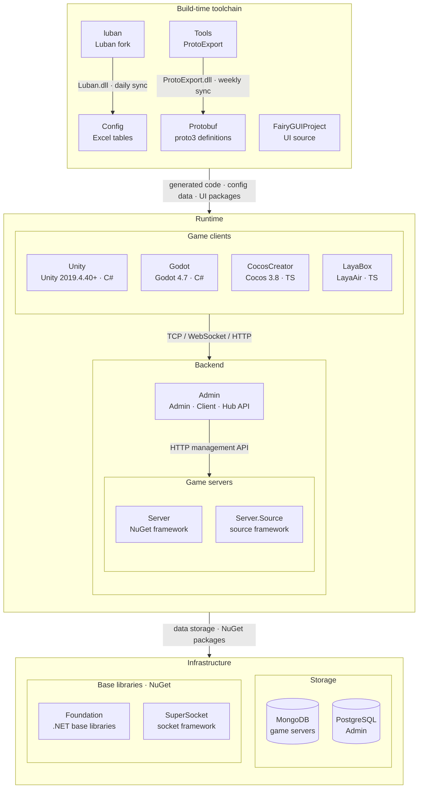

<div align="center">


# GameFrameX Unity

[](https://github.com/GameFrameX/GameFrameX.Unity/releases)
[](LICENSE.md)
[](https://gameframex.doc.alianblank.com)

**独立游戏前后端一体化解决方案 · 独立游戏开发者的圆梦大使**

[📖 文档](https://gameframex.doc.alianblank.com) · [🚀 快速开始](#快速开始) · [💬 QQ群：467608841](https://qm.qq.com/q/467608841)

---

🌐 **语言**: **简体中文** | [繁體中文](README.zh-TW.md) | [English](README.md) | [日本語](README.ja.md) | [한국어](README.ko.md)

---

</div>

## 项目简介

GameFrameX Unity 是 GameFrameX 综合解决方案的 Unity 客户端实现，提供 90+ 个模块化组件，涵盖游戏开发全链路：从核心框架、资源管理、UI 系统、网络通信到广告、支付、登录、数据分析等运营功能。兼容 Unity 2019.4.40 及以上版本。

## 特性

- **模块化设计** — 每个组件独立包，按需引入，互不干扰
- **热更新支持** — 集成 HybridCLR，支持 C# 热更新
- **多 UI 方案** — 同时支持 FairyGUI 和 UGUI
- **异步优先** — 基于 UniTask 的 async/await 异步编程模型
- **全平台覆盖** — iOS、Android、WebGL、微信/抖音/支付宝小游戏等
- **丰富的运营组件** — 广告（穿山甲、TopOn）、支付（支付宝、Apple、Google）、登录（QQ、微信、Apple、Facebook、Google）、数据分析、对象存储等

## 快速开始

### 1. 配置 Scoped Registry

在项目的 `Packages/manifest.json` 中添加 GameFrameX 的 scoped registry：

```json
{
  "scopedRegistries": [
    {
      "name": "GameFrameX",
      "url": "https://gameframex.upm.alianblank.uk",
      "scopes": [
        "com.gameframex"
      ]
    }
  ],
  "dependencies": {
    "com.gameframex.unity": "1.11.0"
  }
}
```

### 2. 添加所需组件

在 `dependencies` 中添加需要的包即可，版本号可在 [Releases](https://github.com/GameFrameX/GameFrameX.Unity/releases) 页面查看。

<details>
<summary>示例：添加常用组件</summary>

```json
{
  "dependencies": {
    "com.gameframex.unity": "1.11.0",
    "com.gameframex.unity.asset": "2.0.0",
    "com.gameframex.unity.ui": "2.1.1",
    "com.gameframex.unity.ui.fairygui": "3.0.0",
    "com.gameframex.unity.procedure": "1.0.4",
    "com.gameframex.unity.event": "1.0.2",
    "com.gameframex.unity.fsm": "1.0.3",
    "com.gameframex.unity.network": "2.5.1",
    "com.gameframex.unity.sound": "1.0.6",
    "com.gameframex.unity.localization": "2.0.0"
  }
}
```

</details>

## 组件列表

版本号通过 [GameFrameX UPM Registry](https://gameframex.upm.alianblank.uk) 自动获取。标记 `-` 的包为通过 Git URL 安装的第三方组件。

### 核心框架

| 包名 | 说明 | 版本 |
|:-----|:-----|:----:|
| com.gameframex.unity | 核心运行时与编辑器基础（事件池、引用池、任务池、对象池、变量系统等） |  |
| com.gameframex.unity.entry | 框架入口组件 |  |
| com.gameframex.unity.event | 事件系统 |  |
| com.gameframex.unity.fsm | 有限状态机 |  |
| com.gameframex.unity.procedure | 流程管理 |  |
| com.gameframex.unity.mono | MonoBehaviour 封装 |  |
| com.gameframex.unity.coroutine | 协程组件 |  |
| com.gameframex.unity.timer | 计时器 |  |
| com.gameframex.unity.entity | 实体组件系统 |  |
| com.gameframex.unity.globalconfig | 全局配置管理 |  |
| com.gameframex.unity.debugger | 调试器 |  |

### 资源管理

| 包名 | 说明 | 版本 |
|:-----|:-----|:----:|
| com.gameframex.unity.asset | 资源加载与管理 |  |
| com.gameframex.unity.download | 文件下载组件 |  |
| com.gameframex.unity.tuyoogame.yooasset | YooAsset 资源管理（定制版） |  |
| com.gameframex.unity.gwiazdorrr.betterstreamingassets | StreamingAssets 直接访问 |  |
| com.gameframex.unity.builder | 构建管线工具 |  |

### UI 框架

| 包名 | 说明 | 版本 |
|:-----|:-----|:----:|
| com.gameframex.unity.ui | UI 基础框架 |  |
| com.gameframex.unity.ui.fairygui | FairyGUI 适配层 |  |
| com.gameframex.unity.ui.ugui | UGUI 适配层 |  |

### 网络通信

| 包名 | 说明 | 版本 |
|:-----|:-----|:----:|
| com.gameframex.unity.web | HTTP 网络请求（支持 async/await） |  |
| com.gameframex.unity.web.protobuff | ProtoBuf 网络通信 |  |
| com.gameframex.unity.psygames.unitywebsocket | WebSocket 网络库 |  |
| com.gameframex.unity.webview | WebView 内嵌浏览器 |  |

### 数据与配置

| 包名 | 说明 | 版本 |
|:-----|:-----|:----:|
| com.gameframex.unity.config | 配置管理 |  |
| com.gameframex.unity.localization | 本地化/多语言 |  |
| com.gameframex.unity.focus-creative-games.luban | Luban 配置数据生成 |  |
| com.gameframex.unity.google.protobuf | Protocol Buffers 序列化 |  |
| com.gameframex.unity.google.flatbuffers | FlatBuffers 序列化 |  |
| com.gameframex.unity.json.simplejson | SimpleJSON 库 |  |
| com.gameframex.unity.xincger.litjson | LitJSON 库 |  |

### 音频与动画

| 包名 | 说明 | 版本 |
|:-----|:-----|:----:|
| com.gameframex.unity.sound | 音频播放与管理 |  |
| com.gameframex.unity.demigiant.dotween | DoTween 动画插件 |  |
| com.gameframex.unity.esotericsoftware.spine.spine-unity | Spine 动画运行时 |  |

### 场景与设置

| 包名 | 说明 | 版本 |
|:-----|:-----|:----:|
| com.gameframex.unity.scene | 场景管理 |  |
| com.gameframex.unity.setting | 设置管理 |  |

### 热更新

| 包名 | 说明 | 版本 |
|:-----|:-----|:----:|
| com.gameframex.unity.tencent.xlua | XLua（腾讯版） |  |
| com.gameframex.unity.xlua | XLua 适配 |  |

### 广告

| 包名 | 说明 | 版本 |
|:-----|:-----|:----:|
| com.gameframex.unity.advertisement | 广告基础组件 |  |
| com.gameframex.unity.advertisement.csj | 穿山甲广告 |  |
| com.gameframex.unity.advertisement.topon | TopOn 聚合广告 |  |
| com.gameframex.unity.advertisement.wechatminigame | 微信小游戏广告 |  |
| com.gameframex.unity.advertisement.douyinminigame | 抖音小游戏广告 |  |
| com.gameframex.unity.advertisement.alipayminigame | 支付宝小游戏广告 |  |
| com.gameframex.unity.advertisement.kuaishouminigame | 快手小游戏广告 |  |

### 支付

| 包名 | 说明 | 版本 |
|:-----|:-----|:----:|
| com.gameframex.unity.payment | 支付基础组件 |  |
| com.gameframex.unity.payment.alipay | 支付宝支付 |  |
| com.gameframex.unity.payment.apple | Apple 内购 |  |
| com.gameframex.unity.payment.google | Google Play 内购 |  |

### 登录

| 包名 | 说明 | 版本 |
|:-----|:-----|:----:|
| com.gameframex.unity.login.apple | Apple 登录 |  |
| com.gameframex.unity.login.facebook | Facebook 登录 |  |
| com.gameframex.unity.login.google | Google 登录 |  |
| com.gameframex.unity.login.qq | QQ 登录 |  |
| com.gameframex.unity.login.wechat | 微信登录 |  |

### 数据分析

| 包名 | 说明 | 版本 |
|:-----|:-----|:----:|
| com.gameframex.unity.gameanalytics | 数据分析基础 |  |
| com.gameframex.unity.gameanalytics.gameanalytics | GameAnalytics SDK |  |
| com.gameframex.unity.gameanalytics.gravity-engine | Gravity Engine |  |
| com.gameframex.unity.gameanalytics.talkingdata | TalkingData |  |
| com.gameframex.unity.gameanalytics.talkingdata.sdk | TalkingData SDK |  |
| com.gameframex.unity.gameanalytics.grafanaloki | Grafana Loki 日志 |  |
| com.gameframex.unity.gravityinfinite.gravity-engine | Gravity Engine 适配 |  |
| com.gameframex.unity.sentry | Sentry 错误追踪 |  |
| com.gameframex.unity.adjust | Adjust 归因分析 |  |

### 对象存储

| 包名 | 说明 | 版本 |
|:-----|:-----|:----:|
| com.gameframex.unity.objectstorage | 对象存储基础 |  |
| com.gameframex.unity.objectstorage.aliyun | 阿里云 OSS |  |
| com.gameframex.unity.objectstorage.qiniu | 七牛云 Kodo |  |
| com.gameframex.unity.objectstorage.tencent | 腾讯云 COS |  |

### 小游戏

| 包名 | 说明 | 版本 |
|:-----|:-----|:----:|
| com.gameframex.unity.minigame.wechat | 微信小游戏适配 | - |
| com.gameframex.unity.tuyoogame.yooasset.minigame.alipay | YooAsset 支付宝小游戏 |  |
| com.gameframex.unity.tuyoogame.yooasset.minigame.taptap | YooAsset TapTap 小游戏 |  |
| com.gameframex.unity.tuyoogame.yooasset.minigame.tiktok | YooAsset 抖音小游戏 |  |

### 平台工具

| 包名 | 说明 | 版本 |
|:-----|:-----|:----:|
| com.gameframex.unity.getchannel | 渠道信息获取 |  |
| com.gameframex.unity.operationclipboard | 剪贴板操作 |  |
| com.gameframex.unity.readassets | StreamingAssets 文件读取 |  |
| com.gameframex.unity.xcode | Xcode 构建后自动配置 |  |
| com.gameframex.unity.systeminfo | 设备唯一标识符（OAID/IDFA） |  |
| com.gameframex.unity.sharesdk | ShareSDK 社交分享 |  |
| com.gameframex.unity.android | Android 原生工具 |  |

### 开发工具

| 包名 | 说明 | 版本 |
|:-----|:-----|:----:|
| com.gameframex.unity.yasirkula.debugconsole | 运行时调试控制台 |  |

### 第三方库

| 包名 | 说明 | 版本 |
|:-----|:-----|:----:|
| com.gameframex.unity.cysharp.unitask | UniTask async/await |  |

## 生态架构

GameFrameX 由以下仓库组成：构建期工具链生成协议与配置代码，运行时由游戏客户端、游戏服务器与运营后台协作。



### 核心项目

| 项目 | 作用 | 技术栈 | 产物与对接 |
|------|------|------|------|
| [Unity](https://github.com/GameFrameX/GameFrameX.Unity) | Unity 客户端工程：从 GameFrameX UPM 源按需组装 90+ 框架组件，HybridCLR 热更新，内置登录、背包、房间等示例 | Unity 2019.4.40+, HybridCLR, YooAsset, FairyGUI, UniTask | 消费 Protobuf / Config / FairyGUIProject 产物；TCP 29100 + HTTP 28080 连 Server，HTTP 20808 连 Admin Client API |
| [Server](https://github.com/GameFrameX/GameFrameX.Server) | Actor 模型游戏服务器：Apps 持久化状态层与 Hotfix 可热更逻辑层严格分离，支持单进程与多进程部署 | .NET 10, MongoDB, Docker | 监听 TCP 29100 / WebSocket 29110 / HTTP 28080；为 Admin 提供邮件、发道具、玩家管理等 HTTP 管理接口 |
| [Admin](https://github.com/GameFrameX/GameFrameX.Admin) | 多租户运营后台：Admin（20802）/ Client（20808）/ Hub（20806）三个 host + Vue 管理端，覆盖区服、公告、邮件、订单支付、远程配置、在线运营 | .NET 10, SqlSugar, PostgreSQL, Vue 3.5, PrimeVue | 按区服 `HttpManageUrl` 调用 Server；Client API 为游戏客户端提供全局信息、登录与支付回调 |
| [luban](https://github.com/GameFrameX/luban) | Luban 配置工具的 GameFrameX 分支：合入官方 v5.1.0，增加 `gameframex` 表导入器与 `cs-dotnet-json` / `cs-dotnet-bin` 等生成目标 | .NET 10, Scriban | 发布 Luban tar.gz 与 Docker 镜像；每日同步进 Config 的 `Tools/` |
| [Config](https://github.com/GameFrameX/GameFrameX.Config) | 配置表仓：Excel 数据表 + schema + 本地化表，一键脚本生成前后端代码与数据 | Excel, Luban | `gen-client-*` → Unity; `gen-server-json` → Server; `gen-server-bin` → Server.Source; `gen-godot-json` / `gen-cocos-json` / `gen-laya-json` → Godot / CocosCreator / LayaBox |
| [Protobuf](https://github.com/GameFrameX/GameFrameX.Protobuf) | 统一网络协议定义：proto3，按文件名中的数字模块 ID 组织消息与错误码（正数为客户端↔服务器，负数为服务器内部） | proto3 | `Proto2CsExport_Server` → Server; `Proto2CsExport_Client` → Unity; `Proto2CsExport_Godot` / `Proto2TsExport_CocosCreator` / `Proto2TsExport_LayaBox` → 其他客户端；每次 push 由 CI 发布六种语言的 Release |
| [Tools](https://github.com/GameFrameX/GameFrameX.Tools) | ProtoExport 协议代码生成器：C# / TypeScript / C++ / Lua / Go 五种语言，提供 CLI、Avalonia GUI 与 Docker 三种形态 | .NET 10, Avalonia 12 | `ProtoExport.dll` 每周同步进 Protobuf 的 `Tools/`；Docker 镜像 `gameframex/gameframex-tools` |

### 周边系统

| 项目 | 作用 | 技术栈 | 产物与对接 |
|------|------|------|------|
| [Foundation](https://github.com/GameFrameX/GameFrameX.Foundation) | 模块化 .NET 类库合集：本地化、JSON、命令行参数、日志、HTTP、加密、哈希、ORM 基类实体、幂等性 | .NET | 以 NuGet 包被 Server、Server.Source、Admin、Tools 引用 |
| [SuperSocket](https://github.com/GameFrameX/GameFrameX.SuperSocket) | SuperSocket 的 GameFrameX 分支：.NET 10 构建目标、依赖注入支持、面向弱网游戏流量的 KCP / ReliableSession | .NET 10 | NuGet：Server（ClientEngine）、Server.Source（Server / Kcp / Udp / WebSocket） |
| [Server.Source](https://github.com/GameFrameX/GameFrameX.Server.Source) | 框架层以源码形式放在仓内的服务器版本：服务发现、跨进程 RemoteMessaging（TCP / KCP）、多进程部署 | .NET 10, MongoDB, Docker | 接收 Config `gen-server-bin` 产物；`docker-compose.multi.yml` 多进程部署 |
| [Godot](https://github.com/GameFrameX/GameFrameX.Godot) | Godot .NET 客户端：可复用运行时模块、编辑器插件、热更新程序集 | Godot 4.7, C# | Config `gen-godot-json`, Protobuf `Proto2CsExport_Godot`；TCP 29100 / WebSocket 29110 连 Server |
| [CocosCreator](https://github.com/GameFrameX/GameFrameX.CocosCreator) | Cocos Creator 客户端，以 Unity 版为基准迁移 | Cocos Creator 3.8, TypeScript | `npm run gen:proto` / `gen:config` 调用 Protobuf / Config 脚本；WebSocket 连 Server |
| [LayaBox](https://github.com/GameFrameX/GameFrameX.LayaBox) | LayaBox 客户端 | LayaAir, TypeScript | Config `gen-laya-json`, Protobuf `Proto2TsExport_LayaBox`；WebSocket 连 Server |
| [FairyGUIProject](https://github.com/GameFrameX/GameFrameX.FairyGUIProject) | FairyGUI 编辑器工程：所有游戏界面的设计源文件 | FairyGUI Editor | 发布 UI 包到 Unity `Assets/Bundles/UI`，代码到 `Assets/Hotfix/UI/FairyGUI/` |

## 文档与资源

- **文档地址**：https://gameframex.doc.alianblank.com
- **备用文档**：https://gameframex-docs.pages.dev
- **备用文档**：https://gameframex.doc.cloudflare.alianblank.com
- **备用文档**：https://gameframex.doc.vercel.alianblank.com

> 所有站点内容一致。

## 社区与支持

- **QQ 群**：467608841

## 开源协议

[Apache License 2.0](LICENSE.md)

---

**免责声明**：部分组件来源于互联网开源项目，仅供学习交流使用。如涉及侵权，请提交 Issue 或 Email 联系，我们将及时移除。
