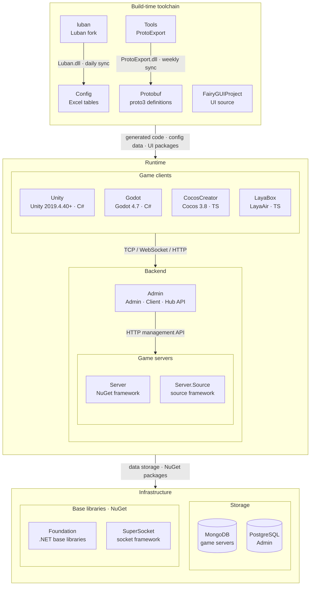

<div align="center">


# GameFrameX Unity

[](https://github.com/GameFrameX/GameFrameX.Unity/releases)
[](LICENSE.md)
[](https://gameframex.doc.alianblank.com)

**獨立遊戲前後端一體化解決方案 · 獨立遊戲開發者的圓夢大使**

[📖 文檔](https://gameframex.doc.alianblank.com) · [🚀 快速開始](#快速開始) · [💬 QQ群：467608841](https://qm.qq.com/q/467608841)

---

🌐 **語言**: [简体中文](README.zh-CN.md) | **繁體中文** | [English](README.md) | [日本語](README.ja.md) | [한국어](README.ko.md)

---

</div>

## 項目簡介

GameFrameX Unity 是 GameFrameX 綜合解決方案的 Unity 客戶端實現，提供 90+ 個模組化組件，涵蓋遊戲開發全鏈路：從核心框架、資源管理、UI 系統、網路通訊到廣告、支付、登入、數據分析等運營功能。相容 Unity 2019.4.40 及以上版本。

## 特性

- **模組化設計** — 每個組件獨立包，按需引入，互不干擾
- **熱更新支援** — 整合 HybridCLR，支援 C# 熱更新
- **多 UI 方案** — 同時支援 FairyGUI 和 UGUI
- **非同步優先** — 基於 UniTask 的 async/await 非同步程式設計模型
- **全平台覆蓋** — iOS、Android、WebGL、微信/抖音/支付寶小遊戲等
- **豐富的運營組件** — 廣告（穿山甲、TopOn）、支付（支付寶、Apple、Google）、登入（QQ、微信、Apple、Facebook、Google）、數據分析、物件儲存等

## 快速開始

### 1. 設定 Scoped Registry

在專案的 `Packages/manifest.json` 中新增 GameFrameX 的 scoped registry：

```json
{
  "scopedRegistries": [
    {
      "name": "GameFrameX",
      "url": "https://gameframex.upm.alianblank.uk",
      "scopes": [
        "com.gameframex"
      ]
    }
  ],
  "dependencies": {
    "com.gameframex.unity": "1.11.0"
  }
}
```

### 2. 新增所需組件

在 `dependencies` 中新增需要的包即可，版本號可在 [Releases](https://github.com/GameFrameX/GameFrameX.Unity/releases) 頁面查看。

<details>
<summary>範例：新增常用組件</summary>

```json
{
  "dependencies": {
    "com.gameframex.unity": "1.11.0",
    "com.gameframex.unity.asset": "2.0.0",
    "com.gameframex.unity.ui": "2.1.1",
    "com.gameframex.unity.ui.fairygui": "3.0.0",
    "com.gameframex.unity.procedure": "1.0.4",
    "com.gameframex.unity.event": "1.0.2",
    "com.gameframex.unity.fsm": "1.0.3",
    "com.gameframex.unity.network": "2.5.1",
    "com.gameframex.unity.sound": "1.0.6",
    "com.gameframex.unity.localization": "2.0.0"
  }
}
```

</details>

## 組件列表

版本號透過 [GameFrameX UPM Registry](https://gameframex.upm.alianblank.uk) 自動獲取。標記 `-` 的包為透過 Git URL 安裝的第三方組件。

### 核心框架

| 包名 | 說明 | 版本 |
|:-----|:-----|:----:|
| com.gameframex.unity | 核心執行時與編輯器基礎（事件池、引用池、任務池、物件池、變數系統等） |  |
| com.gameframex.unity.entry | 框架入口組件 |  |
| com.gameframex.unity.event | 事件系統 |  |
| com.gameframex.unity.fsm | 有限狀態機 |  |
| com.gameframex.unity.procedure | 流程管理 |  |
| com.gameframex.unity.mono | MonoBehaviour 封裝 |  |
| com.gameframex.unity.coroutine | 協程組件 |  |
| com.gameframex.unity.timer | 計時器 |  |
| com.gameframex.unity.entity | 實體組件系統 |  |
| com.gameframex.unity.globalconfig | 全域配置管理 |  |
| com.gameframex.unity.debugger | 除錯器 |  |

### 資源管理

| 包名 | 說明 | 版本 |
|:-----|:-----|:----:|
| com.gameframex.unity.asset | 資源載入與管理 |  |
| com.gameframex.unity.download | 檔案下載組件 |  |
| com.gameframex.unity.tuyoogame.yooasset | YooAsset 資源管理（定製版） |  |
| com.gameframex.unity.gwiazdorrr.betterstreamingassets | StreamingAssets 直接存取 |  |
| com.gameframex.unity.builder | 建置管線工具 |  |

### UI 框架

| 包名 | 說明 | 版本 |
|:-----|:-----|:----:|
| com.gameframex.unity.ui | UI 基礎框架 |  |
| com.gameframex.unity.ui.fairygui | FairyGUI 適配層 |  |
| com.gameframex.unity.ui.ugui | UGUI 適配層 |  |

### 網路通訊

| 包名 | 說明 | 版本 |
|:-----|:-----|:----:|
| com.gameframex.unity.web | HTTP 網路請求（支援 async/await） |  |
| com.gameframex.unity.web.protobuff | ProtoBuf 網路通訊 |  |
| com.gameframex.unity.psygames.unitywebsocket | WebSocket 網路庫 |  |
| com.gameframex.unity.webview | WebView 內嵌瀏覽器 |  |

### 資料與配置

| 包名 | 說明 | 版本 |
|:-----|:-----|:----:|
| com.gameframex.unity.config | 配置管理 |  |
| com.gameframex.unity.localization | 本地化/多語言 |  |
| com.gameframex.unity.focus-creative-games.luban | Luban 配置資料生成 |  |
| com.gameframex.unity.google.protobuf | Protocol Buffers 序列化 |  |
| com.gameframex.unity.google.flatbuffers | FlatBuffers 序列化 |  |
| com.gameframex.unity.json.simplejson | SimpleJSON 庫 |  |
| com.gameframex.unity.xincger.litjson | LitJSON 庫 |  |

### 音頻與動畫

| 包名 | 說明 | 版本 |
|:-----|:-----|:----:|
| com.gameframex.unity.sound | 音頻播放與管理 |  |
| com.gameframex.unity.demigiant.dotween | DoTween 動畫插件 |  |
| com.gameframex.unity.esotericsoftware.spine.spine-unity | Spine 動畫執行時 |  |

### 場景與設定

| 包名 | 說明 | 版本 |
|:-----|:-----|:----:|
| com.gameframex.unity.scene | 場景管理 |  |
| com.gameframex.unity.setting | 設定管理 |  |

### 熱更新

| 包名 | 說明 | 版本 |
|:-----|:-----|:----:|
| com.gameframex.unity.tencent.xlua | XLua（騰訊版） |  |
| com.gameframex.unity.xlua | XLua 適配 |  |

### 廣告

| 包名 | 說明 | 版本 |
|:-----|:-----|:----:|
| com.gameframex.unity.advertisement | 廣告基礎組件 |  |
| com.gameframex.unity.advertisement.csj | 穿山甲廣告 |  |
| com.gameframex.unity.advertisement.topon | TopOn 聚合廣告 |  |
| com.gameframex.unity.advertisement.wechatminigame | 微信小遊戲廣告 |  |
| com.gameframex.unity.advertisement.douyinminigame | 抖音小遊戲廣告 |  |
| com.gameframex.unity.advertisement.alipayminigame | 支付寶小遊戲廣告 |  |
| com.gameframex.unity.advertisement.kuaishouminigame | 快手小遊戲廣告 |  |

### 支付

| 包名 | 說明 | 版本 |
|:-----|:-----|:----:|
| com.gameframex.unity.payment | 支付基礎組件 |  |
| com.gameframex.unity.payment.alipay | 支付寶支付 |  |
| com.gameframex.unity.payment.apple | Apple 內購 |  |
| com.gameframex.unity.payment.google | Google Play 內購 |  |

### 登入

| 包名 | 說明 | 版本 |
|:-----|:-----|:----:|
| com.gameframex.unity.login.apple | Apple 登入 |  |
| com.gameframex.unity.login.facebook | Facebook 登入 |  |
| com.gameframex.unity.login.google | Google 登入 |  |
| com.gameframex.unity.login.qq | QQ 登入 |  |
| com.gameframex.unity.login.wechat | 微信登入 |  |

### 數據分析

| 包名 | 說明 | 版本 |
|:-----|:-----|:----:|
| com.gameframex.unity.gameanalytics | 數據分析基礎 |  |
| com.gameframex.unity.gameanalytics.gameanalytics | GameAnalytics SDK |  |
| com.gameframex.unity.gameanalytics.gravity-engine | Gravity Engine |  |
| com.gameframex.unity.gameanalytics.talkingdata | TalkingData |  |
| com.gameframex.unity.gameanalytics.talkingdata.sdk | TalkingData SDK |  |
| com.gameframex.unity.gameanalytics.grafanaloki | Grafana Loki 日誌 |  |
| com.gameframex.unity.gravityinfinite.gravity-engine | Gravity Engine 適配 |  |
| com.gameframex.unity.sentry | Sentry 錯誤追蹤 |  |
| com.gameframex.unity.adjust | Adjust 歸因分析 |  |

### 物件儲存

| 包名 | 說明 | 版本 |
|:-----|:-----|:----:|
| com.gameframex.unity.objectstorage | 物件儲存基礎 |  |
| com.gameframex.unity.objectstorage.aliyun | 阿里雲 OSS |  |
| com.gameframex.unity.objectstorage.qiniu | 七牛雲 Kodo |  |
| com.gameframex.unity.objectstorage.tencent | 騰訊雲 COS |  |

### 小遊戲

| 包名 | 說明 | 版本 |
|:-----|:-----|:----:|
| com.gameframex.unity.minigame.wechat | 微信小遊戲適配 | - |
| com.gameframex.unity.tuyoogame.yooasset.minigame.alipay | YooAsset 支付寶小遊戲 |  |
| com.gameframex.unity.tuyoogame.yooasset.minigame.taptap | YooAsset TapTap 小遊戲 |  |
| com.gameframex.unity.tuyoogame.yooasset.minigame.tiktok | YooAsset 抖音小遊戲 |  |

### 平台工具

| 包名 | 說明 | 版本 |
|:-----|:-----|:----:|
| com.gameframex.unity.getchannel | 渠道資訊獲取 |  |
| com.gameframex.unity.operationclipboard | 剪貼簿操作 |  |
| com.gameframex.unity.readassets | StreamingAssets 檔案讀取 |  |
| com.gameframex.unity.xcode | Xcode 建置後自動配置 |  |
| com.gameframex.unity.systeminfo | 裝置唯一識別符（OAID/IDFA） |  |
| com.gameframex.unity.sharesdk | ShareSDK 社交分享 |  |
| com.gameframex.unity.android | Android 原生工具 |  |

### 開發工具

| 包名 | 說明 | 版本 |
|:-----|:-----|:----:|
| com.gameframex.unity.yasirkula.debugconsole | 執行時除錯控制台 |  |

### 第三方庫

| 包名 | 說明 | 版本 |
|:-----|:-----|:----:|
| com.gameframex.unity.cysharp.unitask | UniTask async/await |  |

## 生態架構

GameFrameX 由以下倉庫組成：建置期工具鏈產生協議與配置程式碼，執行時由遊戲用戶端、遊戲伺服器與營運後台協作。



### 核心專案

| 專案 | 作用 | 技術棧 | 產物與對接 |
|------|------|------|------|
| [Unity](https://github.com/GameFrameX/GameFrameX.Unity) | Unity 用戶端工程：從 GameFrameX UPM 源按需組裝 90+ 框架元件，HybridCLR 熱更新，內建登入、背包、房間等範例 | Unity 2019.4.40+, HybridCLR, YooAsset, FairyGUI, UniTask | 使用 Protobuf / Config / FairyGUIProject 產物；TCP 29100 + HTTP 28080 連線 Server，HTTP 20808 連線 Admin Client API |
| [Server](https://github.com/GameFrameX/GameFrameX.Server) | Actor 模型遊戲伺服器：Apps 持久化狀態層與 Hotfix 可熱更邏輯層嚴格分離，支援單程序與多程序部署 | .NET 10, MongoDB, Docker | 監聽 TCP 29100 / WebSocket 29110 / HTTP 28080；為 Admin 提供郵件、發道具、玩家管理等 HTTP 管理介面 |
| [Admin](https://github.com/GameFrameX/GameFrameX.Admin) | 多租戶營運後台：Admin（20802）/ Client（20808）/ Hub（20806）三個 host + Vue 管理端，涵蓋區服、公告、郵件、訂單支付、遠端配置、線上營運 | .NET 10, SqlSugar, PostgreSQL, Vue 3.5, PrimeVue | 依區服 `HttpManageUrl` 呼叫 Server；Client API 為遊戲用戶端提供全域資訊、登入與支付回呼 |
| [luban](https://github.com/GameFrameX/luban) | Luban 配置工具的 GameFrameX 分支：合入官方 v5.1.0，新增 `gameframex` 表匯入器與 `cs-dotnet-json` / `cs-dotnet-bin` 等產生目標 | .NET 10, Scriban | 發佈 Luban tar.gz 與 Docker 映像；每日同步至 Config 的 `Tools/` |
| [Config](https://github.com/GameFrameX/GameFrameX.Config) | 配置表倉庫：Excel 資料表 + schema + 在地化表，一鍵腳本產生前後端程式碼與資料 | Excel, Luban | `gen-client-*` → Unity; `gen-server-json` → Server; `gen-server-bin` → Server.Source; `gen-godot-json` / `gen-cocos-json` / `gen-laya-json` → Godot / CocosCreator / LayaBox |
| [Protobuf](https://github.com/GameFrameX/GameFrameX.Protobuf) | 統一網路協議定義：proto3，依檔名中的數字模組 ID 組織訊息與錯誤碼（正數為用戶端↔伺服器，負數為伺服器內部） | proto3 | `Proto2CsExport_Server` → Server; `Proto2CsExport_Client` → Unity; `Proto2CsExport_Godot` / `Proto2TsExport_CocosCreator` / `Proto2TsExport_LayaBox` → 其他用戶端；每次 push 由 CI 發佈六種語言的 Release |
| [Tools](https://github.com/GameFrameX/GameFrameX.Tools) | ProtoExport 協議程式碼產生器：C# / TypeScript / C++ / Lua / Go 五種語言，提供 CLI、Avalonia GUI 與 Docker 三種形態 | .NET 10, Avalonia 12 | `ProtoExport.dll` 每週同步至 Protobuf 的 `Tools/`；Docker 映像 `gameframex/gameframex-tools` |

### 周邊系統

| 專案 | 作用 | 技術棧 | 產物與對接 |
|------|------|------|------|
| [Foundation](https://github.com/GameFrameX/GameFrameX.Foundation) | 模組化 .NET 類別庫合集：在地化、JSON、命令列參數、日誌、HTTP、加密、雜湊、ORM 基底實體、冪等性 | .NET | 以 NuGet 套件被 Server、Server.Source、Admin、Tools 引用 |
| [SuperSocket](https://github.com/GameFrameX/GameFrameX.SuperSocket) | SuperSocket 的 GameFrameX 分支：.NET 10 建置目標、相依性注入支援、面向弱網遊戲流量的 KCP / ReliableSession | .NET 10 | NuGet：Server（ClientEngine）、Server.Source（Server / Kcp / Udp / WebSocket） |
| [Server.Source](https://github.com/GameFrameX/GameFrameX.Server.Source) | 框架層以原始碼形式放在倉庫內的伺服器版本：服務發現、跨程序 RemoteMessaging（TCP / KCP）、多程序部署 | .NET 10, MongoDB, Docker | 接收 Config `gen-server-bin` 產物；`docker-compose.multi.yml` 多程序部署 |
| [Godot](https://github.com/GameFrameX/GameFrameX.Godot) | Godot .NET 用戶端：可重用執行時模組、編輯器外掛、熱更新組件 | Godot 4.7, C# | Config `gen-godot-json`, Protobuf `Proto2CsExport_Godot`；TCP 29100 / WebSocket 29110 連線 Server |
| [CocosCreator](https://github.com/GameFrameX/GameFrameX.CocosCreator) | Cocos Creator 用戶端，以 Unity 版為基準遷移 | Cocos Creator 3.8, TypeScript | `npm run gen:proto` / `gen:config` 呼叫 Protobuf / Config 腳本；WebSocket 連線 Server |
| [LayaBox](https://github.com/GameFrameX/GameFrameX.LayaBox) | LayaBox 用戶端 | LayaAir, TypeScript | Config `gen-laya-json`, Protobuf `Proto2TsExport_LayaBox`；WebSocket 連線 Server |
| [FairyGUIProject](https://github.com/GameFrameX/GameFrameX.FairyGUIProject) | FairyGUI 編輯器工程：所有遊戲介面的設計原始檔 | FairyGUI Editor | 發佈 UI 包至 Unity `Assets/Bundles/UI`，程式碼至 `Assets/Hotfix/UI/FairyGUI/` |

## 文檔與資源

- **文檔位址**：https://gameframex.doc.alianblank.com
- **備用文檔**：https://gameframex-docs.pages.dev
- **備用文檔**：https://gameframex.doc.cloudflare.alianblank.com
- **備用文檔**：https://gameframex.doc.vercel.alianblank.com

> 所有站點內容一致。

## 社區與支援

- **QQ 群**：467608841

## 開源協議

[Apache License 2.0](LICENSE.md)

---

**免責聲明**：部分組件來源於網際網路開源專案，僅供學習交流使用。如涉及侵權，請提交 Issue 或 Email 聯繫，我們將及時移除。
